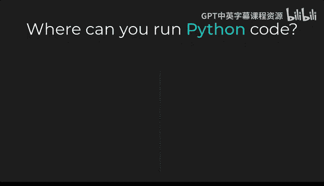
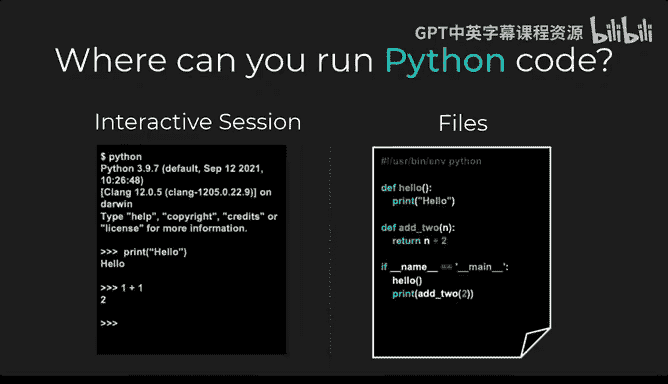
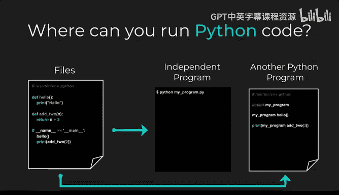
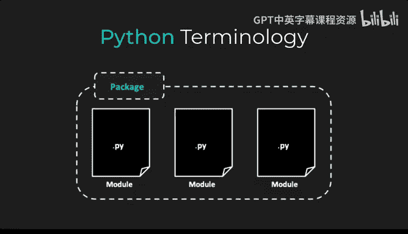
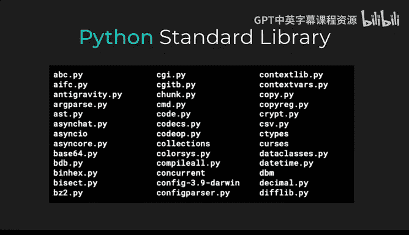
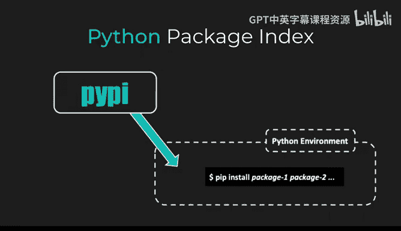
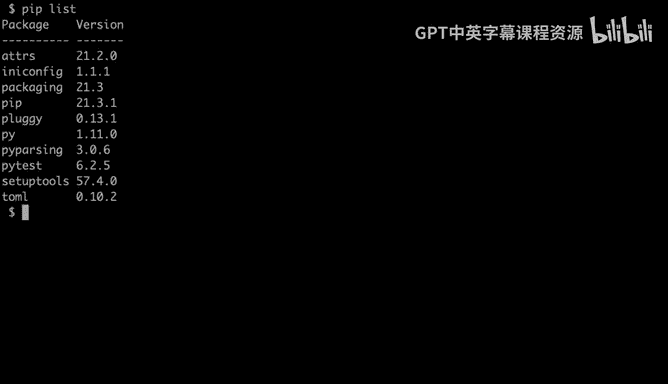

# 杜克大学《Python、Bash和SQL数据工程基础1｜Python Bash and SQL Essentials for Data Engineering》 - P5：05_01_03_使用pip安装Python包.zh_en - GPT中英字幕课程资源 - BV1KW421R7Kz

In this lesson， we learn about package installation using PIP。

We will learn how to list the currently installed packages。Install a package。

 including installing a particular version。Uninstall a package。Upgrade a currently installed package。

Well， what is a package？Python code can be run in an interactive session by typing Python on the command line or from files。

When Python code is saved to a file， the code in this file can be run as an independent program。

Or imported and used in another Python program。

When code is saved to a file with the purpose of reuse， it is called a module。

When a module or group of modules is bundleed together specifically for distribution to and installation in multiple Python environments。

It is referred to as a package。

Along with every installation of Python is a group of packages known as the Python Standard Library。

These packages can be used in any Python program。

In addition to the standard library， theres a huge ecosystem of third party packages。

 these packages add all sorts of specialized functionality to the default installation。

The main location for these packages is the Python Pack Index， also known as Pipe Pi。

Pip is the package installer for Python。It is the default tool for managing the installation of Python packages。

By default， it will download installed packages from the Python Pack In。

 though it can be pointed to other locations。Since Python version 3。4。

 Pip is installed as part of the Python default installation。

To see the version of Python used in your environment。

 open a shell and type Python with the version flag。On many systems。

 there are multiple Python installations。Usually a legacy copy of Python 2 and a newer version of Python 3。

These can be accessed by aliases， usually Py2 or Python 2 for the Python 2 version。

And Py3 or Python 3 for the Python 3 version。If your default Python version is Python 2。

 use the Python 3 alias for the examples in this course。Pip can generally be accessed in two ways。

Firstly， invoke using the Python moduleM。Or as a separate standalone command。The Pip Help command。

Lists all of the commands and general options available。

To see the documentation for a particular command， type the command name after the help command。

The three commands we will use for the rest of this lesson are list， installs， and uninstall。

The L command lists the packages along with version numbers that are currently installed in your environment。

Use the install command followed by a module name or a list of module names to install them。

Let's install the popular testing library P Test。We can see that PIP not only installed P test。

 but also other packages that we did not specifically request。

These are the packages on which Pi test depends。Pip automatically installs the libraries needed by a package that we've requested。

To uninstall a package， use the uninstall command followed by the package name。

Notice that PP is uninstalled Pi test， but not its dependencies。

 we would have to explicitly name them with the uninstalled command to remove them as well。

The In command will install the latest available version of a package by default。

We can install a specific version by using the install command with double equals signs after the module name。

One hack to see what versions are available is to leave the version number blank。

This displays an error， but the error message reports on all of the available versions。

To install a specific version， put that version number directly after the double equals。

And we can see that this specified version is installed。

If we wish to upgrade to the latest version of a package。

 we can either uninstall and reinstall it or use the upgrade option with the install command。

And now the package is upgraded to the latest version。

You have learned how to list the packages installed in your environment， install packages。

 and uninstall them。Now it's time to try this on your road。

