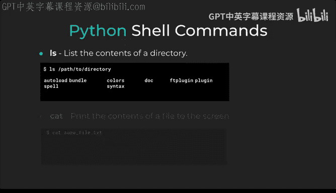
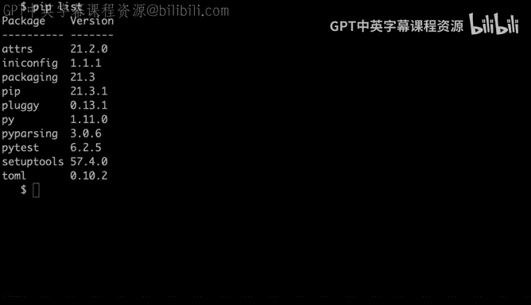
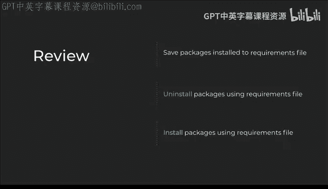
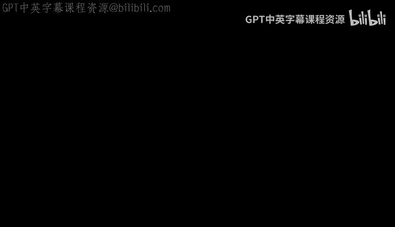

# 杜克大学《Python、Bash和SQL数据工程基础1｜Python Bash and SQL Essentials for Data Engineering》 - P6：06_01_04_保存Python依赖文件.zh_en - GPT中英字幕课程资源 - BV1KW421R7Kz

In this lesson， I will show you how to save the current state of your Python package installation to a requirements file。

How to uninstall packages enumerated in a requirements file and how to install packages using a requirements file。

Once you have installed the packages you need to implement a Python project。

 it is the best practice to save a record of these packages。This makes your project portable。

 which means that you can set your project to run on different machines。For example。

 once you have your Python program working， you might't want to move it to a production server or share it with a colleague for their use。

In either case， you will need to document the packages your program needs to run。

As part of this lesson， we will use two shell commands。List and cat。

List shows the contents of the current directory， or if we supply a path， the contents of that path。

Cat will echo the contents of a file to your screen。

 Remember that the Pip list command will display the current installed packages and their version numbers。

Yeah。Let's see what we have installed in this environment。Yeah。Yeah。Yeah。

The Pip freezeze command displays the same information。

But in a format that can be used with the install and uninstal commands。

We can redirect the output from Pip freeze to a file by using the redirect operator。

 which is the right words arrow。Here we are outputting the text to a file named requirements do text。

 any file name will work but the convention is to name it requirements do text。

We can use the cat command to see the contents of the file by typing cat filed by the file make。

See that the patches listed in the file match those installed in our environment。

To uninstall the packages enumerated in the file， use the dash R flag and the file name with Pip on installst。

Yeah。We can see with Pip L。That the only packages left are those required for P's use。

The more common usage is to combine their crime's file with Pip's install command。Once again。

 using the dash R flag and the file name。그。Yeah。And once again。

 we can check the results using the P list command。

This is the standard way to install packages for someone else's project that you are setting up or for your own project in a new environment。

In this lesson， you have learned how to create a requirements file containing a record of your package installation and how to use the file to install and uninstall packages。

 Now you should practice creating and using requirements files。

