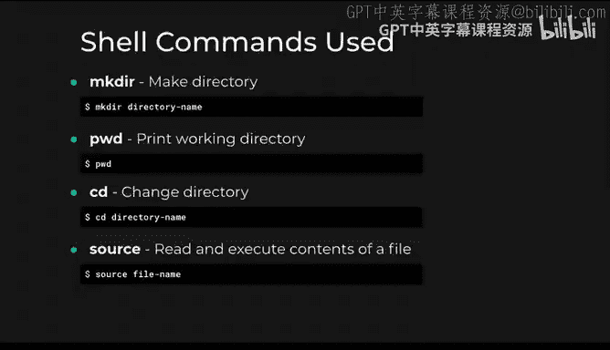
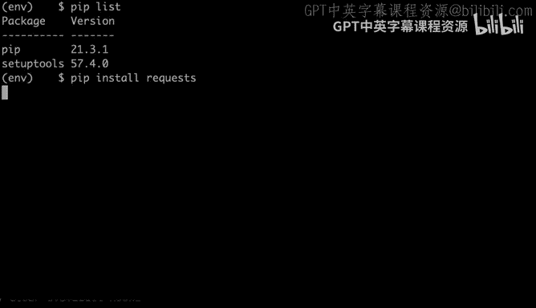
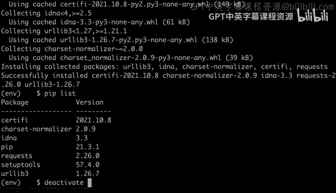
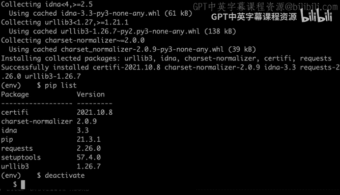
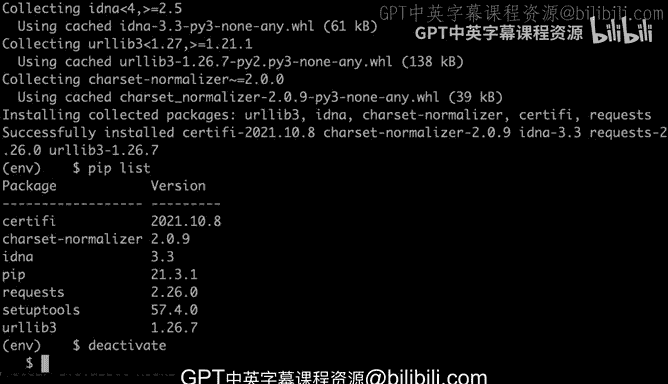

# 杜克大学《Python、Bash和SQL数据工程基础1｜Python Bash and SQL Essentials for Data Engineering》 - P7：07_01_05_创建与使用Python虚拟环境.zh_en - GPT中英字幕课程资源 - BV1KW421R7Kz

In this lesson， you will learn to create a Python virtual environment。

Activate and use a virtual environment。Install packages to that environment。

Deactivate and leave a virtual environment。By default， when you install packages。

 you are installing them across your user environment。

This means that they are shared by all of the projects in that environment。

This is mostly fine if you only develop locally， but if you wish to develop portable projects。

 sharing dependencies leads to two problems。The first。

 it is challenging to determine which packages are requirements for any individual project。

 If you recreate a requirements file from a shared environment。

That file may reference packages not needed for your current project。

When you distribute these requirements along with your project。

 you are wasting time and disk space by installing unneeded packages。Second， over time。

 you may have projects which require different versions of the same package。

If you are sharing the installed packages， you will need to either change the installed version whenever you change projects or constantly update older projects to use new package versions。

To avoid these challenges。It is ideal to have a unique environment per project。

There are different ways to achieve this， including virtual machines and containers。

 but a lightweight option for Python projects is Python virtual environments。

When you're in a Python virtual environment。Packages installed are installed to that environment only。

It is easy to create a virtual environment per project and hence keep each project's dependencies isolated。

When you create a virtual environment， you specify a location to store the associated packages and configuration。

There are different opinions onto the best place to store your virtual environments。

One convention is to store all of your virtual environments in a central location。

Often in a subdirecty of your home directory。Another is to store them in their associated project directories。

The ability to create virtual environments historically depended on the package， Vir M。

 but since Python version 3。5， a standard library module， VM is provided。In this lesson。

 we will introduce the She commands。Make directory。Which is used to create a new directory。

Print Work directory， which displays the path of your current location。Change directory。

 which moves into a specified directory。And source， which reads and executes the contents of a file。

The first step to setting up a new project is to create a directory to hold its code and documentation。

Let's create a directory named My first project。By using the make directory command。

Now we can change into this directory。And use print working directory to see where we are。

To create a virtual environment。We call Python with a module flag dash M。The module， Vm。

And the path to the spot we wish to store the new environment。In this case。

 we have named our environment M and we'll store it in the current project directory。Using List。

 we can see that this command is created a new directory with the environment's name。

If we peek into this directory。We see three subdirecties in a configuration file。

In order to use our new environment， we need to activate it。We do this。

By sourcing the activate script， which exists in the bin subdirecty of the environment directory。

And now we are in our virtual environment。We can use Pip list。

To see that only the minimum needed packages are available。

If we install a package well in our environment。It will be installed for this environment， only。

This means that if we create a requirements file in this environment。

 it will only reflect the packages we have installed for this project。

When we are ready to stop working on this project， we need to deactivate the environment。

The VM module automatically supplies and deactivate command。

And now we are back to our shared user environment。In this lesson。

 you have learned to create a virtual environment， Act and use a virtual environment。

 install packages to that environment only， and deactivate， leave it。

Now is's time for you to practice with virtual environments。

