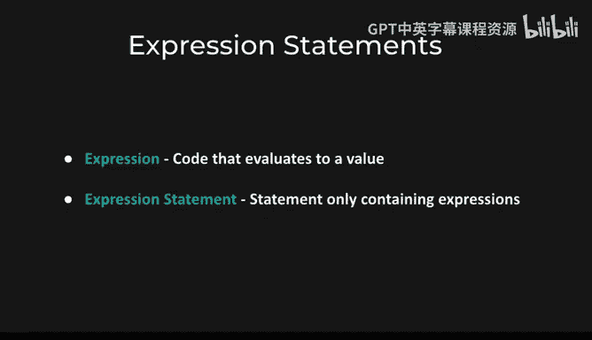
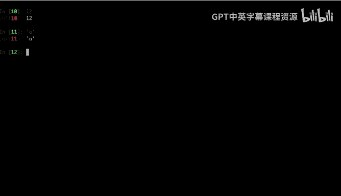

# 杜克大学《Python、Bash和SQL数据工程基础1｜Python Bash and SQL Essentials for Data Engineering》 - P8：08_01_02_Python中的表达式语句.zh_en - GPT中英字幕课程资源 - BV1KW421R7Kz

In this lesson， you will learn to install and run i Python。

Use the i Python shell to run code interactively。And to execute Python expression statements。

Python programs are constructedative statements。The statement is defined as a single logical line of code。

Statements can generally be divided into simple statements and compound statements。

The first simple statement we will look at is the expression statement。

A Python expression is a piece of code that evaluates to some value。

An expression statement is a simple statement containing only an expression。

These are generally more useful in an interactive Python shell。 As we have seen before。

 you can open an interactive shell on the command line by simply typing Python。

This will open the default Python shell， which is included in any Python installation。Over the years。

 people have built upon the shell to create more feature rich shells。

The most popular is the I Python shell。You can install the i Python shell by using PIip。

Once it is installed。You can open the shell by using the command I Python。

When you type a statement in an interactive shell。And then press enter。

 the statement is executed and any return value is displayed。

Here we have typed the simple expression 1 plus 1 and see that the result is displayed on the next line。

You can perform other math operations such as multiplication。Subtraction。Division。Raising to a power。

And using the modulus operator。You can also use parentheses to group these expressions。

If you press enter after typing a single object。Such as。The number 12。Are an A in quotes。

 which we refer to as a string。The value will be echoed as output。

This will become useful after we have introduced variables and imported modules。But for now。

 just remember， if you want to see what value a Python object contains。

 you can just type its name in an interactive shell and see what is returned。In this lesson。

 you have learned to start an interactive Python shell。

 Use the I Python shell to run code interactively and execute。Python expression statements。

Now you should try expression statements in an eye Python shell。

