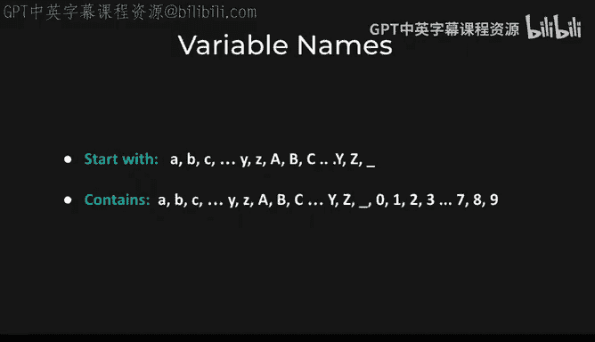
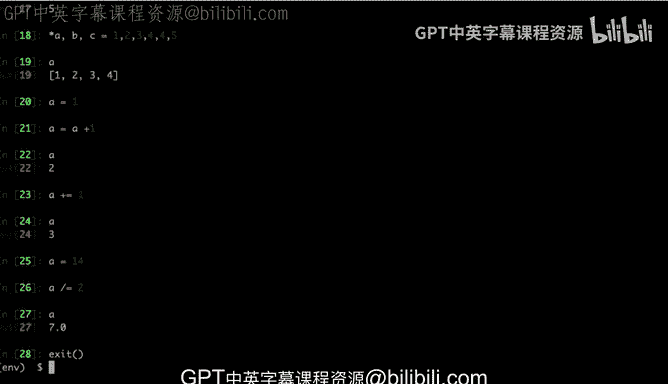

# 杜克大学《Python、Bash和SQL数据工程基础1｜Python Bash and SQL Essentials for Data Engineering》 - P9：09_01_03_Python中的赋值语句.zh_en - GPT中英字幕课程资源 - BV1KW421R7Kz

In this lesson， you will learn to assign a value to a variable。Use a variable in an expression。

Assign multiple values to multiple variables and update a variable using an expression。

The next type of statement we will discuss。Are assignment statements。

These statements assign a value to a variable。The value in this case could be any data type in Python。

 such as a number， some text， or any other object。A variable is a name that points to a piece of data。

It is important to understand that the variable points to the data and is not the data itself。

Multiple variables can point to the same value。And an existing variable can be changed。

To point to a different value。Variable names must start with a letter or underscore。

And all of the characters in a variable name must be letters， numbers or underscores。

Keep in mind that Python variable names are case sensitive。

Let's open an iython shell to demonstrate variable assignment。To assign a value to a variable。

 we use the assignment operator， the equal symbol。Here we have assigned the value1 to a variable named A。

We can easily check the value of a variable in an interactive session by just typing its name。

We can now use the variable in expressions。For example。

Since the value of our available in this case is a number， we can perform math operations audit it。

We can also assign a variable to the result of an expression。And do operations between variables。

We can assign。Multiple variables。To the same value， by chaining them together。

We can also assign multiple variables。To multiple values。By separated them， by commas。The values。

Will be assigned in the order that they are given。If you want to assign more values than variables。

 you can use the star operator。When given a group of values longer than the group of variable names。

 the name with the star next to it will be assigned the extra values。

The start can be put in front of any one of the variable names。You can assign。A variable。

 the result of an expression that uses the same variable。So if we assign the variable A to 1。

We can then update its value。Using the current value in an expression。

This type of operation is so common that there are syntactic shortcuts for it。

 referred to as augmented assignment。So instead of the expression we previously used。

You could use the augmented assignment operator。Plus equals。And now we see that a。Hesband。

Incrementmented up by the value we gave。There are augmented assignment operators for all of the math operations。

For example， if we said 80 to 14。And then wished to reassign it to the result of dividing it by two。

We can use the augment division assignment operator。

Giving the number we wish to divide it by after the operator。To Levi Python。

You need to use the exit command。And now you know how to assign a value to a variable。

 how to use a variable in expressions。And how to assign multiple values to multiple variables。

How to update a variable using an expression。Now you should try to work with variables。

