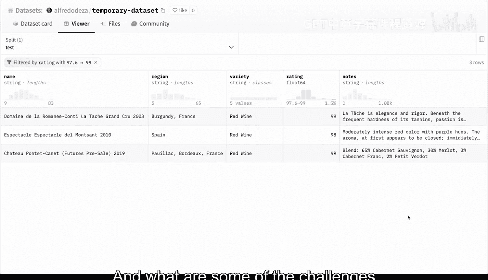
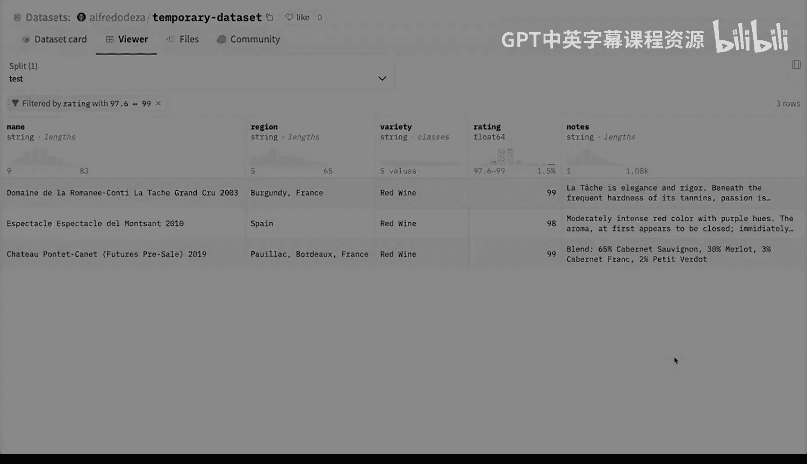

# 杜克大学《大型语言模型实践（开源大语言模型方案）｜Large Language Model Operations 》 - P11：11_01_03_什么是合成数据集增强.zh_en - GPT中英字幕课程资源 - BV1Cs421N7fp

Synthetic data sets or augmenting or generating synthetic data to enhance or create more data for a data is what synthetic data is all about the reasons for something like this might be different you might have insufficient data so in here you can see that I have the results of a world junior championship or actually many different ones like you can see here in 1998 and several other years and this is accurate data this is accurate real data processed from real results however you might want to have more entry points because you want to perform some machine learning tasks or data science task and do some kind of generation so in that case you have several options like if the data that you have is limited and you want to have well。

Different things showing up in athlete for the lengths and here for the places and the height and the year well you might have to resort to generating that synthetically and what does that mean well you will have to leverage a large language model so that it can help you out this is one example of a data this is very limited let's see we only have。

Some of these values are not very good， but I think we only have about， I think we only have like a。

Probably like 30 or 40 entries here so this is a very good example Now let me show you something different here where this is a temporary dataset that I built a while ago and it has 200 rows Now this is more all over the place and this is a wine based dataset where we have the name of the wine。

 the region， the variety rating and some of the node and then that's it so this is a perfect example where you want to say for example the ratings are from 90 it seems that they go all the way down to 85 and all the way up to 99 but let's say for example you want to concentratecent in only wines that are in the in the range of 97 between 99。

Then I can filter that and this is of course， going to take a while。

 But what happens here is that you might not have enough data。

 and this is a very solid example where this is not good enough。

And you're seeing here that only having three results is not good and depending on the type of tasks that you want to do。

 you might want to enhance that so there's different ways to do this， you can generate it randomly。

 you can write some code to generate some names picks from some famous regions and put the variety in there and pick a random number between 97 and 99。

And it gets trickier when you want to have some sort of nodes that make sense。

 so this is where large language models shine and is a good way of understanding how are what's the problem that you need to solve and when you might be facing it and what are some of the challenges that you might be encountering when you try to solve this problem。

