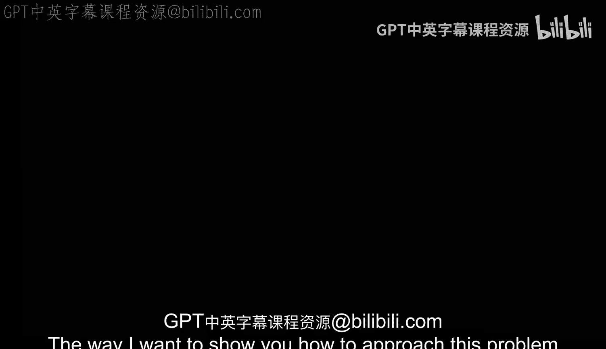
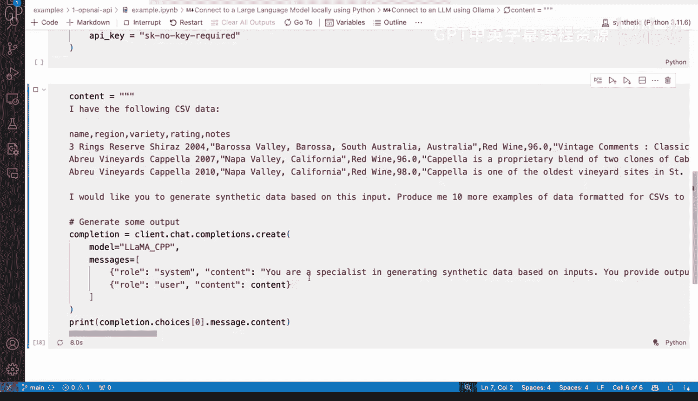

# 杜克大学《大型语言模型实践（开源大语言模型方案）｜Large Language Model Operations 》 - P12：12_01_04_增强应用程序概述.zh_en - GPT中英字幕课程资源 - BV1Cs421N7fp

The way I want to show you how to approach this problem of generating synthetic data for a data set is by using a large language model and we want to keep things simple and we're going to be using the open AI based APIs that we're going to be connecting to a local large language model Now you don't need to use a local large language model。

 you could very well be connecting to a valid open AI API that is not hosted locally and actually you can use a similar technique to what I'm going to be doing here。

To connect to a large language model you will see some of the system prompts and some of the things that we're not be doing in order to make all of these work。

 but the first step is to connect to a large language model locally and in this case I am going to be able to run something with Lama file Now I'm giving you here two options one is with Lama file and the R1 is using o Lama if you've installed all Lama in your system then the connection will be slightly different there's a couple of things that will change the the API key remember is never going to be required。

 but you have to put something in there that's why it says sk no key required is you can be it can be anything it doesn't matter this does change because Lama file will always run on local host for 08080 and V1 is actually required。

Connecting to a large language model using all Emma will require to use a slightly different address。

 again the API key is now required， but depending on the model that you're using behind the scenes。

 you will have to change the model on how you're connecting。

So those are the two ways how we're going to be doing this。And in this Jupyter notebook。

 I'm going to get started by running this cell and I've effectively created a client so that I can connect I can connect locally Now beyond that。

 I mean if I was using lema I would have to use something else here and then the next thing I wanted to show you was actually how this is going to be put together so now that I have the client instantiateated。

 I am able to call the completion， interact with a large language model by using client chat completions and create notice how the model is named Lama CPP and that is something that will change if you're using lema in this case I'm using Lama files this will work and then the messages is where things start to get interesting in this case I am going to provide a system。

 a system message and the system message is going to allow me to provide instruction。

On to the large language model to see to specify how they need to behave and I'm saying you're a specialist in generating synthetic data based on inputs and you will provide some outputs I wont show you the hopro because it is not relevant and then the content it is essentially this one right here which is what you would expect for the input if you were using something like chat GT or some of the other services out there。

 this is kind of like what I go in there and then the completion would produce something like this Now in order to make all of these work。

 I need to actually have something running locally and to do that I'm going to toggle the terminal and in my terminal I'm going to run a large language model in this case I have mixedtro and this is what I'm going to be running run this and it's going to start initializing the model so that it runs locally This is also going to bring a my buffer non by buffer。

But my browser sorry， and you can see here that it actually did。

 and this is the default screen that you will get at the full website。

Now this is running local host for 880， I'm not going to be using that。

 that's just the default behavior。 I'm going to go back to my code editor。

And you can see here that things are running， I'm going close these and I am going to now run the content。

 I'm going to run this interaction to see what is it that I'm getting。

 so this is going to take a few seconds because it' running locally and my system is well very performant Great so that took a few seconds almost 227 seconds over there and it did generate quite a few synthetic data so this is essentially how a model would work you would need to install or these interaction would work and you would need to install some dependencies like the Open AI the open AI APIs but this actually work very very well and it was able to generate quite a few quite a few entry points that was needed and was useful so that's a quick overview on how you would put something like these together。

