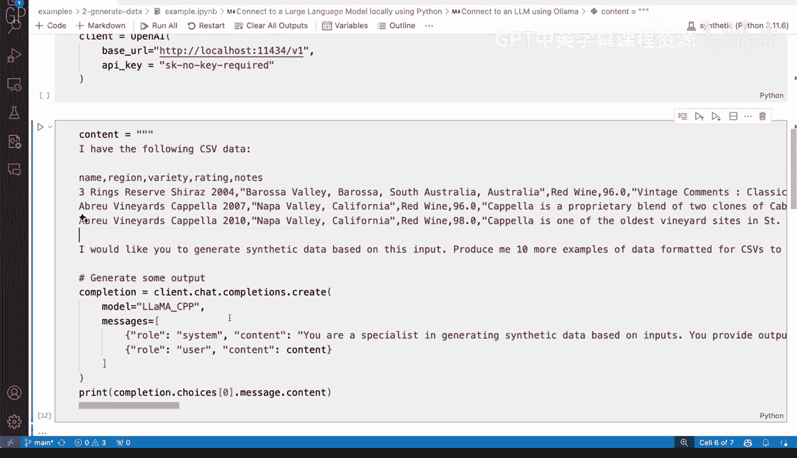

# 杜克大学《大型语言模型实践（开源大语言模型方案）｜Large Language Model Operations 》 - P13：13_01_05_测试本地LLM进行增强.zh_en - GPT中英字幕课程资源 - BV1Cs421N7fp

There are some challenges when generating synthetic data when we're talking or interacting with a large language model we've already seen how we can connect to a local large language model or a remote API using using the open AI APIs and in here but what I'm doing is again I'm running a large language model locally and I'm connecting through the OpenaiI library。

 the Python library I'm not using lema for this one。

 but the interaction will be essentially the same but what is the challenge and what are some of the problems that you may be facing in this case we're talking about a comma separated value file so I'm going to scroll here down。

To where I show you the actual CSP data， so here we have four columns， five columns， a name。

 region variety rating and notes and they follow a specific order right so we have the name is this one right here and then the region is's this one right there and we keep going here you will see that this is red one and then there's a specific rating is using a floating point it could be an integer and then there are comments about what what the type of wine is some notes those notes are well this is where large language models shine but this is a very specific format and I cannot just consume in parts what's coming out of the large language model so when I ask the large language model to generate synthetic data based on the input and produce me 10 more examples。

Then that I'm going to be using to augment datas， I want to do this in a semi automated way。

 but if you look at the output，And actually here's let's take a look at the whole system prompt you're a specialist in generating synthetic data based on inputs you provide output formatted for CSBs to augment data CSBs in this case are comma separated value files so what is the type of response I'm going get well I'm going to get first some sort of a greeting and say sure I would be happy to help you generate something synthetic data based on your provider examples here10 new examples and that's fine and that's kind of friendly actually but if I were to parse all of these programmatically I wouldn't I wouldn't be able to do that because I would need to understand that this is now valid CSB formatting and here at the bottom that's not even valid as well and it's also including the header which I might or might not want。

However， all of this portion right here is correct at the end it says please know that these are synthetic and while they're based on the structure of your original data the details are invented。

 which is fine because I'm okay with that I understand is synthetic so this is a challenge how can I deal with this situation in order to make something well much solid and much better well this is where altering the system prompt might come in handy so let me show you what I've done right here。

The prompt the prompt is going to be the same， but the system prompt is going to change and let's see what are the things that I've changed here first I'm going to say act as an API for generating synthetic data based on inputs so I'm no longer saying please generate something you're going to be helping me generate synthetic data。

Provide output， format it for CSBs。To augment， let me see to augment。

Toor datas do not provide any feedback input questions or let me go scroll or any other kind of text that will not be valid CSB based on the input received when you reply there's no need to provide the headers just the data so now we're tweaking exactly what we want So let's take a look at what the response is so I'm going to scroll here and you can see that the response is actually very accurate and it looks like if I was talking to an API。

 So this generation is perfect because now I don't although I could do perform try to perform some sort of validation that this looks like actually correctly formatted CSB data。

This is very good and will allow me to actually consume this and use it for generating synthetic data and you can see that the generation here is actually pretty good it was able to generate very good information following the same format with the regions。

 different regions from from different parts of the world using the same formatting even floating point for the ratings。

 So this is an excellent way that you can actually try to tweak and and finally configure how you're interacting with the large language model to in this case。

 generate synthetic data。