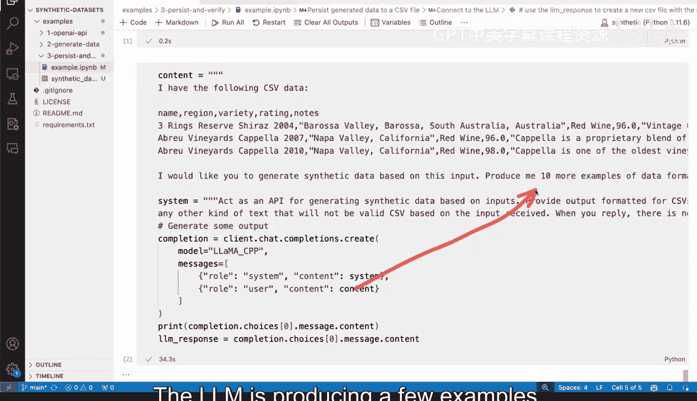

# 杜克大学《大型语言模型实践（开源大语言模型方案）｜Large Language Model Operations 》 - P14：14_01_07_增强和验证增强后的数据集.zh_en - GPT中英字幕课程资源 - BV1Cs421N7fp

Now we're ready to persist the data that has been generated synthetically by the large language model and again we've been able to connect to these large language model I have it running locally but then again this shouldn't be any different from what you will be doing otherwise you can either do a local large language model or you can do a hosted API that is exposing one of these large language models and the prompt is passing these three items and I want to generate 10 more items。

 they're going to be producing these wines and this wine information and I want to get 10 more of these so when I get 10 more and the system prompt is telling the large language model that it should act as an API that essentially means that it won't get any of thevo stuff that we see here and it's only going to concentrate in this。

And for the system prompt， we are essentially telling the large language model that is going to behave as an API and what that means is that we won't have any pros surrounding the response and is going to generate strictly just the things that we want。

 which is the CSP generated output。As we've seen before。

 this is the output that we get which is perfect and is providing us 10 very good solid examples。

 but we want to persist this and we're going to use a little bit of Python to try to actually write and create a new CSB file this is definitely going to be creating a new CSB file that we're going to be using based on what we got so again the column names we knew from before those are named region variety rating and note。

So let's walk through what we're going to be doing here what we're going to be doing here。

 So we're going to create a new CSP file and we're going to be using the CSP module you might want to consider using pandas if you're using something more complex but for writing a plain regular CSP file。

 this is not going to be damn problematic， so this is good enough。

We are going to split the all of the output which came in as a single string and we're going to do this by new line。

 so every single line is going to be you know captured here in this variable。

 then we're going to write， we're going to open this synthetic underscore data that CSB file for writing that's what the W means。

We're going to keep the new lines as nothing there and we're going to define that as file。

 the library， and then we're going to create this writer instance。

 this is slightly different than just writing a regular file with Python。

 but in this case we're going to say a CSP that writer which is going to create the writer instance。

We're going to say that the de is comma。And we're going to write the column names as the first thing that we're going to do is that's going to be separate from the loop。

 and then for every single line， if there is a line， we are going to if there's no line。

 we're going to continue and there is a line， we're going to parse it because if you notice。

If you notice right here， we have a lot of quotes and a lot of extra commas。

 So because this is a comma separated value file， this has to be parsed because this is one entry right the region is one entry not too separated by this character right here so that's why we need to do this extra parsing and we'll see what the difference is when we don't do that and then we write each row and then that's it so let's go ahead and run these and as soon as we run it。

 we'll see that we have the synthetic data file here so I'm going I click it and once I double click that we'll see that everything is working correctly。

 This is exactly what I would expect and it looks pretty pretty good Now remember I was saying that that parsing is needed。

 this is how it would look like。If I do or wise， if I say writerer， right row， and instead of parse。

 I say line。Instead of any parsing and then I run this again。

 then the synthetic data is going to look well not quite well。

 This is perhaps something that you know if you were doing something with pandas it perhaps it would be easier but this is messing up the data that I had so that is some of the things that you should need to consider when you're dealing with persist data and when you are trying to create something like this and once I run this again。

 well everything' is back back again how it should be now one last thing that I want to tell you is that if I had to write something like this for production for something that would be well much more specialized I would perhaps do this in some sort of a function that I could call for many well this one would be one function and this one would definitely be a separate function and the things that I'm fitting like three example。

could perhaps be collected at random from existing data that I have and not only that。

 but I would be able to produce perhaps more than 10 examples once the LOM is producing a few examples。

 you can probably do more of those。

So those are some of the things that I would consider in addition to try to verify that what I'm getting back。

 meaning this data over here is going to be valid CSP。

 so that is how you would put something together to produce synthetic data and augment your data set with a large language model。

