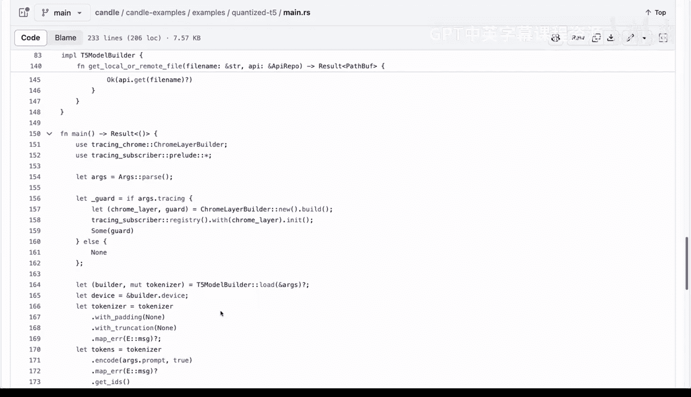
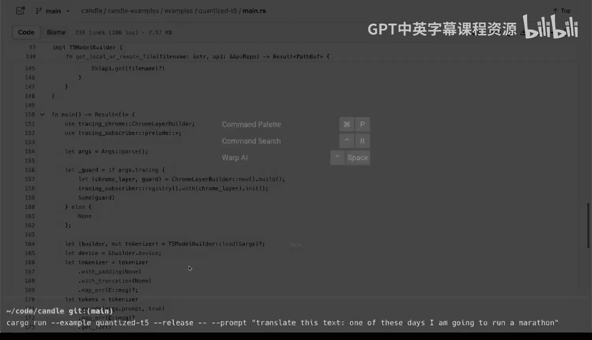
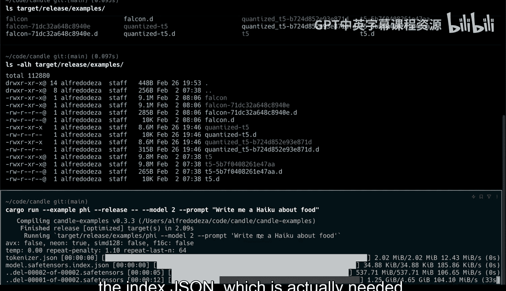
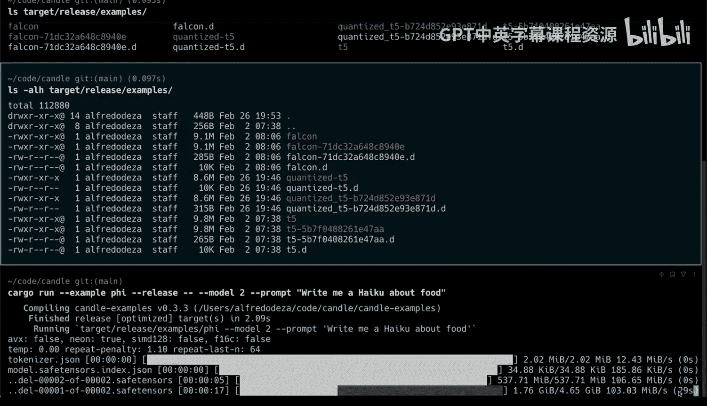
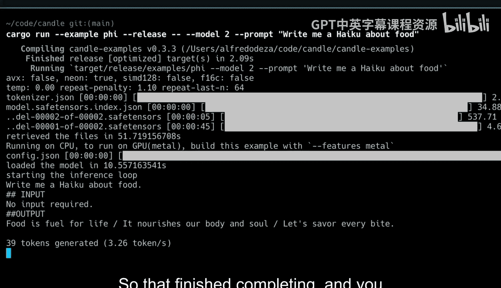
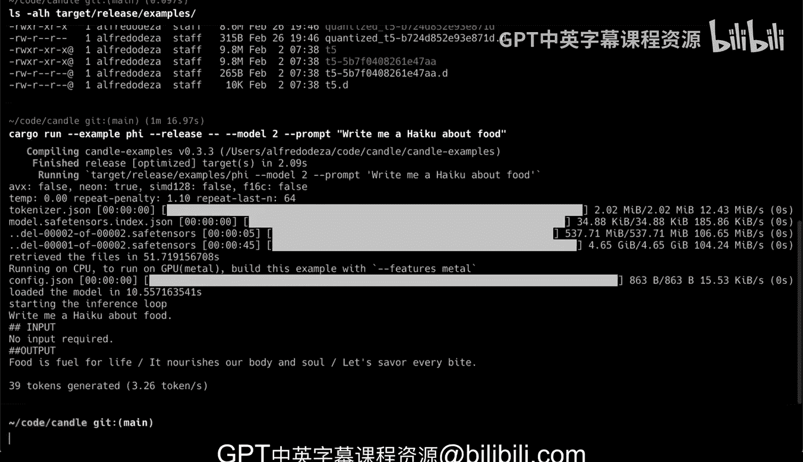

# 杜克大学《大型语言模型实践（开源大语言模型方案）｜Large Language Model Operations 》 - P18：18_01_04_使用Rust Candle.zh_en - GPT中英字幕课程资源 - BV1Cs421N7fp

Unlike other libraries and tools like Rut Bt， the candle project allows you to have a single single executables without any other external dependencies and it is something that will allow you to get the models get everything working in a single binary which is something that is very very powerful。

 one of the things I want to show you here is browsing through the candle examples and we're going to be using specifically one of the examples that is going to be doing translations and for this one I want to actually go all the way down to quantized T5 so quantantas T5 this is how you can run it it's not that complicated however lets before we run it and before we demo these let's take a look at the code。

So that we can see exactly what's going on。Now the code it is quite large， it's 233 lines。

 but it shouldn't be that frightening to take a look at and the reason why is' 233 lines it's because。

This is a command line tool that would allow you to run any of these models right here from the T5 small to these other ones including the large and the extra large and the extra extra large as well。

 so of course you can imagine that some of these will be pretty small to download and execute and less resources。

 but not as powerful， however like the bigger ones might have other capabilities。

So that is really all and because it's a commanding tool we'll have the parsing done here。

 you can see where it tries to enable tracing， it tries to enable understand the revision。

 what the weights， the config files caching prompting the prompt is where you would be producing some input for the model as well so that is what you would have to deal with and a lot of these options will try to get these from behind the scenes we've thought before how hugging face the platform has the capability to post all of these models and you can see here that the quantized T5 is right there under these organization LMC this is what allows you to retrieve that dynamically at the time data time that this runs so this is you can see all of the options for T5 and all of the other options for other languages based。

on T5 as well and at the very end it will interact with the model。

 it will read the input and then it will send that it will tokenize everything and it will send that to the model for proper for proper manipulation of the input so let's go to the terminal and see how this looks like so in my terminal right here I'm running the quantized T5 example and I'm going to say translate this text one of these days I'm going to run a marathons I'm going to run these。

And you can see that it generated 18 tokens and he was able to produce that at 24。

8 tokens per second。And it was able to translate this into。It was able to translate this into German。

 which is great， my German is not very good， but this was very。

 very fast and was able to produce this release example when we were using in。In Ru。

 the dash dash release it means that it will produce everything it needs。Now that's very good。

 if we do here in LS， let's take a look at target and you will see that there's the release one。

 so let's talk around what is in release and we'll have examples。

And let's take a look at what quantized T5 will be。 What's the final。

 what's the final size of these and we'll list that。 And you can see at 9。8 mebytes。

 Well that is pretty compelling。 Now， this doesn't include the model。 However。

 the model was pre download it separately。 So to demonstrate this， I'll run a different example。

 So in this this time around I'm gonna say I'm going to run the5 model and I'm going to say I'm going to use the version2 of that model and I'm going to write something interesting here。

 I'm going to try to say write me a haiku。About food。 So behind the scenes。

 you can see it's building it's downloading all of the models and it's downloading 537 megabytes。

 that's going pretty fast and it's downloading both the safe tensors as well as the tokenizer。

And the index index adjacent which is actually needed so that that will take a quick second it will take a few a few seconds to finish so let's just wait it out until that complete so that finished completed and you can see that the P model is actually producing the output now and it wasn't as fast and you could see that 3。

26 tokens per second was all that I could get from that all of these happen dynamically and it is an excellent excellent way of trying to play around with some of these models using rust now you can see here that it said hey you're running on CPU so make sure that you're aware that running on CPU well it's going to be much slower that is why we saw that performance go down because compared to the R models again Can is a very interesting option I hope you get to try it and you play around。

Some of these examples and perhaps try to come up with something useful that you want to solve with some of these models。

