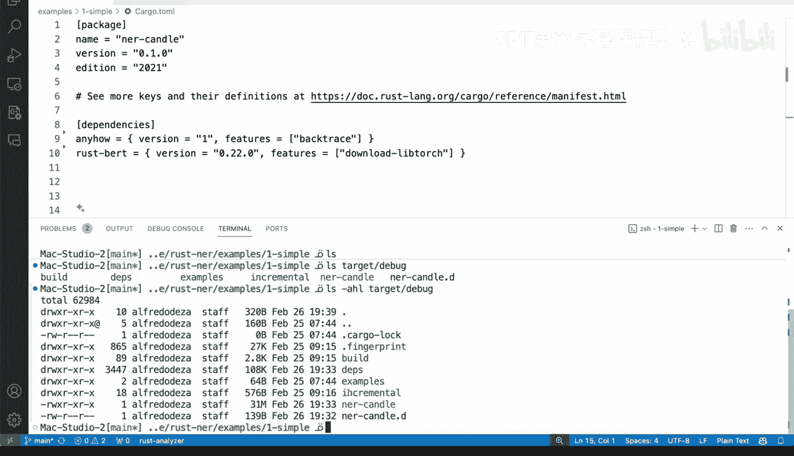

# 杜克大学《大型语言模型实践（开源大语言模型方案）｜Large Language Model Operations 》 - P19：19_01_05_使用Rust BERT.zh_en - GPT中英字幕课程资源 - BV1Cs421N7fp

I want to show you here a project that is very simple and is going to be using rust B and what we're going to be doing is we're going to be using rustbi to do named entity recognition which is the ability to use a model so that we can detect names based on in text。

 actually in text so these are the dependencies and we have just one dependency that is a rust dependency called anyhow allows you to do well interesting things with rust these are not that relevant for what we're trying to do and what I want to cover here is rust B specifically which is allows you to have that same or a very similar experience to what you would have with transformers from hugging face the library so that's those are the dependencies。

Let's take a look at the actual file， so we're going to take a look and it is not a very big file。

 we only have 23 lines， so let's go through each line。

First we're going to start right here and what's going on right there is that we are using a prebuilt or not pre-built better ready to use off the shelf model for name entity recognition that is what an ER stands for here and the pipeline means that all of the abstraction is done for us so that we can write just a little bit of rust and get interesting results so that's what that does and what we're going to get here is like our main function is going to first well set up the model and we're going to say well we' just going to set we're going to instantiate we're going to create these model this variable here and we're going to create a new instance with just defaults and then let's we're going as simulateimilate here the input so we're going to pass in three three phrases here or three sentences one is。

My name is Alfredo was born in Peru， in Portugal， the Paelellata is great。

And then the last one I used to work in a small company called Shocu Okay。

 so then what we're going to do is we're going to grab that input and we're going to put it to good use using in the in the model。

 So this input is going to go all the way right here。And then the N model。

 the name n2 recognition model， has this function right here。

And it's called predict entities and it receives the input which we're passing and then what we're going to do is for every single output for every single item in the output so this is going to generate several items we're going to loop over that and we're going to print exactly what the model is saying so how does that loop let me toggle the terminal and now that the terminal is open。

 I'm going to do cargo run and when I do cargo run this is going to build behind the scenes and is' going to execute is going to run my executable so you can see here that we're getting one by one first one is the Alfredo one。

 the other one is Portugal and the other one is shouldque so it's correctly detecting that the first one is this one which is detected the word Alfredo and the label is P which means it is personal。

So it correctly detects that as an actual name like a personal name。

 so it gives you a little bit of information there。

 then it continues on the word peru and it tells you that label is locked for location and it also tells you exactly where it begins and where it ends and like exactly where it is and also gives you like a score like the certainty that that is actually correct。

So you can actually have very low examples and that might not be very good。

 so next is Portugal location， very good， similar to Peru and then should Q is the label would be org for organization。

With a little bit of certainty there and so you know very good。

 very easy and very nice so one of the caveats that you have to be aware of when you're using rust bird is that it does require you to have pitorrch installed and what I do have here if I go to the dependencies do you see the features here where it says download a liptorrch that means that whenever I'm installing it will automatically download that for me so that is just one caveat of this library where you might want to be aware that that is a requirement otherwise if we go to we show you the target and then I think it's debug you will see that the executable is there so lets let's inspect how big is that executable that you build and at 31 megaby。

That is actually a pretty compelling reason why you might want to consider something like rust and using Rutbi allows you to have this very fast。

 easy way of dealing with a model in a way that you can do interesting things like named entityT recognition。

