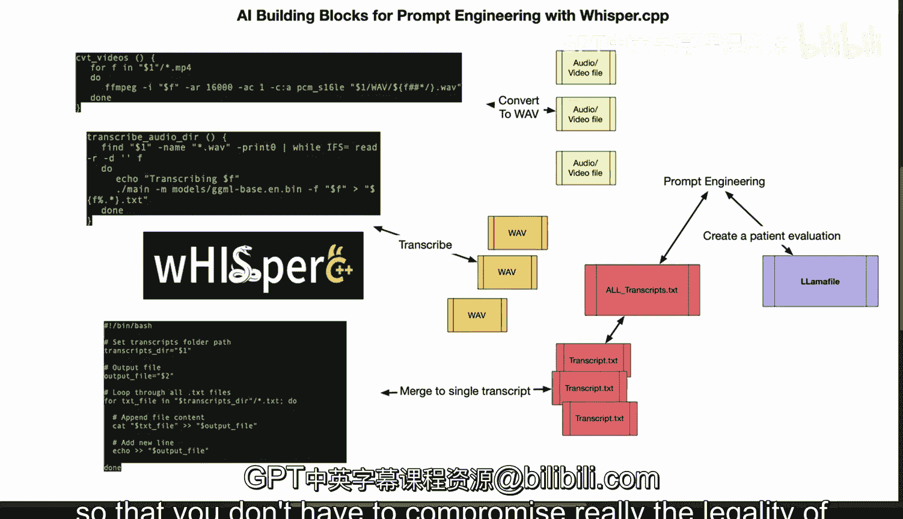

# 杜克大学《大型语言模型实践（开源大语言模型方案）｜Large Language Model Operations 》 - P27：27_02_03_使用Whisper构建GenAI基础模块.zh_en - GPT中英字幕课程资源 - BV1Cs421N7fp

Here we have a diagram that shows how to create these building blocks for prompt engineering with the Whisper CPP transcriptionion Library。

Now， this is an important but boring detail that is easy to miss。

 but let's say you're a doctor and you have a lot of patient files， for example。

 or transcriptions from maybe a session with a patient。

 So how would you actually use this in a Gen AI system。 Well， first up here， you would take。

 let's say a video or an audio file and you convert it to wave。

 And that's what this little bit of bash does here it loops through。

 let's say a huge directory of different patients where you've had a conversation afterwards into a tape recorder。

 And then afterwards， we are able to transcribe that because it's in the right format using Whi C plus plus and what's nice about whisper C plus plus is that it is optimize fast and it has lots of different models。

 including tiny models to regular models to giant models。

 But basically it's got incredibly good transcription performance。 So we could again。

 go through a directory full of wave files。😊，And then make lots of different individual transcriptions Now the next step would be we could leave it there。

 we could do some things with generative AI or we could merge all those transcripts into to essentially a master transcript depending on what we're working with how big of a context window we have and so let's say that we merge all those into all transcripts Txt we could have some prompts。

 let's say I'm a radiologist and I want to look for certain patterns so I want to create like a patient evaluation whether a patient needs to go through and take further exams and so I would take this and put this into a window and say read these transcripts and generate a patient evaluation for all of these different patients and that could be done with a local large language model because again you may be a little bit worried about some of the legality of putting this into a cloudbased system and then I could generate these automated patient evaluations。

is really one of the key components to using open source tools is to use these building blocks and to use regular automation that people have been using for decades and decades。

 use bash， use scripting， use DevOs technologies， but you can see here that this really simple form of automation that empowers the generative AI workflow。

 because now you can all together， combine these transcriptions。

 and then create a sophisticated prompt and actually keep everything local so that you don't have to compromise really the legality of the things that you're doing with medical transcriptions。

