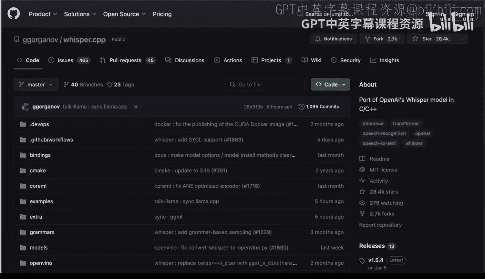
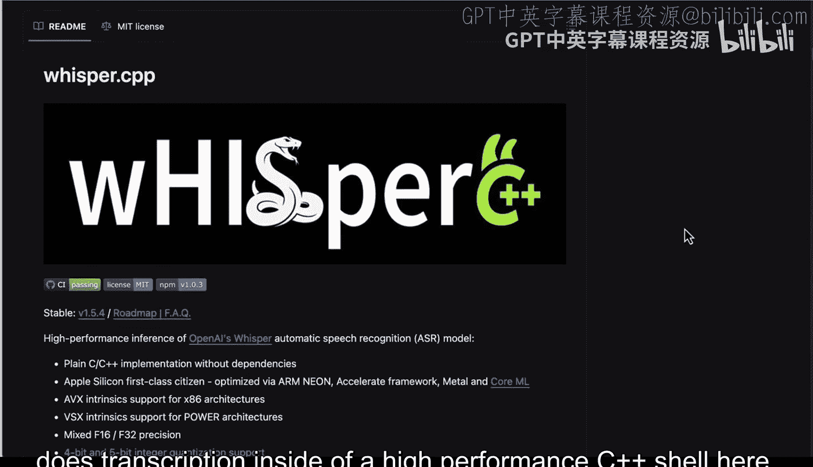
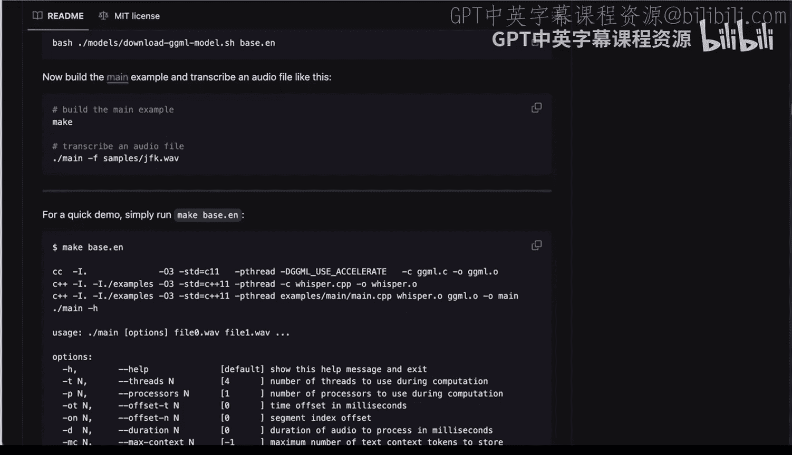
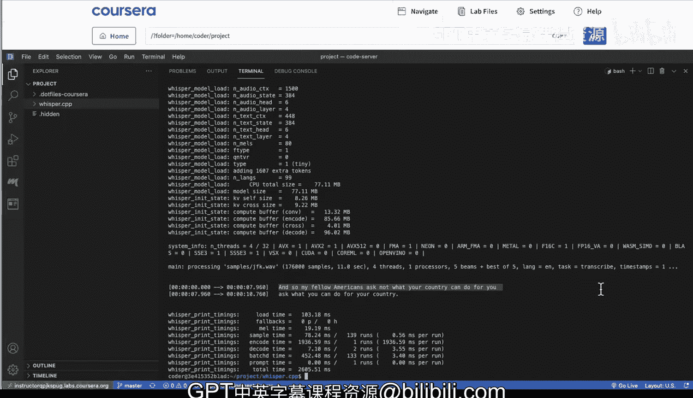

# 杜克大学《大型语言模型实践（开源大语言模型方案）｜Large Language Model Operations 》 - P28：28_02_05_使用Whisper CPP进行转录.zh_en - GPT中英字幕课程资源 - BV1Cs421N7fp

This project is whisper do cP and you can see that it is able to wrap the existing large language model that does transcription inside of a high performance C+ plus shell here。

 you can see the basic benefits here it's got plain C plus plus implementation without any dependencies Apple works as well。

 So if you have a m series chip。 it has incredible performance on the GPU and you've got all these other really good things as well inside of them。

 So really what you need to do to get started with this is to clone it and then you need to pull down the model that's converted to this Ggml format。

 Now this is the base model here， but there are other models as well like a tiny model。

 which I'll show in a second as well as larger models surprisingly the tiny model is actually very effective。

 So let's go ahead and take a look at what that tiny model does。 So here I have a sandbox where I've。

CedWhi dot CPP。 if we take a look at this。Inside this directory。

 I've compiled whisper and then all I need to do to run it is just go to dust slash main dash M and this is where I would feed it the the models here right so I'd say models and then this is going to be the tiny model Now we can actually go through here。

And figure out the size of that model。 And so if we do this， we say D S。

 we can look at the size of this tiny model just to give an overview of how big it is。

 you can see it's only 74 megabytes， but it's actually capable of doing extremely accurate transcription。

 So for you embedded devices， or small kind of lab environments。

 This is a really effective transcription tool。 So what we're gonna to do here next is we're gonna to feed it a wave fileile。

 So you could copy multiple copies of this way file， upload different way fileses。

 etc ce to test out different workflows。 But the idea here is that you're able to run this。

 it goes through it transcribes it even on a CPU， it's got pretty good performance and it goes in against timestamps and it's able to show in this case this famous speech from GFK and we're able to get this transcription。

 So why would you want to do this Well， this is the basic。

Ingrreedients to building out generative AI workflows because you could give it a directory full of files。

 for example， and then go through and merge all those files together into a main transcription and then feed it a prompt that gives you more and more ideas so this is a great start for people that want to start building their own you know self enclosed GenI workflows。

 check out whisper。cppP。

