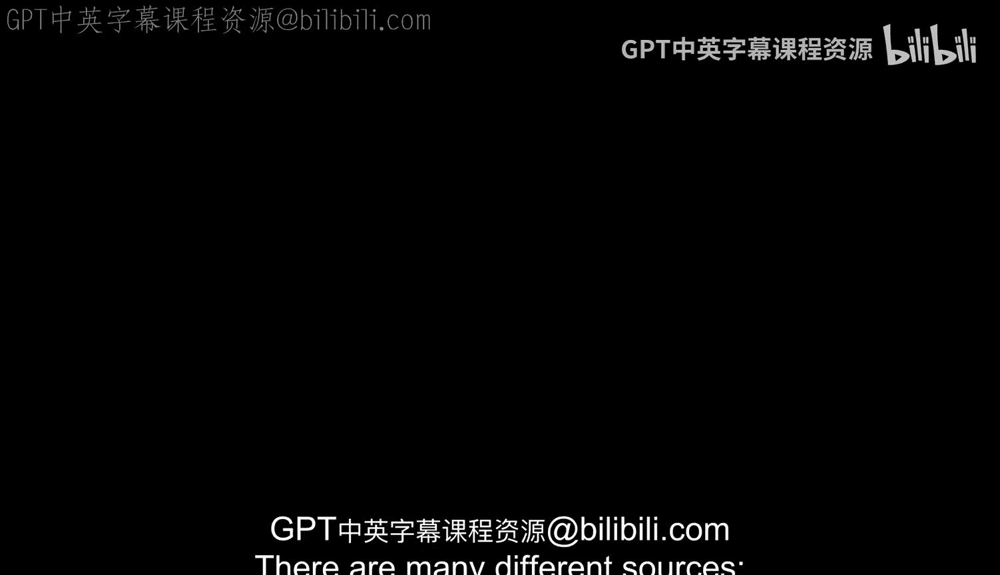

# 杜克大学《大型语言模型实践（开源大语言模型方案）｜Large Language Model Operations 》 - P2：02_01_01_引言_1.zh_en - GPT中英字幕课程资源 - BV1Cs421N7fp

There are many different sources， there many different places where we can find open source models。

 specifically large language models and to interact with them beyond where these models are。

 where where we can find them there's different types of tools that we can use to interact with them well explore some of those tools and some of those platforms primarily I personally like the huggingface platform and we will see what is the Huging face platform。

 how we can find some of these models there， but well also take a look at where and how we can find some of these models in cloud platforms like say for example。

 Azure where you can actually very similarly to hugging face you can filter by model by license and see what might be useful to you and then we will also take a quick look at small language models like。

Phi2， for example， that is coming from Microsoft that they have built something very。

 very small but also very capable and we'll see why that's interesting。

 definitely that's interesting just because of the size and its capabilities and we'll take a closer look at all of these things in the next lessons。

