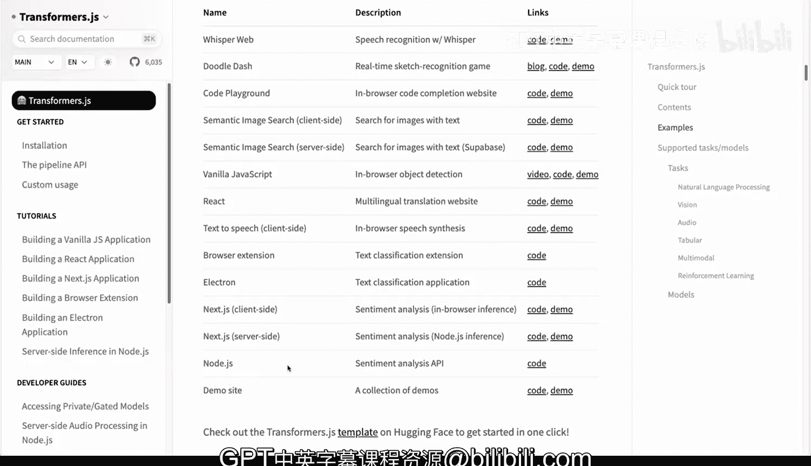

# 杜克大学《大型语言模型实践（开源大语言模型方案）｜Large Language Model Operations 》 - P30：30_03_03_什么是Transformers.js.zh_en - GPT中英字幕课程资源 - BV1Cs421N7fp

Transformers Js is the library， the jascript library that will allow us to load models in the browser directly and then interact with that model with ja directly in the browser。

 So nothing like we've seen before where we've been using other tools that we need to run in a system。

 So this is all browser based。 the one requirement for transformersjs， however。

 is that we need to be using the Onx runtime。 Now this is just an implementation detail。 however。

 but what this means is that any of the models that we want to interact with have to be based on Onyx。

Now you can easily convert models， existing models to Onyx and actually Hugingface makes these very easily。

 there are many different ways on how you can convert this but that is essentially what you need to do Now once you've decided that you want to use something like transformer Stas and you want and an implementation what you get to do is actually start pulling in the models that you want to work with So in this case you can see here that this one's bird based multilingual andcase sentiment let's actually go and dig around this particular model for the sentiment analysis So here I am in what that transformer Js example was pulling and you can see that this is text classification and is actually using onyx So what does that mean well it。

Actually it's an onyx model and it has everything that is needed in order to try to work with the library itself so being been able to have these will allow you to interact with it and you can see here now that I've pulled in it is 670 megabytes。

 the standalone model and if you want to use the quantized version you will only be looking at 169 megabytes。

This is something to consider because Transformer DGS， because it loads on the browser itself。

 you are going to be pulling and doing these types of consuming these type of models。

 so this will be required to download when you are using transformer DGS。

 so in this case going back to the documentation by applying these sentiment analysis we be able to we would be pulling these behind the scenes to try to make it work in the browser。

So there you go， this is some of the things that you would need to take into account specifically the OnX portion here in the examples。

 you can see there's plenty of demonstrations for some of the things that you might want to be doing speech recognition。

 in browse record completion search for images with text。

 I mean there's tons of different things that are very interesting。

And you can actually browse around some of these demos and start playing around with some of these implementations。

