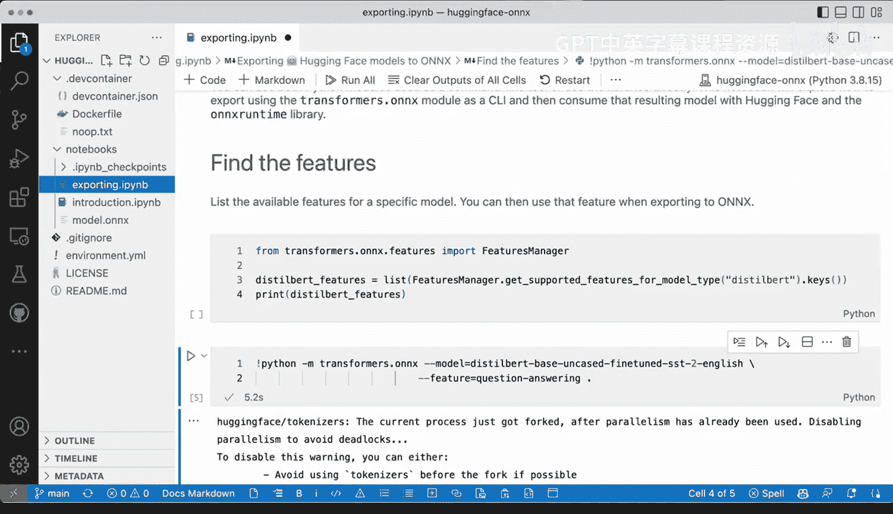

# 杜克大学《大型语言模型实践（开源大语言模型方案）｜Large Language Model Operations 》 - P32：32_03_05_将模型导出为ONNX格式.zh_en - GPT中英字幕课程资源 - BV1Cs421N7fp

Now let's do a little bit of a handson experimentation here with huggingface and Onyx and when I look at exporting the exporting Jupyter notebook that I have here already running again make sure that you have the right kernel installed in this case I'm using the one that is from Conda that has all of the dependencies installed All right so first off let's find the features in this case。

 you're going to import the features module from the Onyx library here on the transformformersx module rather and you're going import a features manager and then for these specifically for these examples specifically when to be doing with distilled bird and when I look at what what those features are and I'll tell you in a second why that is important so lets it's connected to the kernel is going to take a second and wait it out until that complete all right so this completed and what are the features。

Well this model has different things， different tasks that you can do right so you can have sequence classification。

 for example， multiple choice， token classification or question answering which is something that I really enjoy working with models that do question answering All right so why is this important why would you need to understand that if you know exactly what you need and have a model that is doing something very specific then for example question answering。

 then you can say， well I want to port over thetilbi model to Onyx just to do question answering and the way you accomplish that is by again working with the transformers that onx module acid commandline tool and you can pass in Python m transformer onyx actually let's just walk through some of these things that you will need to know for the first you're gonna be using transformers。

 onx again you're using the module acid commandline tool because of the dash and flag right here。

Next we are going to pass in the model like exactly what's the model you want to be working with in this case is going to be that the silverbid base oncase fine tune SST2 English well that's a mouthful。

 but that is exactly the model that we want to working with and then we're going to say the feature that we want is the question answering。

And lastly， and this is kind of hard to see here。 We have a dot。

 Now this dot is pretty important because it means that we want to produce the model right here in this same directory。

 if we wanted something else， we could do something like a path and then the name to the model that we want to I just want to generate that right there。

 so that is going to allow us to generate that so I'm going to run this is going to take a few seconds and it's going to start producing producing output。

 So now right now it's downloading distber based case finet model So let's scroll through the output and see what's going on here what you need to look for at the end is specifically the model model validation。

 So you can see here all good model saved and model that onx if I would have passed in a path you have something slightly different or if I wanted a different name and you can see here that the model output names these are the ones that you will be needing to work with。

 So if I go back。to the Exper， you can see now the Expr is saying。

 hey you have something going on here and that's our model that has been produced right here。

 the model that Onyx which is exactly this one coming from right there so there you go that is how you would like let me scroll here all the way to the top you would find the features in this case we're producing one for question answering and this is how you would work with hugging phase in coordination with Onx to port models from from hugging phase over to Onyx and produce a working model for Onyx。

