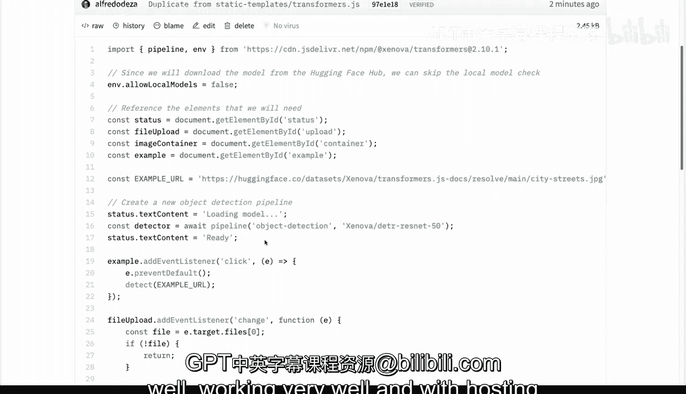

# 杜克大学《大型语言模型实践（开源大语言模型方案）｜Large Language Model Operations 》 - P33：33_03_06_在浏览器中使用Transformers.js.zh_en - GPT中英字幕课程资源 - BV1Cs421N7fp

With Transformers Js， you have the ability of running models on the browser。

 we've already seen a couple of things that you can do with Transformers Js。

 but I want to show you something actionable and we're going to be running a template based on based on the examples here we have on the documentation So I'm going to keep scrolling all the way here to the very end。

And what you can do here is open up a new space and the Huin face platform has this very nice basically like they call them spaces and you can actually run run models on the browser and with even with backend applications。

 but in this case we're going to concentrate only on Transers data。

 so I'm going to click on template， I've already signed in into my account。

And this is going to greet me here with create a new space。 I'm going to call it demo transformers。

And then I'm gonna pick a license。 MIT is fine， and you can see that it has already picked up static website and is using transformers Sta Js right there。

 which is pretty good。 And then the nice thing about this is that it already is going to be backed up by hardware that is already it's freely available because I have an account I'm not paying anything from it。

 you can see that it's free， I'm not gonna pay anything from it。 So this repository。

 this space is going to be public and I'm going to click create space and as soon as I do that it's going to load these application So what is it what is it that that this demo is going to be doing Well。

 it is going to do object detection with with transformers Stas So I'm going I can upload an image or try an example that this is already working on the browser it's already good to go So I'm going try an example I'm going to click here and now this loaded and you can see here that transformers。

Stjas with the model behind the scenes， it's doing a lot of detection。

 so you can see that's a traffic light， our light， a person， a bicycle。 This is incorrectly。

 this is incorrectly detecting that's a bicycle， but it is it is a drawing of a bicycle right there。

 which is fine。 but that is effectively how it runs。

 but you have a live demo So now what I want to show you are the files now because I'm zoomed in you don't see them。

 but I'm going to zoom out for a second here and I'm going to go and show you the files So when I go and show you the files。

 this is the actual application So you can upload all of your files in this case I had all of the examples ready to go and I was able to very quickly get that going。

 but let me show you what that looks like like this is the index that H so you can see there's a little bit of HTML there that's the demo that we were just seen the index thatjs is where all of the magic。

😊，appens here in the pipeline， you can see that we're importing transformers and we are getting that going and the actual the actual model that we were using was this one the ETR Resnet 50 so this is the model that was doing the object detection and you can see the pipeline right here the pipeline right here was was the actual task that we want to from this model and that is how this is going to be all tied up。

 So this is a very quick， very easy way that you can actually try models on the browser that is actually well working very well and with hosting provided by the hugging face platform。

