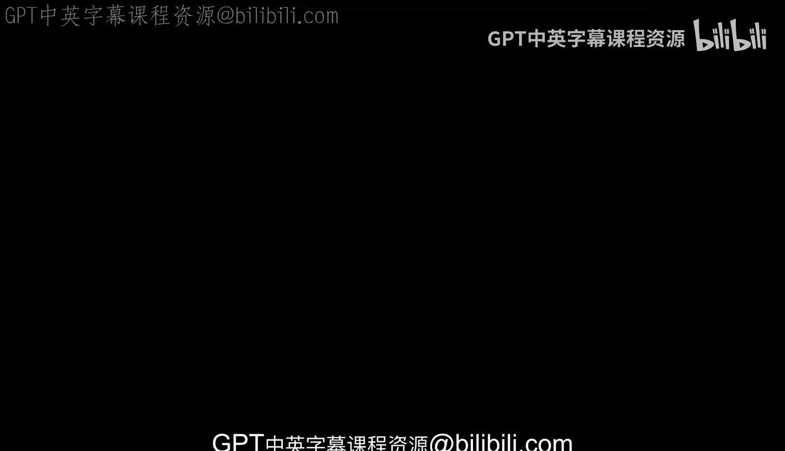
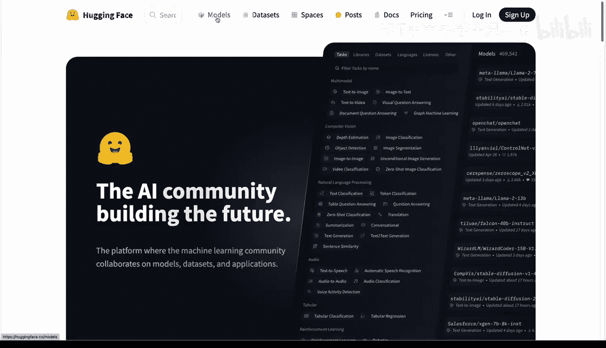
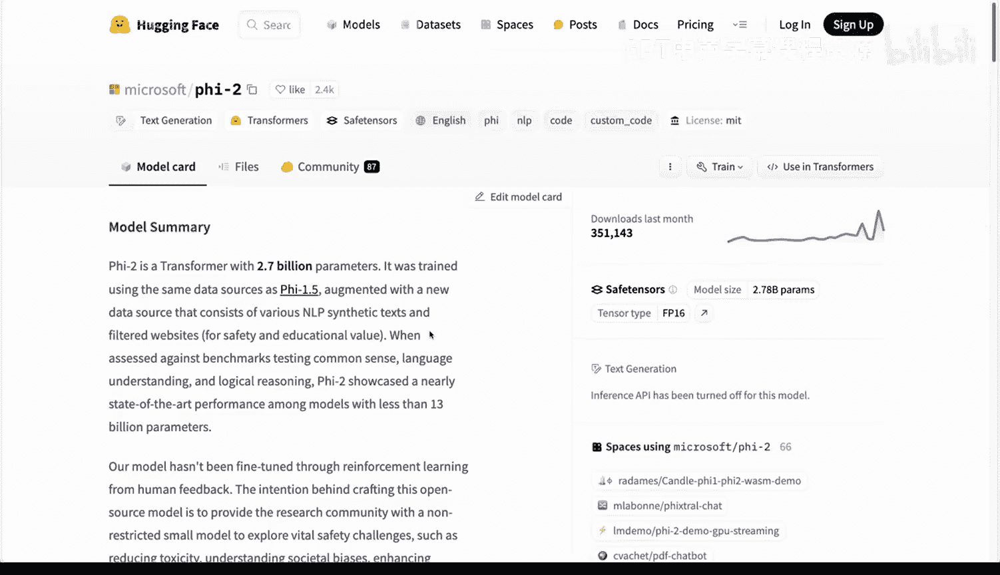
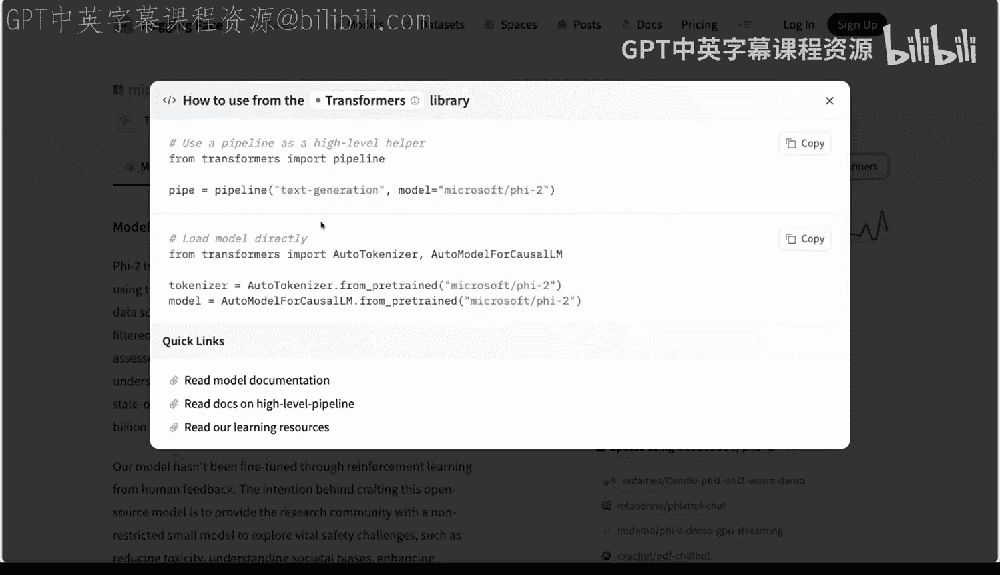
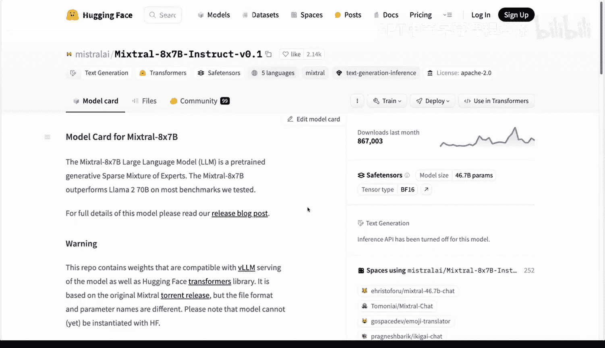
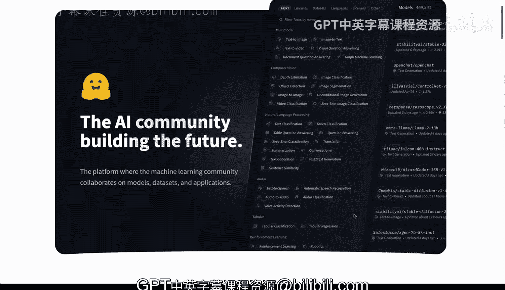

# 杜克大学《大型语言模型实践（开源大语言模型方案）｜Large Language Model Operations 》 - P3：03_01_03_Hugging Face平台上的开源模型.zh_en - GPT中英字幕课程资源 - BV1Cs421N7fp

When we're talking about open source models， we will no doubt be mentioning Hugingface the company along with that。

 So Hugingface is a company that specializes in doesn't special。

 but hugging face is kind of like a repository， a place where we can have host and share are models and many companies。

 including many cloud service providers allow allow allow their models to be hosted in this platform。

 So Hugingface is not only a company it' also a platform and many of the open source models are hosted in here。

 So what does that actually mean Well right here the very top you' will see that there's many different options we have models。

 data sets， spaces。 So what are those。 So let's quickly go into。

Moels and I click here and you will see that even companies like Microsoft are actually putting models in there and one thing to notice is that some of these are very specific in this case Microsoft Phi2 is a text generation specific model What does that mean it means that it its main task。

 its main purpose for these actual model will be text generation meaning something aching to the functionality。

 the capabilities of what we saw before with services that are providing chat based systems like chatgBT and other service providers that's not the only one you can see in this case Miral has Miral which is also doing text generation So why is hangingging phase here and。

What's the relationship with all of these models， What is going on， Well， it is a good。

 popular service for hosting these models and putting in there。 So if we were to like， for example。

 go to Phi 2。And I click here， you will get a little bit of information about what this model is and how does it work and you will see some of the description needed to like how to use it and some of the instructions on how to implement that Now this is great but there's also many different things we can actually see code examples on how to use that with a little bit of Python as you can see here we can actually poke around the actual files that that are make part of these model some of these like the configuration files and some of the things require for the tokenizer which we haven't dived into yet。

 but all of these are able to make part of what this model is doing。

 you can see here that the size is 564 megabytes that looks like a big file and you can actually go ahead and download these files or even。

T them right away， like if I was logged in I would be able to try that text generation In API has been turned off for this model。

 however， and we're not going to try that yet so I'm going to go back all the way to the models and you can see that there's others other capabilities as well and all of these have different types of tasks associated with them have computer vision。

 natural language processing audio I mean there's all kinds of different things so the models not all of the models might be fully open source。

 some models might be closed source if we were able to for example try to let's take a look at mystral AI here and try to figure out the license you can see that the license here is going to be Apache 2。

0 that's a very permissive license and but these licenses are going to change not all the models are going to have the same license。

And some of them will allow you to do more， others to do less or be more constrained to say。

 for example， doing only research。So whenever you hear about HugingF and whenever you hear about open source models。

 just make sure that you understand the hugging face is just a place where you can share。

 you can upload， you can host your models include most open source models。

 and that a lot of companies and a lot of folks do also host their models there。

