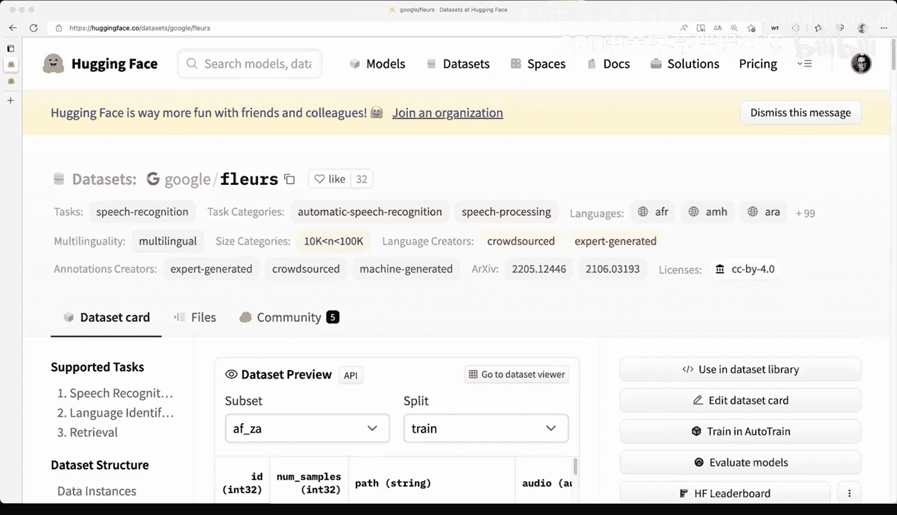

# 杜克大学《大型语言模型实践（开源大语言模型方案）｜Large Language Model Operations 》 - P4：04_01_04_Hugging Face简介.zh_en - GPT中英字幕课程资源 - BV1Cs421N7fp

Let's do a quick overview of the Huging phasese hub now the Huging phase hub means that you will be interacting with reppostittories。

 models， datas， spaces and even perhaps organizations and endpoints depending on what you're trying to do so I have the main for my account。

 the main hugging face space so if I go ahead and go towards the new button over here。

 you'll see that you have three main options。if I go to model well， that's effectively a repository。

 I'm gonna to click here and you'll see that I get prompted to create a new model。

 So you in here you can actually fill out the names and have a couple options if you've worked before with GiHub。

 this will fill very， very familiar it's similar similar interaction and you can do the same thing here with the huggingface Ci。

 So you'll have to specify who's the owner in this case I'm the only owner I'm not part of any organization and I'll put the model name for example。

 sample model name and then the license I'll pick know probably like say something like MIT if it's supported。

 I think I scroll past by it， I can say MIT and if it's public or private So once that's available that is uploaded I can consume these from anywhere either with the libraries from Huging。

And or directly from this page， but there's more to the Hub done these and I'll continue exploring some of the other things the data it's the same same interface and again you can do this with the command line tool as well where you can put information here as to what the data is now datas similarly will allow you to have those files hosted in and all of these by the way are GiHub repositories so both the data。

 the model they're all GiH GiHub GiHub Git repositories where you can interact with and have pull requests and changes and even clone the repositories locally so that you can have some interaction you'll have to have Git LFS and actually this is covered in the documentation if I go back here you can see here that the clone your model or data locally。

You will require LFS so I think newer versions of Git。

 the command line tool will come with LFS installed。

 but if it doesn't you can see here it's Git LS installed and then that's good to and then you can clone it pretty straightforward like that and similarly going back to this this was with a data if we go back and say a space this is the one that I wanted to show you is a space allows you to have a host a hosted version of your own application using a hugging face and in this case it has options of here it tells you streamle or radio but in fact you have you have this three options you can use streamle radio or static what does this mean like if you want to demonstrate what your hosted application can do and you want to do that interactively you can use any of these options。

to do just that。 so the space will allow you to have some of those running and it make it really really interactive。

 So that's it that's kind of like a big highlevel overview。

 I didn't cover organizations but essentially that's if like you're having like a group of people or your own company and you're working with our machine learning engineers and you want to create your own or new organization then you will do that similar similar to what you would do with Github an organization when you join a company say for example。

 let's see some of these ones right here。 well these ones are not organizations。

 but you'll get Google Eastern organizations or we go let's take a look at that one and in this case Google is the organization and this is the project。

 So if I was collaborating probably here Google have to give me access to their own organization and help me。

Contribute to this and I don't want to translate this right now and that's a quick overview of what the hub is essentially a few different components that we discussed we talked a little bit about data sets。

 spaces， organizations and models and repositories。

