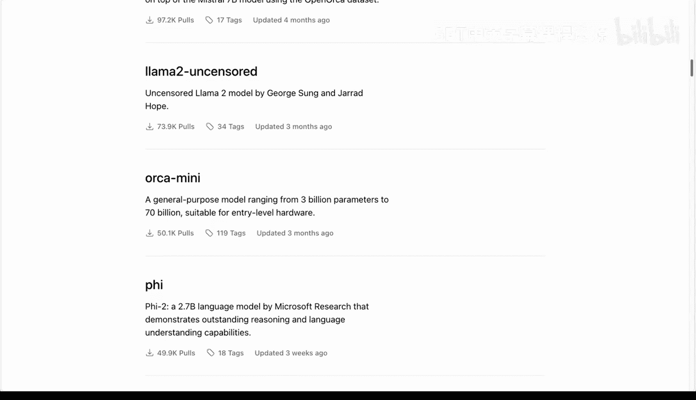

# 杜克大学《大型语言模型实践（开源大语言模型方案）｜Large Language Model Operations 》 - P5：05_01_05_开源模型的库与工具.zh_en - GPT中英字幕课程资源 - BV1Cs421N7fp

When talking about open source open source models， we need to definitely be talking about the tools that we're going to be working with and you can really do that without taking a look at the Transers' library from hugging face。

 the hugging face folks have been the hugging face folks have been producing massive amounts of tools and we be using and overviewing some of these while we are exploring some of the things that we can do so within transformers well this is definitely going to be you know a very large repository with many different things you can even see some of the translations that we have here for different languages。

 but in essence what are we talking about well we're seeing a library that it is an abstraction and we're going to go all the way down here is an abstraction。

That allows us to very easily interact with many different models， open source models， of course。

 and load them in a way that is dynamic， but I'm going to instead of showing you a specific example which I'm going to show you in a second I want to show you kind of like what the abstraction looks like so I'm going to scroll here all the way down and you can see some of the different types of things that it has even for audio and images。

 all kinds of different things， but I'm going to scroll down all the way to the bottom and in here I'm going to show you a pipeline。

 this API that I'm going to show you right here， this example is kind of like what makes me excited about transformers the library。

 So in four or five lines of Python you can actually interact with a model and in this case we're talking about these specific model。

 So now you might be saying。Well where is this coming from that's Google dashboard birdbase and case like where is this what is this from pretrained Well this is a dynamic loading this model Google dashboard is the organization on hugging phase and the bird based uncased is a model that exists in the hugging phase platform and in here it means that this will be using pytorrch and you can see here that it has support for Tensorflowlow and this looks these two these both examples are using birdb and case but one is using Tensorflow and the other one is using pytorrch which are libraries to interact with these models but you see how similar they are this is the power of using something like transformers for loading models in a way that in a dynamic way because you don't have to have these models pre download it and。

Access somehowhow so it's democratizing the access to these models that are available for you in the Hugingface platform。

 So now let me show you something different， something that I've built before which is building an actual application and I'm going show you the web application and I'm going go into the details of the web application itself but you can see here that I'm going to use I'm going to use these pipeline from transformers and do you see these generator and this is using the GP2 model and beyond the bits and pieces of the API you can see just 23 lines of Python。

The generated end point receives an input and then it is generating a maximum number of sequences1。

 a maximum length of 35 characters and is generating text from the GPT to model which is this one right here so you can see here I'm generating text just with just with a few lines of Python so that's the magic behind some of these tools that allows you to do very powerful stuff when you're working with models so now I'm going to show you transformers again。

 but in this case the JavaScript version and in the ja version well it allows you to run machine learning models on the web and that is also a very powerful thing to do and when I really like about this is that and I'm going to show you how it looks with the Python version。

This is the Python version right here， but the JavaScript version looks very， very， very similar。

 so you get that same dynamic loading of models you can see here you're doing a sentiment analysis and it's giving you sentiment analysis based on a phrase right here and it tells you well this is positive and what's the score for that。

So JavaScript allows you to the actual transformer that is the ja library allows you to put this into the browser and drag with that next I want to show you another project by hack face but this one in this case is called candle and candle is a rustbased project and candle will allow you to interact with large language models like whisperhi Lama 2 T5 I mean there's really potentially almost anything that you can but it's very easy to get started and the very interesting way here that this implementation has is because it rust you can end up with a single executable that you can drop anywhere and if you have support for GPUs you will be able to drop these and the resulting binary once you build these and make it work seamlessly and the example。

are well plentiful and you can see there's support for a lot of different things there Next I want to show you rust BRT。

 which is the ability to interact with B based models and it's a port of hugging faces。

 transformers library as you can see here and you can use either Pytorch or the onx runtime and the loading of the loading of models will also happen in happen dynamically just like in transformers and this is also very interesting and we'll see that in a little bit more detail later but you can see here that you have all kinds of different tasks like translation summarization sentiment analysis。

 language generation so you have definitely plenty of support。And then the other ways。

 the two other ways to interact with these large language models for open source models actually is one is Lama file and Lamma file is a way that you can have to run that you can have to run an actual model with a full API and an open AI API based or actually an API that will look like the openaiI API and you will have a web interface and you have here several of these models that are available to you and similar to Lama file we have O Lama which allows you to run again large language models locally and it has supports for several several of these large language models like Mi I've run Miel before and I particularly like Phi to which is the one from Microsoft but definitely you can see there is a lot of these models that you have access to and in this case well。

My2 would be like a small large small language model， not a large language model。

 So there you go that's a quick overview of some of the tools that you have at your disposal to try to interact with some of these models。

 these open source models as they' are starting to come up and be more popular。

