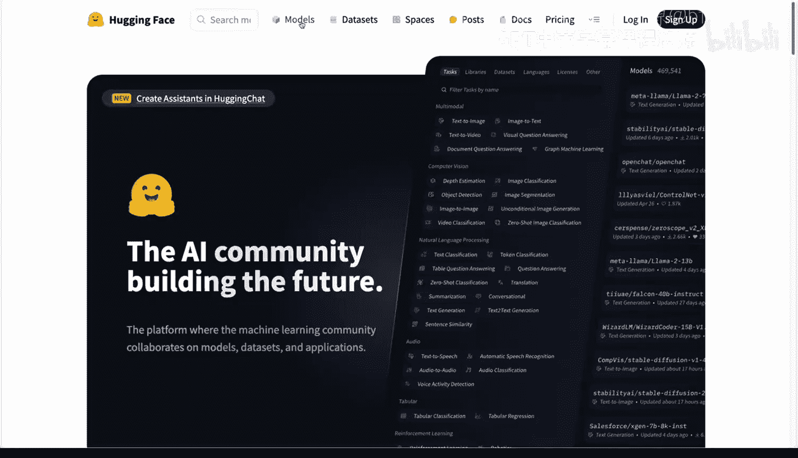
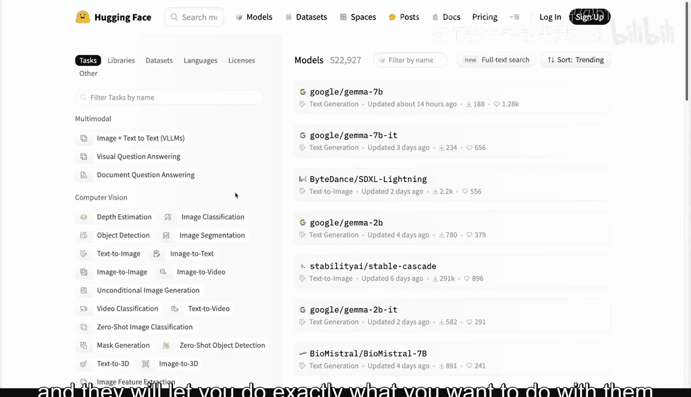

# 杜克大学《大型语言模型实践（开源大语言模型方案）｜Large Language Model Operations 》 - P6：06_01_06_Hugging Face中的大语言模型.zh_en - GPT中英字幕课程资源 - BV1Cs421N7fp

Let's do a search for large language models in the Huging phase hub and we're going to specifically try to filter through some of the different models that we have here now we've already seen a little bit on how that might be we're going to go to models and how do we get there well we're going to specifically ask for text generations so these are these are kind of like the things that capabilities of the different models can you can actually filter by these tasks。

And here you have all of the computer vision ones natural language processing is what we're going to be concentrating on for the text generation and specifically text generation you can see it is right here now you might see that there's many different ones and in the case of text generation well it's kind of difficult to find right here it's kind of buried so what you do here is you start typing text generation and you will get these fussy filtering happening in real time as you do that and text generation appears right here so I'm going to click that one and when I do the models here on the right are going to be filter out so all of these ones are models that are going to be working for large but essentially large language models that are going to allow me to do text generation all right but the next thing that I want to do is something that is。

Important， it might be important for you depending on the type of use that you want to do for some of these models and in this case I want to concentrate on licenses and the licenses specifically will allow me to ensure depending on the task that I want to proceed with will be will allow me to do that so some of these ones are not going to allow me to do anything for example proprietary or generate something that might be you know that I can generate a profit on so I can resell or I can do anything like that so in this case I would say Apache or MIT would be something that I would feel comfortable for example so I can say I'm going to click Apache。

And right away it filter out all of my options and Apache will allow me to do well almost anything that I want with some of these models。

 So that's pretty cool and allows you to further down your search for some of the things that you want to do in this case you know Miroll has is one of those so let's take a look at what Miroll is doing over a million downloads last month right there and it allows you to essentially with that license do well a lot of different things that you may want to do Now in here you can see that there's lots of folks that have been doing implementations with this model as a base have been doing other kinds of interesting things Now besides the examples and all of these things what you can what you can do here is essentially make sure that the files are correct and are kind of like the things that you will be looking at and it will give you an idea of what are the。

Ss that you're gonna have to be dealing with。 And in this case，12。1 gigytes is well it's quite a lot。

 Now I'm going go back here。 and instead of Apache。

 I'm gonna say MIT and P2 from Microsoft which is again something that I've shown before。

 I think it's pretty cool。 I think it's something I really like and specifically the files and I show you here。

 we are going to be talking about well files that are much much smaller So5 gigabytes in comparison to what we were seeing before and sometimes when you see these large language models they can be actually even smaller I think a have P2 locally like roughly around to2 to3 gigtes because it's being packaged in a different way。

 but then again this gives you a good idea on where you can find some of these open source models。

 what are the licenses that you have to look for in。How to filter。

 how to filter those models so that you can find。So you can find exactly what you want for the type of things that you're looking for when you're looking for models that are specifically open source and they will let you do exactly what you want to do with them in a way that is permissive and according to the license。

