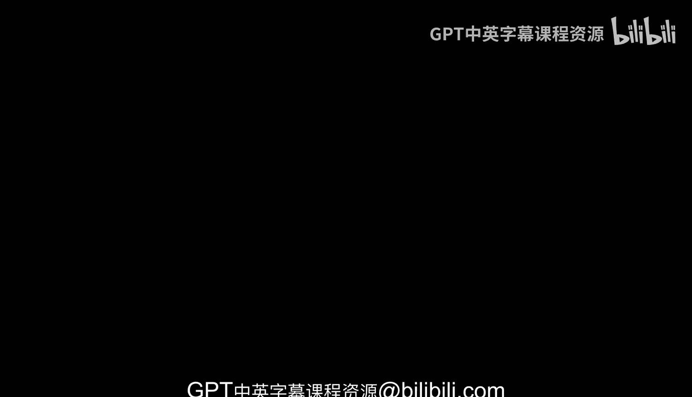
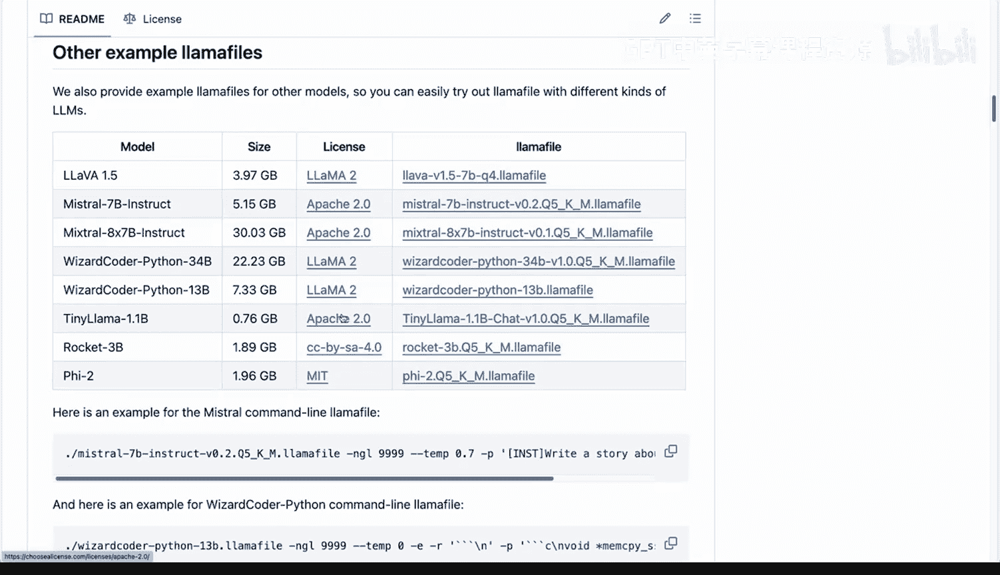

# 杜克大学《大型语言模型实践（开源大语言模型方案）｜Large Language Model Operations 》 - P7：07_01_08_什么是小语言模型.zh_en - GPT中英字幕课程资源 - BV1Cs421N7fp

Small language models are also interesting and there are several options that you have at your disposal that are going to be open source in this case again I'm referring to Phi2 which is the next generation of models by Microsoft that it is actually a small language model。

In here， well this is when it was announced in here one of the things that I want to show you is that this is the next generation because first they started with Phi1 and5 and then continue with phi 1。

5 so what are exactly we're talking about here well。

The key phrase here is this one right here where we have 51。5， which is one of the generations。

 the previous generation of the Phi model with performance comparable to models that were five times larger TC is particularly interesting because we are talking about the capabilities of a model。

To try to perform in a comparable way to models that are much， much bigger。

 the Phi2 version is going to be a 2。7 billion parameter model that it's still。

 although that sounds like a very， very large parameter account you will see that it pales in comparison to some of the other ones that are can be up to 25 times larger。

 So， you know this is。This is actually very interesting because it opens up the capabilities of the types of things that you can do when size matters and when the type of output that you want to have is not you don't need bleeding edge or state of the art and have to be something very large。

 the one thing that I want to show you here is I'm going to go。😊。

To the Lama file example where you can actually download some of these files and here it is pretty clear that what type of languages or what type of models we're talking about and where size starts mating so it matters because when you see something like tiny Lama or rocket or phi2 you can see here that you know you're talking about less than2 gigytes for these three and tiny Lamma is less than1 gigabyte and Phi2 sits on around just below2 gigy versus 30 gigabytes for the Mial。

8 by 7b and 22 gigytes for a with coder for Python so  30 gigabytes versus 2 well that's you know 10 times smaller for some of these language models and again why is this important well size might matter for the type of the type of workloads that you want to have and when you need to deploy something well deploying something like this is going to be cheaper is going to be easier to make it perform and you might again you might not need all of that big power from a large language model but you will have similar capabilities that you can take advantage of。

