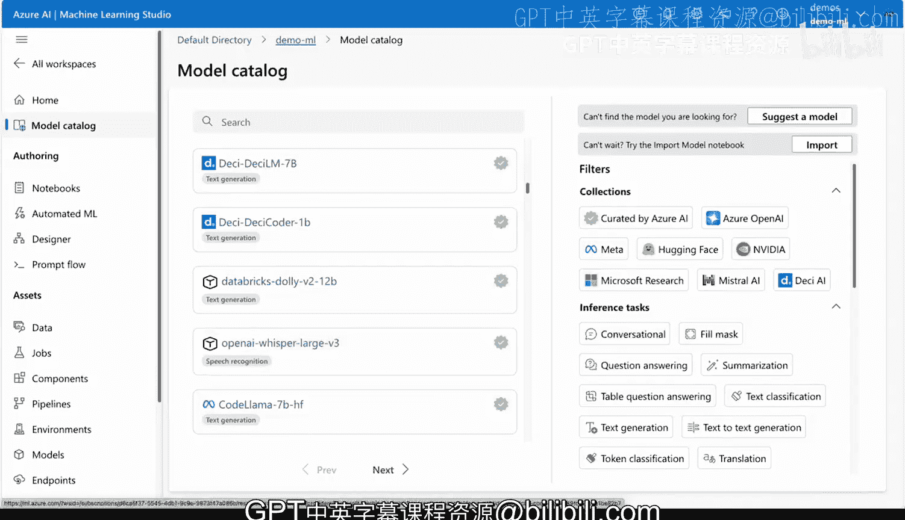

# 杜克大学《大型语言模型实践（开源大语言模型方案）｜Large Language Model Operations 》 - P8：08_01_09_Azure中的大语言模型.zh_en - GPT中英字幕课程资源 - BV1Cs421N7fp

Large language models can also be found in the cloud。

 and in this case I'm going to show you Microsoft， Azure similar experiences might be found in other service providers like Azure but in this case I'm going to concentrate in Azure specifically and I'm going going to go to Azure Ma learning which is one of default places where you can go in Azure to look at models there's also the Azure Open AI service。

 but then again you wouldn't be able to find the open source models in the Azure Open AI service So in here I have two workspaces and I'm going to open this one which is the demo Ml that I just created and I'm going to launch the studio the specifics on how these works and what exactly we're looking at is not really that relevant because what we want to do is actually take a look at the models that we're going to have access to and right off the bat you will see that。

We have generative AI models。 We have Falcon， we have Miralal large， and we have mixtureal。

A by 7b and you can see there's several that are already here that you can actually take a look so let's take a look at some of the other ones that we have available when we go to the model catalog so when we go there you can see that there's collections and these collections will allow you to kind of like filter out similar to other services when you want to specify some specific tasks like conversational or you want summarization that will filter out what you're looking at。

 so in this case， for example， if I were to look at Microsoft research I'll probably be looking at Phi or Phi2 and there you go this is some of the models that would be available to you Phi2 I particularly like because it's a small language model or is also interesting and if you go there you will be able to see not only the description which I really like but。

You're also able to deploy right away， which you can very easily click on a realtime endpoint or a batch endpoint as well as looking at the license if we take a look at a license here。

 well this hasn't been published yet but you can see that there's different versions even and it's interesting how Azure in Azure Maachine learning Studio in this case has an offering where you can take a look at the model catalog and go through some of the things that are available to you even Mi Stral large which is now available I mean things are going moving very very fast and you have the ability to go through and find all of these models particularly here with the ability to deploy with not much effort。

