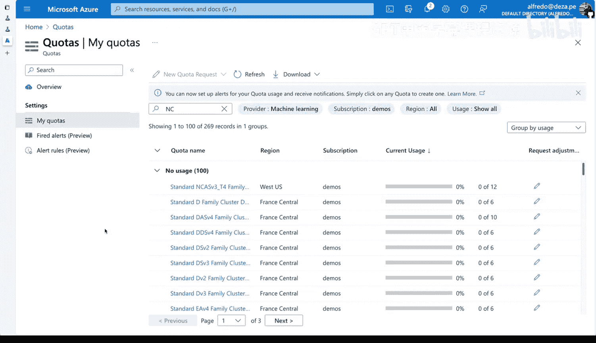

# 杜克大学《大型语言模型实践（生成式AI简介、Azure的LLMs（1、2课，共6课）｜Large Language Model Operations》 - P100：23_02_02_GPU配额与可用性.zh_en - GPT中英字幕课程资源 - BV1Ef421m7zD

Quotas and specifically GPU quotas is something that you need to keep track of when you're working with Azure in general Here I am in Azure AI machine learning Studio this is something that is particular specifically to Azure AI machine learning studio when you want to deploy certain generative AI models so let's take a quick look at some of the some of the models that we have here and let's try to go ahead and deploy one we' going to click this one which is Miralal AI 7b instruct Per1 So if I want to deploy it。

 it'll say hey， they want to a realtime endpoint Im going to click here and it's going to ask me like where where you want me and the first thing that it tells me is like you probably don't have enough quota for creating a virtual machine so what is it that you need to do in this case and what are some of the things you can do well。

Azure tends to keep changing the way how you request for more quota and actually I think there are certain issues at the time of this lesson where if you click here it will tell me that well youll have some issues and you won't be able to request more quota so how does that look well I'm going come here I'm going to look for what I want and let's say let's find something like this one the and see ADSA 104 family cluster of the dedicated CPUUs I'm going to click request quota and the current bug here or current issues that if I click submit I'm going to get an error now usually you shouldn't be getting an error this is I'm using a paid subscription and the error is that it fails to request quota right right here so your support plan plan type is free well I have a paid version so you might get something like that but there。

A other options， and depending on the region you're deploying， you might be a little bit luckier。

 so I'm going to go back to the portal。And in the portal you will see that I have quotas and I can click in here in quotas and in here you have several different options because quotas are not only for GPUs。

 but in this case we're interested in machine machine learning I'm going to click on that one and in machine learning you are going to have all kinds of different quotas so in my case I might want to be looking for specific type of GPUus so for example I know that the NCV3 series are allow will allow me to work with Nvidiaious Teslas V100。

 so I can search for less I'm going to filter that out so NC。

And you'll see that it'll start filtering。 So NCs V3 is the one that I'm looking for and you can see that the region I can detect that what region is that I have0 of 12 so perfect。

 So at least that gets me a little bit of a little bit of room to play around with GPUus if I wanted to deploy somewhere else。

 you can see that the region is crucial because that way I can actually deploy or create a resource for azure machine learning studio that maps to this region and that would allow me to have that type in there。

 Now certain things are not gonna to be possible and if I want to request an adjustment is going to not let me do this if I want to say 124 it will tell me hey you are not going be able to do this you need to actually go ahead and create that in azure Ma learning studio So if I click create Pro request youll tell me yeah no。

Going to have to go to ash machinechine learning studio which we were before。

 but at least in this case， this is how you will be able to understand where the quota is availability of the quotas in what not only what subscription but also what regions so with this in place you will be able to understand and be able to deploy resources and compute instances that will help you when you're working with generative AI models。

