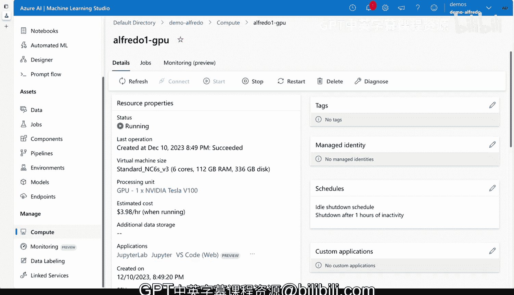

# 杜克大学《大型语言模型实践（生成式AI简介、Azure的LLMs（1、2课，共6课）｜Large Language Model Operations》 - P101：24_02_03_创建计算资源.zh_en - GPT中英字幕课程资源 - BV1Ef421m7zD

Back in A A machinech learning studio let me create an actual an actual compute instance I'm going scroll way down to manage and then click on compute right here so I'm going to click there and I'm going to get here to compute instances I want to specifically get a compute instance running so I'm going to go ahead and click create new in here you can name this compute instance I can usually try to do something like GPU or something that helps me identify what is it that I'm creating and then I'm going to say yes。

 the type of machine is going to be GPU as soon as I do this this list gets filter out and you can see that I have access with if I want to select from all other options you will see that there are other options that I have available including some others that might be slightly cheaper the Tesla B 100 seems okay to me right now there are others that well。

I don't have quota。 we've already seen quota issues before。

 but I'm going to go ahead and select the standard and6 v3。

 So let's go ahead and review and create and here you will get some options after  60 minutes of inactivity you will auto shutdown which is really neat and you can actually change that if you want to enable assessation and log into the machine you of course can do that as well So great this is this looks pretty good and I'm gonna go ahead and click create oh and before that。

 let's take a look at the virtual machine details6 course112 gigys of Ram and 336 gigytes of storage which is pretty nice and like a good I would say entryle GPu that will be good enough for for a few interactions when I'm trying to deploy some of some of these large language models so I've clicked on create。

And that's all that it will take it will take just like a few minutes to create just like any regular birch machine living in the cloud and then once it's finished。

 we can actually use these compute instance to do an actual deployment for a large language model so let's wait a second until finishes creating and then we can poke around the actual machine Co so the birch machine is finished it is actually running and I can have like some applications here that I can run on that one I don't want that right now I'm gonna to click on this one and take a look at a little bit of the management。

 some of the things that I can actually do here well I can detect what jobs are running here there's nothing right now attached to it because this is a compute instance inside an a machine learning studio the tasks and the things that are here for。

machine will be specific to machine learning tasks so I have certain things I can of course apply tags I'm not interested in looking at that right now but I can go ahead and deleted right there I can restarted stop well it's already started so that won' one count right now so let's take a quick quick look this will cost me about $4 an hour when it's running which is fine and you can see here that I have an IP address。

 these are all internal and it is attached to a specific subscription perfect so there we go that is how you get a compute instance and you select a specific type in this case I want to use the Tesla V100s and that's what I chose and this is already good to go for some action and getting some large language models actually deployed。

