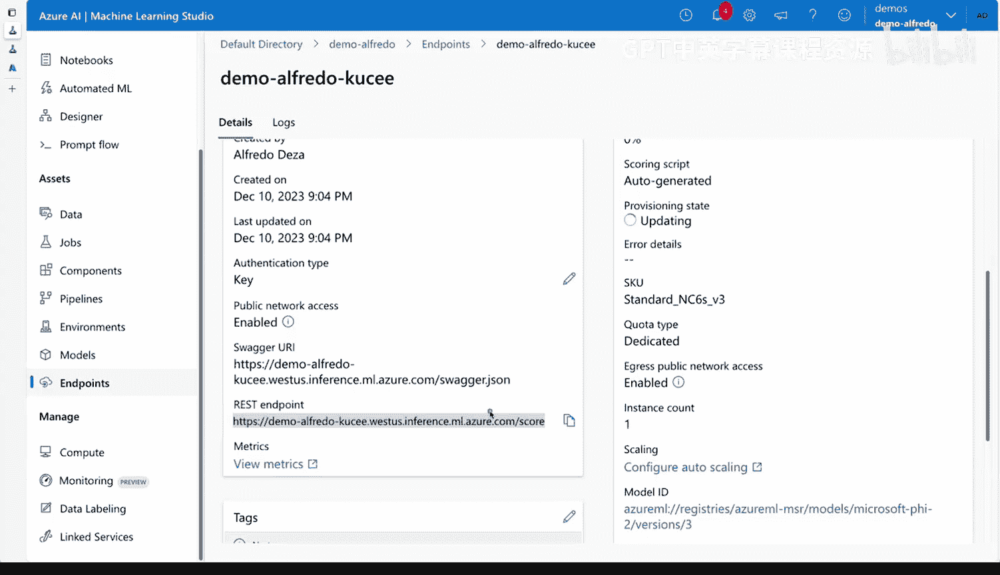

# 杜克大学《大型语言模型实践（生成式AI简介、Azure的LLMs（1、2课，共6课）｜Large Language Model Operations》 - P102：25_02_05_部署模型.zh_en - GPT中英字幕课程资源 - BV1Ef421m7zD

Within Azure machine learning studio in the model catalog which we've seen before there is the capacity。

 the ability of deploy deploying models straight from there aside from the computing the compute instance the compute resource that we deploy before which allows me to do many different tasks I am able to deploy these in a different way instead of like creating the compute resource and then deploying something custom on it。

 I can actually select from here and create the compute instance Microsoft has one model that I want to use so I'm going to filter by a collection on Microsoft research I'm going to click here and Phi2 seems to be like the one that I want。

 I'm going I click on this one and when I click deploy I'm going to select the real time endpoint and I'm going to have that quota enough to be able to deploy this is going to use the NC6 version 3 in6 course perfect and I'm going to select a new。

point that means that I don't have an existing one。

 but I could definitely attach now to existing one。

 The endpoint name it has to be something that is unique。

 and you will see here that this will be the ending of or the endpoint I'm going to be using the resulting endpoint I'm going to have to use to consume that。

 So perfect that's going to be the deployment name inferencing data collection I don't want to collect any data and package model I don't want to do it right now so'm when to click deploy and is going to take a quick second now I will be able to I'll have to wait until that completes and then once that's done we will be able to verify that it is working and be able to try to consume it at the endpoint Allright so we see that the deployment succeeded and you can see here that it is already live and we have a couple of things。

 the deployment was good to go live traffic allocation is continuously update。

It's zero right now because there's nothing allocated I haven't been doing any requests。

 authentication type is key， I can actually change that to if I want to like using a token based authentication and I'm not going to do it right now but you can see that this is good to go the swagger URL like if I want to actually look at the documentation is already there and I can actually pull that in and browse the documentation and the rest endpoint which is how I can interact with that will be right here so that is how you deploy an endpoint and we'll see how to consume from the endpoint next。

