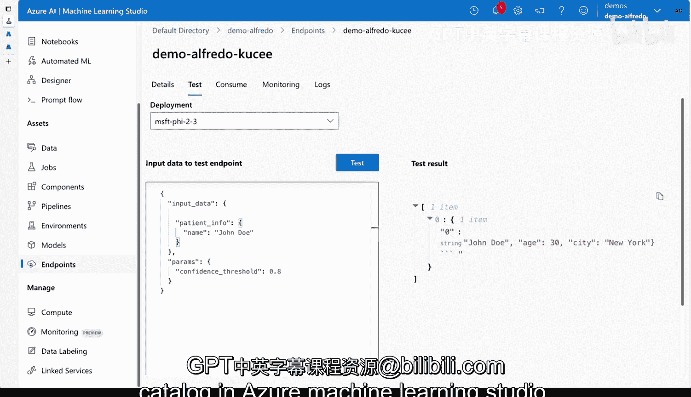

# 杜克大学《大型语言模型实践（生成式AI简介、Azure的LLMs（1、2课，共6课）｜Large Language Model Operations》 - P103：26_02_06_使用推理API.zh_en - GPT中英字幕课程资源 - BV1Ef421m7zD

Back in Azure AI machinech learning studio our model has been deployed for a while。

 we get the live traffic location is green。 This is important to get that green checkmark because when that happens and the provision state says succeeded that means that we can actually test consume check the monitoring the logs I've been already playing a little bit around with these endpoints if I take a look at the logs you will see that there's been some success although there's also been some problems like some exceptions that we're seen right here。

 so monitoring is very interesting one， you will see that I'm getting making many requests two requests per minute well not that many but you will be able to take a look at what are some of the things that you have here if you want to inspect the latency and how many requests you're getting want more details you will have to take a look in Azure monitoring when I going to do that right now and we're gonna take a look at。

Testing so the deployment is this one is the only one we have available and that's what we get。

 So that is fine if you just want to have some data and then test it out and get some result if we want to consume this in another different way we can actually go and take a look here and we'll get the primary in the secondary key and the actual endpoint this is all good however。

 when you have raw information like this to in track with the API you might get into trouble because you might want to have something easier to test withLuckily we have the consumption options here and we have Python C sharp and R example。

 So let's take a look at the Python 1 and we already have here fully fleshed out script that we can actually copy and run it will have our URL you will have our ability to get the API keys actually let's take a look where are those。

Get burdos getting the API keys。 It seems to me let's take a quick look。 API key oh right。

 in online 27 you can see that this is an empty and empty string So that means that you you' will probably have to hardcode your API key which comes from the very top。

 if we go here for the primary key， you can use a primary or secondary key at no problem。 alright。

 so finally we're going go and try to test it out。 So this is not enough。

 if we try to test it like this， we will get zero items because there's no input data。

 let's try to paste something that I already had here。

 perhaps is these are actually models if you want to tweak the model， I don't want to tweak anything。

 I'm gonna go and quickly test this out and we're going to get some responses back。

 The responses right now are not relevant。 This is meant to。

Give you provide you an example of how you would actually go and test test this out So you have several different things here to poke around starting when everything is already deployed and ready to go then you would go to test if you want to put some input data you would go and then consume if you want to write a script and you can have many different types of input input data depending on what you want to try to do so we could actually take out H and say name and then well it's not valid because I left a coma test it again and there we go nothing nothing actually meaningful got generated Okay so there we go that is how you would start consuming a model that you've deployed from the model catalog in a machine learning in studio。

