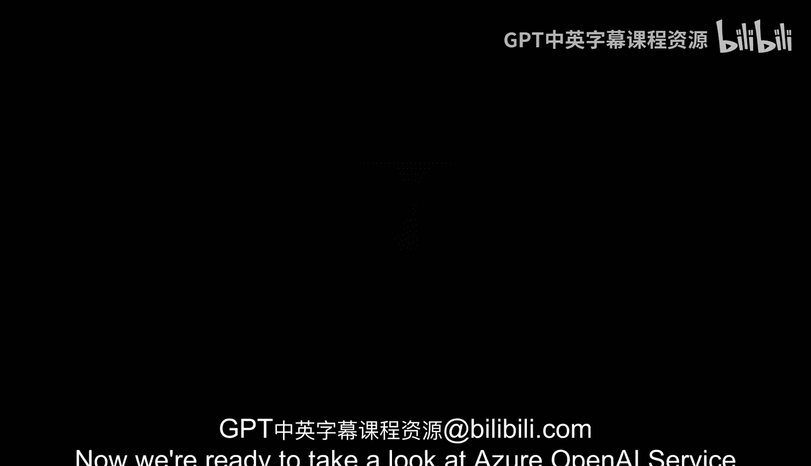

# 杜克大学《大型语言模型实践（生成式AI简介、Azure的LLMs（1、2课，共6课）｜Large Language Model Operations》 - P105：28_02_01_引言_5.zh_en - GPT中英字幕课程资源 - BV1Ef421m7zD

Now we're ready to take a look at Azure Open AI service and the specifics required to start interacting with it from getting access to the actual service through some of the most simple ways on creating Azure Open AI service resources and trying to deploy model on the playground。

 we'll see what the playground is and how to use it and how to interact with it。

 I think it's a pretty straightforward way to create your own models will not create your own models but create your own deployments of Open AI models that reside within the Azure Open AI service。

