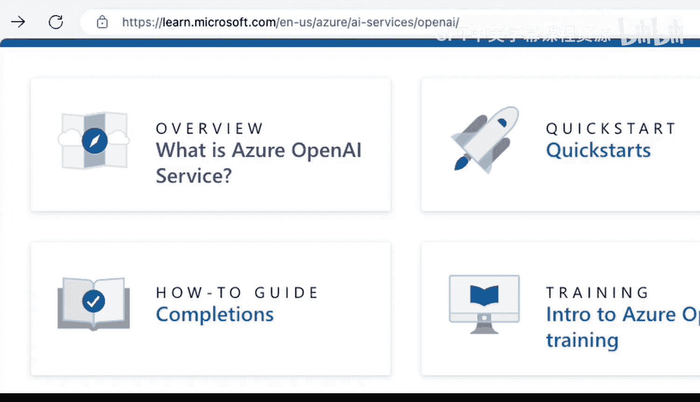

# 杜克大学《大型语言模型实践（生成式AI简介、Azure的LLMs（1、2课，共6课）｜Large Language Model Operations》 - P106：29_02_02_获取Azure OpenAI服务访问权限.zh_en - GPT中英字幕课程资源 - BV1Ef421m7zD

Let's see how we can get access to Azure Open AI service。 Now right now access is kind of restricted。

 This might change in the future， but as of this lesson， we have to go through certain steps in here。

 this is the Microsoft learn。Page we've seen before how to operate how to use Microsoft learn the documentation specifically and in this case we've landed on the Azure Open AI service documentation Now this is a great place to start not only to gain access。

 but also to go and see what is Azure Open AI service like how does it work create resources using embeddings using the open AI models like everything you need including the quickstar which I really like as well Now the thing here that I want to show you is on the additional resources section now websites can always change。

 but the most important thing is that if we are still looking for applying to access for access to Azure Open AI service。

 that link is displayed here if I click here it will take me to the actual page。

 let's wait until it loads。And perfect is this one right here now now zoom in and it will have several different steps。

 I want to show you another another method to get to this page as well。

 which is going to be a little bit easier to remember and that one is this one right here this is going to be the aka Mlash OAilash access and you can see this it's right at the very top and this one is going to be very is much easier to remember and its going to allow you to give you access to the same page as well。

 it's just like a short link rather than you can also use aka OAi slash access。 Alright。

 so once you go there and if I click load， it will get you to the request access to a open AI service。

 So all you have to do here well of course read the whole instructions and then fill out everything in here and。

Try not to use a personal address so you can see here some examples of what a personal address is so you would basically have to have like an actual account for being and requesting requesting this resource you'll have to go through steps like your personal information like your first name and last name subscription IDs and and all of the information related to the IDs。

 company address again you cannot use personal information the company name street address。

 company C， all kinds of different information that that will be used in order to provide you with the service so once you complete and I'm going to scroll very。

 very fast all the way to the bottom you will submit and then it will take a little bit to get you access that's all that is needed in order to request for access now in this case you know it's kind of like there's throttling down the signups for the service。

This is what we're getting and in this case， your best resource again。

 if you want to just make sure that the process is accurate and it hasn't changed just landing on Microsoft Learn and in going to the search and going to ash or Open AI service so that you can see what the latest is。

