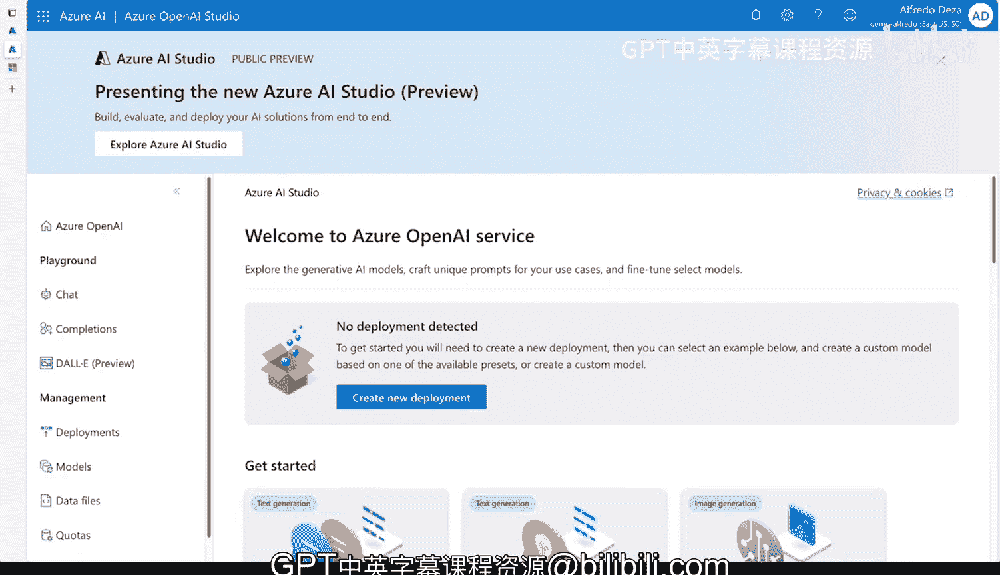

# 杜克大学《大型语言模型实践（生成式AI简介、Azure的LLMs（1、2课，共6课）｜Large Language Model Operations》 - P107：30_02_03_创建Azure OpenAI服务资源.zh_en - GPT中英字幕课程资源 - BV1Ef421m7zD

Let's create an Azure open AI service resource and we're going go here to the portal。

 the Azure portal and we're going to well you can always as always you can always search for it or in my case Ive open before Azure Open Aure I'm going to click on this one but I want to create a new one so let's see how I can do that will have to go through create right here and create will allow me to submit everything that I need so I'm going go and click that one and this form will show up Al right so subscription I have a few I'm going use my demo subscription I usually like to create a good resource group for demo open AI Aredo so that will allow me to ensure that things are properly contained and I understand how easy is it is going to be later when I want to remove everything IUS is fine。

Name has to be unique。 So if I say demo， for example， it's probably not gonna work。 There we you go。

 because the the reason is because there is a sub domainomain。 So the subdomain name is already used。

 please pick a different name。 So why is that， Because like its it requires behind the scenes is going to be using domains。

 and the domains are going to be part of the API。 So it has to be something that might be meaningful and unique enough。

 So I'm gonna to say demo Alredo usually works。Hopefully there's no one with them Alfredo and there we go demolfredo works the pricing tier I'm going to have the standard one and I'm going to well you can actually take a look at the view full pricing details we're not going go into details of that right now but you'll have here this will probably get updated continuously when you want to explore kind of like what you're trying to do there with the API so I'm going to say next。

The network， all networks， including the internet can access these resource。

 you can log this down in several different ways with these different types that you have right there I'm going to allow any network including the internet to access that resource I'm going to click next I'm not going to add any special texts。

 but you can definitely add some texts if you choose to。

And it is going through going to go through some validation process behind the scenes and finally I'm able to go ahead and create it So it's going to initialize the deployment and this is going to be almost almost instance and because the deployment is it's going to be very fast for theAsh or open AI service it is up pretty quickly but let's wait until you complete and then we'll come back Alright。

 so deployment succeeded so I'm going to go to the resource I can either click here I'm going to close it or I click on go to resource I'm going to click here。

😊，And demo Alfredo is ready to go。 I want to note one thing here that is crucial for everything that we're going be doing with Azure Open AI service one is that you definitely have you can develop you can have you have tons of resources here that are all very useful including the exploring and deploy but。

When when you're ready to consume those endpoints， you will have to use some keys now you can manage your endpoints and manage manage your keys right here however where the place you need to go is right here keys and endpoint this is crucial because if you're not if you're not careful you're going to be well it took me a second to understand that the keys were not in Azure AI Studio or Azure Open AI Studio they were not there they are right here。

 so if I click on keys and endpoint my keys will be there the region remember we looked at at the endpoint now outside this is the endpoint demo A Allfredo openaiI that Azurecom so something to keep in mind and this is going to be very useful when you start consuming your services I'm going to go to overview review and finally going to go Azure Open AI Studio。

Please note that this is going to eventually change and is sometimes referred to Azure AI Studio。

 not Azure OpenI Studio， but regardless this is where we want to be。

 we're going to launch launch that resource and wait until it loads and this is going to allow me to play with the Azure Open AI service I'm to be able to take a look at quota as an interact with the models。

 but that is essentially how you create an instance a resource of Azure Open AI Studio。

