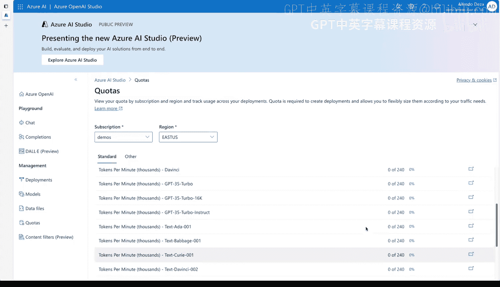
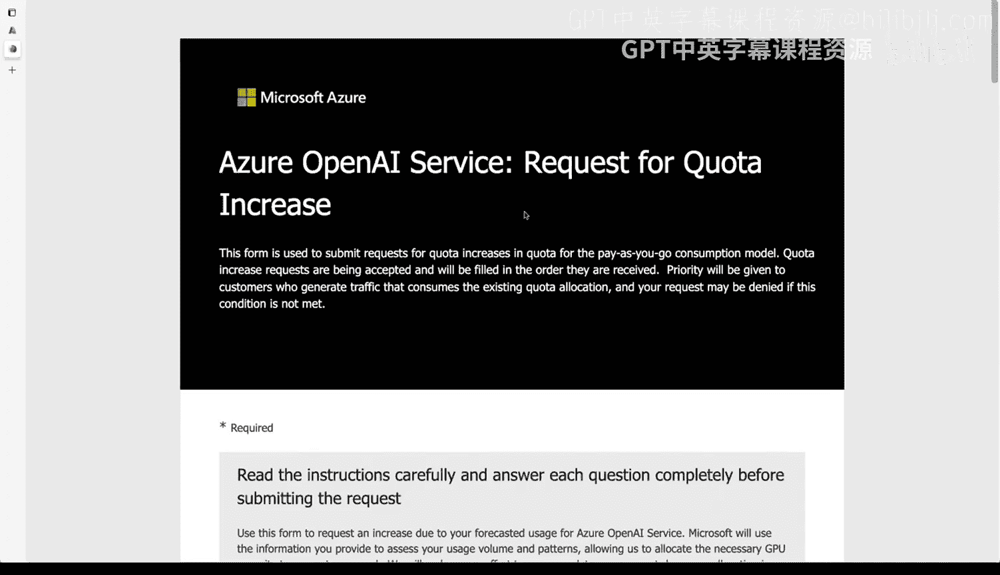
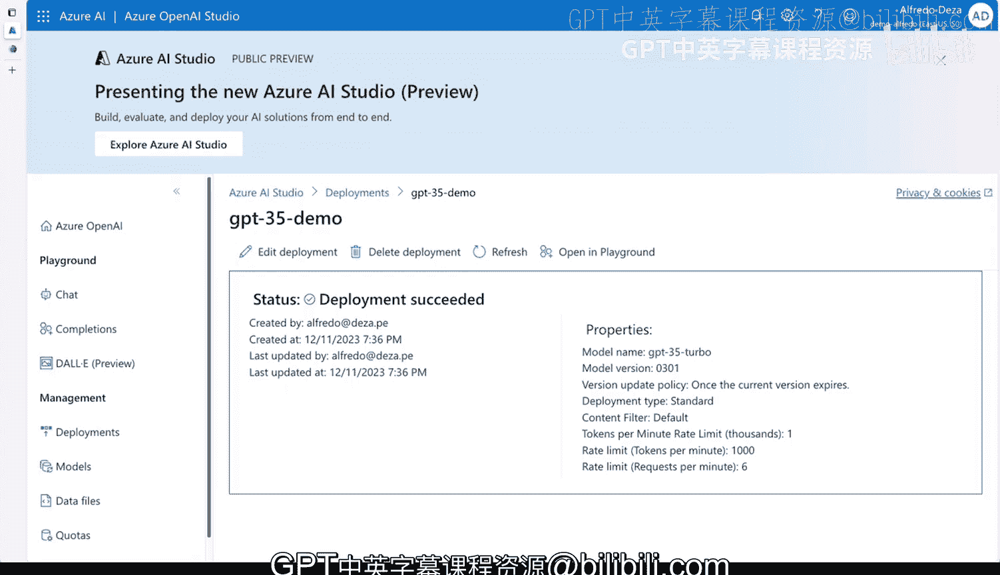

# 杜克大学《大型语言模型实践（生成式AI简介、Azure的LLMs（1、2课，共6课）｜Large Language Model Operations》 - P108：31_02_04_部署OpenAI模型.zh_en - GPT中英字幕课程资源 - BV1Ef421m7zD

We're ready to start playing with our models and the open AI models and deploy them before we get started。

 I want to show you here in quota and we are in the Azure AI studio you saw how that changed names before it was Azure Open AI Studio actually。

Here is Saur Open Studio and here is Saur A Studio so depending on timing your your view might be slightly different but what I want to show you before we start launching things is a quick look at quotas and what we're going to see in quotas is that quotas are going to be treated differently and we'll see once these loads and in here in quotas instead of instead of having your the quotas set by the service you are going to set your own limits so you can see here that the limits are very different this is scrolling is kind of tricky I'm going to zoom out a little bit and you'll see here that you have like 240 total tokens per minute this is how in the thousands by the way。

 so you have the models and everything in tokens per minutes by the thousands and you have0 200。

40 and you have a percentage so if you want to change anything you will be able to set a request for quota increase process we're not going to go through that but it's useful to understand thats that's a thing all right we're going to go to models when I click here and then we are going to take a look at GPT35 turbo when I click on that one and we're going to deploy it。

 let's see how this looks I click on deploy。

And he is going to ask me to select the model model version in this case I want I have a couple of options。

 I'm going to use this one and I'm going to call this deployment GPT 35 demo let's very quickly look at the advanced options we've seen these very quickly before that 240。

000 tokens per minute quota available for my deployment looks great。

And you can see here that I can change that all the way from 240。

000 and but reduce it to just 1000 so that's really neat and this dynamic quota allows me to take advantage of capac there's more capacity then that's great but I won't get charged unless I use it so that's pretty good pretty neat I'm going to leave that enabled and I'm going to click create and you can see how fast that got created successfully created deployment GT35 demo so very very fast because it is an API。

Alright， so that has been deployed， where do we go What do we do here Well we're going to go to deployments and in deployments we're going to click that and that is going to be our deployment is succeeded is good to go and we'll have some corresponding information for the model that we have we can edit the deployment create a new one deleted make sure that certain information is appearing let's take a quick look at GPT35 demo which we just deployed and let's see what happens in here we'll get additional information。

 what's the rate limit， what are some of the tokens and some of the things that we have here and interesting enough we can open it in the playground or go directly to chat for example and use that demo so we can click here and open in playground。

And start using the playground for that and we can start interacting with that model。

 we're not going to do that right now， but this is how you would go ahead and do it let's very quickly click on Exp Azure AI Studio and make that load so this is the new Azure AI Studio that has that is still on preview mode and it has everything you need including browsing the model catalog and try in Azure Open AI so definitely have other options here as well if I go to try Azure OpenI Azure Open AI you'll see that the catalog is right here as well so back to where we were with GPT35 demo our model has been deployed and that's all you need need to know for now we will be interacting with these later once we start dealing with the APIs。

