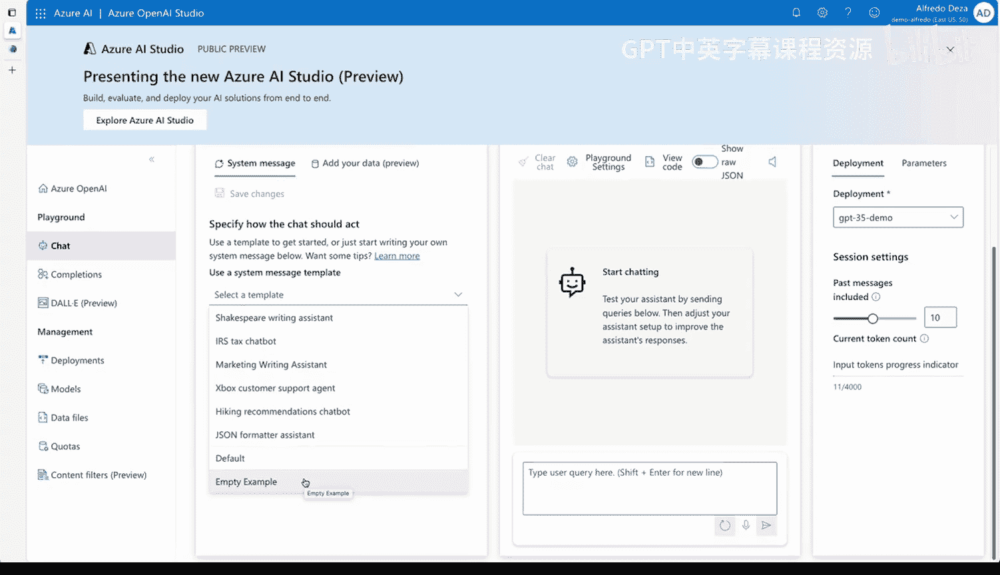
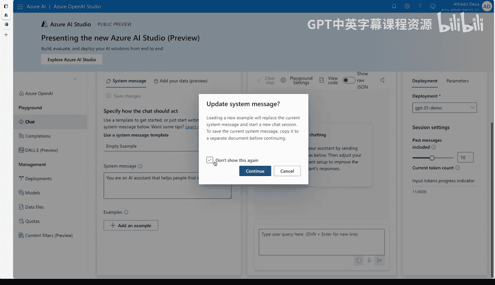
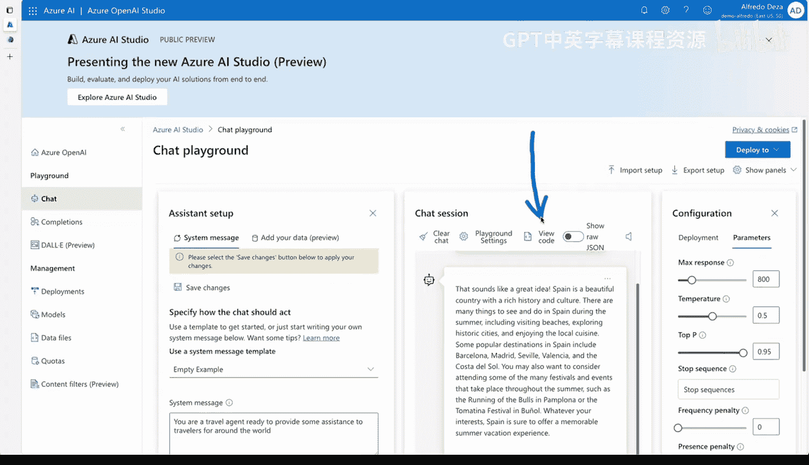
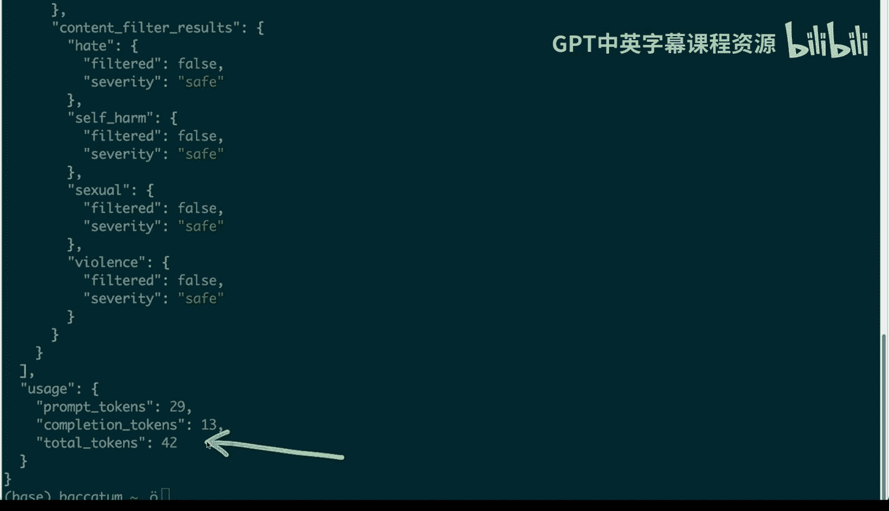
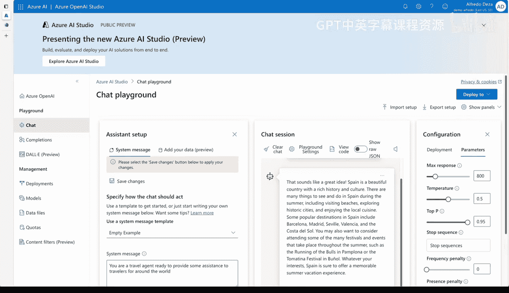

# 杜克大学《大型语言模型实践（生成式AI简介、Azure的LLMs（1、2课，共6课）｜Large Language Model Operations》 - P109：32_02_05_使用Playground.zh_en - GPT中英字幕课程资源 - BV1Ef421m7zD

So now let's see how we can consume。 We can actually use this model that we've deployed。

 So let's go to our we are in national open AI the service and we're going look at our deployments our G35 demos there。

 we're going to open it in the playground and within the playground we definitely have we have the ability to interact with it。

 So we are going to say these are some some of the templates that you can you can you can use。

 I am going to。

Make it an empty example。 Yes， that looks fine with me。

And we going we're going to say you are a travel agent ready to provide some assistance to travelers for around the world and that's going to be fine and then we're going to say a query I' we're not going to sp my the input we're going to actually type it in and we're going to say I want to travel to Spain in the summer。

Let's see what we can get and we're we're gonna hit that and we're going get that sounds like a great idea。

 Spain is a beautiful country with a rich history and culture of course and that is great we're able to interact track we're able to play around with that and that is very nice we have the deployment here if we had many different models we would be able to do other things right here now parameters are maximum response the temperature I mean you can you can really start tweaking things around here now the interesting thing is that you can view the code and try to make some make some changes and you can see here that you have to start with in Python and you can see the message text was I want to travel to Spain in the summer and the assistant was able to provide some things here but if we wanted to do a curl request for example。

It will look like this I actually went ahead now note that this will require your API key。

 remember we had that API key from before you can also get it from right here So if we copy that and the endpoint is right here if we copy those you will be able to use curl on the command line and I'm going to open my terminal as well and show you how I play it around with that as well All right so this is my terminal and I know there's a lot of things here so let's go bit by bit first that's my curl request this right here is the whole endpoint it actually ends right there I'm going to set the heaters。

 this is an application Jason I've exported my azure openaiI key I pasted it there and I'm using a variable there this dashD means I'm going to pass some data and the message is hey you' you're an AI assistant that helps。

People find information perfect and I added a role user content。

 tell me I joke Max tokens 100 temperature and all the defaults and I'm piping to JQ to get nice Json back you don't need to have either JQ or curl or anything but I wanted to show you these in case you were interested to see some other options beyond playground as I show you just a few seconds ago so I'm going to scroll I did that request and then got this as a response so I get this Json back tells me the model and it tells me a couple of different things first if its if there's hate selfharm。

 sexual or violence and it tells me that everything is safe this allows you to set your own your own parameters if you're creating an application and you want to fine tune a little bit of that All right choices we get a lot of things here produced。

By the model and we get the message by the assistant and the joke is why don't scientists trust atoms because they make everything Well so and so it's actually just a very average joke but funny because it's average and we get a little bit of also the content filter results if it's safe or not so it told me that I used 29 tokens tokens for the prompt 13 for the completion and total tokens 42 pretty neat and I would say that it is a really nice way on how to interact with deployed model so right away very easy。

 very fast you can either play play around with the chat playground if you want to use the UI and again these UI might look different when you're consuming it or you can just deploy it or actually consume the API right away using those APIs API keys and endpoint that I just show you。

Uing either the terminal or the examples with code in Python。

