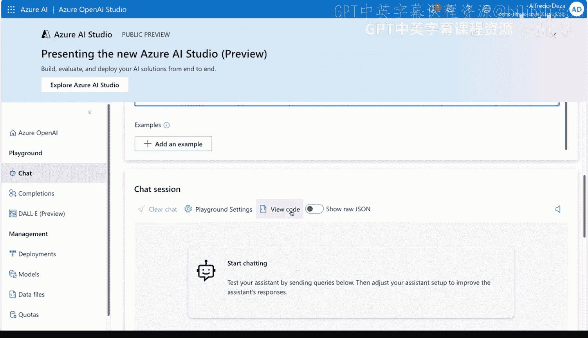
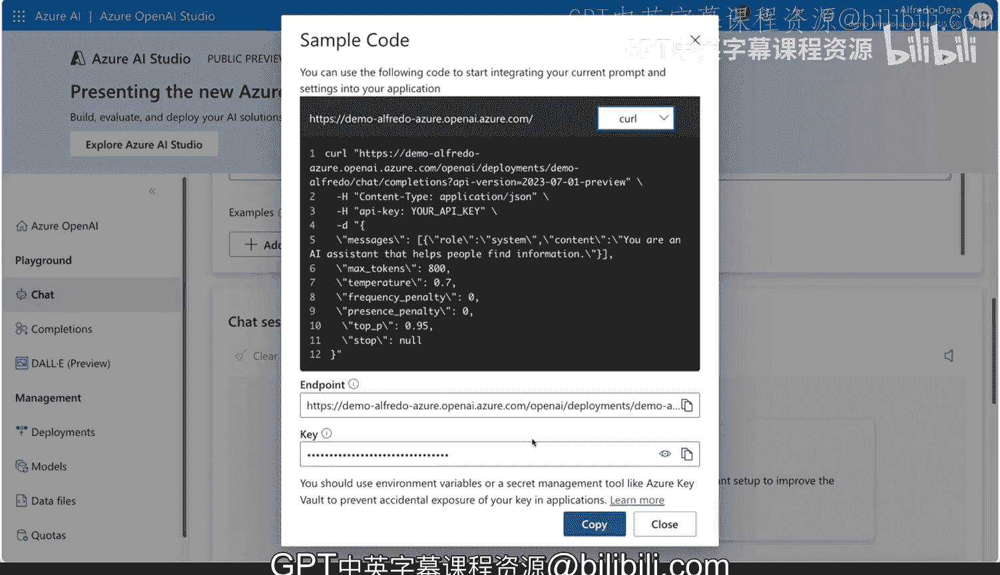

# 杜克大学《大型语言模型实践（生成式AI简介、Azure的LLMs（1、2课，共6课）｜Large Language Model Operations》 - P112：35_02_02_使用密钥与端点.zh_en - GPT中英字幕课程资源 - BV1Ef421m7zD

There are a few things to keep in mind when you're using endpoints and API keys with Azure for open the Azure Open AI service the first one which I've mentioned previously is if you come here and lets someone pick this one that I've already created I mentioned that you're going to find keys right here so when you are looking at the resource management and you want to take a look at keys and endpoint and actually look at model deployments you can definitely find those right here now you will get the endpoint that is that is fine and with these you will also get the location in region and a couple of keys key management or keys management of your keys will allow you to actually like if you want to say for example regenerate ones or copy not copy to the clear。

because that's not really management， but if you want to regenerate the keys。

 you will be able to do so here， so say for example， if you've accidentally exposed the keys。

 like say for example if I was worried about showing this in a demo and I want to make sure these are regenerated。

 well those would happen are right here。Now you can also take a look at model deployments。

 I'm not going to manage them right here， but keys and endpoints right here。 There is one caveat。

 the endpoint works here， but do you see that this is this is kind of generic Its not as specific to the models that I have deployed Well in my case I have deployed models and they're not showing here this will show in certain situations So let's take a look at what those situations are I'm going to go to the Azure studio and I'm going to go to the models in the models I have several ones that I have already deployed but what about several models that are available rather。

 So what about my deployments， I'm going to go to deployments and you can see here I have a couple that I've deployed。

 So let's take a look at demo dash Alfredo that deployment that I've named like that。

 So this is good。 It's fine it's talking about G 35 Trvo。

And that is good for what we're trying to do here and now let me go to actually go to the playground I'm going to click Open playground I could actually go to playground in chat and then select that and I want to open this one right away and what I want to show you I'm going to scroll here all the way to the top and here what I want to show you is not to the top of here there we go so in the chat session I want to show you view code so if I click on this one on view code。

When you want to use something like say for example Python you will be able to use the Azure。

 not the Azure but the openaiI library so you'll get these things that you need to define these variables in this case this code sample requires a specific version that's fine but I want you to take a look at the openaiI API base that we have here so in this case Https column Dev s demo dashlfredo Azure that openaiI that Azure co that is what we saw before and that is not specific right so how does openaiI no how does Azure know what specific model we're referring to now for something like Python you need the API base is this generic one which is fine but for other situations you will need the specific one and I know this。

Be confusing， but the thing is that you see right here this engine that says demo D Alfredo。

 well that refers to the actual model that we deployed and we named it demo D Alfredo So if I named this something different it would be different。

Here what's confusing is that you also get an endpoint and you also get the key。

 you only get a single key If you want to use one of the other keys。

 you can go back to the previous dashboard for the Open AI service。

 but do you see how the endpoint is actually specific that is because you can actually use this endpoint when you're talking to the API in something that is not using the open AI library So if we go here to curl and the command line you will see that this is actually using the whole API that is specific so this is the actual endpoint using Https behind the scenes。

 the open AI library for Python constructs that for you you can see here the preview1 and then demo dash Alfredo happens right here So those are things that you need to keep in mind keys and different types of endpoints depending on how you're going to interact with。

API。