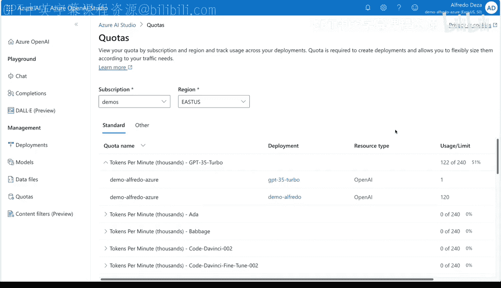

# 杜克大学《大型语言模型实践（生成式AI简介、Azure的LLMs（1、2课，共6课）｜Large Language Model Operations》 - P114：37_02_04_审查用量与配额.zh_en - GPT中英字幕课程资源 - BV1Ef421m7zD

So now that we've interacted a little bit with the Azure OpenaiI service and we've deployed a model and we've consumed that model。

 I'm going to go and take a look at quotas quotas is right here under management so I'm going to click there and try to load so that's going to load and its going to show me exactly what I have been using with my deployment so let's wait until it loads alright so that finished loading and what we have here is the tokens per minute and thousands for GP35 Tber remember that's the one that I've actually deployed。

And in this case， I have a usage limit of 122 out of。

Let's see 122 out of 240 so I'm used my 551% in in that short interaction that we had so that's how you would start looking at that quota and you can see here that I have several different others because there's definitely a lot of ammal I can deploy so I'm going to scroll here the way to the top and let's see what are some of the things that I'm going to get so I have by deployments separated and I have like usage limit I have one here and I have 120 right here and that is adding to my total for these model right here you can have many different deployments for the same model in this case theseGPT35 turbo and I can have in this case two deployments for that model now remember you're going get charged by the usage and not necessarily by the compute so this is something that。

I very neat because it allows you to deploy and just worry about the consumption of the API and not necessarily about the compute so there's a lot of flexibility and this definitely allows you to keep track close eye and what is it that you're using and set some restrictions。

