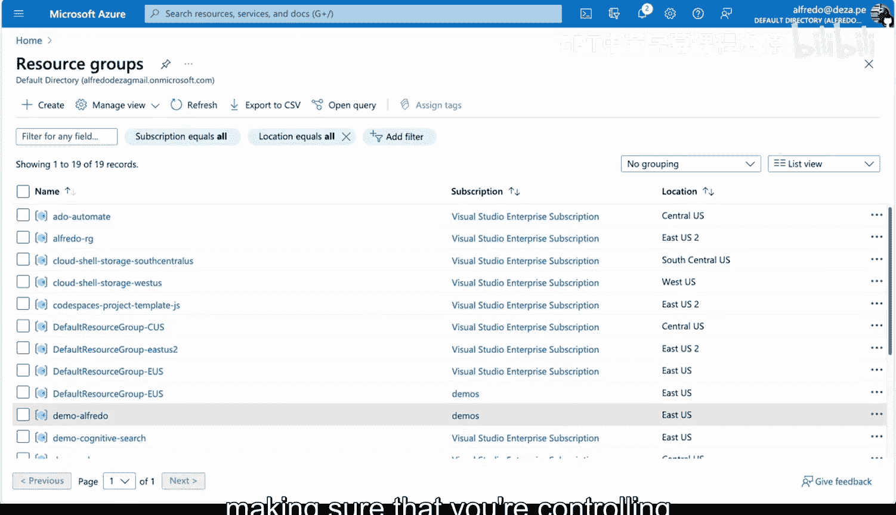

# 杜克大学《大型语言模型实践（生成式AI简介、Azure的LLMs（1、2课，共6课）｜Large Language Model Operations》 - P115：38_02_05_清理资源.zh_en - GPT中英字幕课程资源 - BV1Ef421m7zD

So we've tried out Azure Open A service， we've deployed some models。

 we've consumed the API and we've consumed some tokens in while we were trying to do something like that。

 so we've used the keys and the endpoint like we've I've show you before but now it's time to clean everything up so you can definitely go and delete these but what if you've added all other resources to this well the most important aspect of Azure that you need to learn is to use resource groups resource groups are your best friend at the time of the leading resources within Azure a resource group is a grouping。

Of of resources。That will go together for a single purpose in this case。

 I usually name all of my demos I prefix them with demo so I know I can actually look for that and destroy them at one so what makes it nice about these is that at the time of deletion I don't need to go look at 20 different services and I'll show you here the services that I have I don't need to look at all of these things and delete them one by one I can just actually go and look at the resource groups so I'm going to go right here to resource groups I can click on that one and you will see here that I have my different subscriptions that will be listed right there and I have a few that are on my demos one including this demo Alfredo so I'm gonna to click here so that can you can see what is it that I have in this case I only have demo Alfredo Aure but if I were to go back and。

fin something else so say for example， let's see let's pick this area automate hasab。

 I think it has a couple different things。 Look at that。

 look at the amount of different services that I have So if I wanted to make sure that I delete all of these components。

Instead of like finding each component rich resource that I want to delete。

 I just group them in this case is ADO automate and then that would go away but that's not what I want to delete I want to delete everything that is this demo for open AI so I'm going to click the lead resource group so the whole group is going to go away including my Azure Open AI service one so I'm going to click the delete resource group I'm going to copy this to the clipboard I'm going to tie that name right here to confirm the deletion so beware because you can go back once you delete this it will delete every single resource I'm I click delete and there we go I'm going to click delete and this is going to take a second because remember I had a couple of deployments and this is going to remove every single thing that I had for demo Alfredo Azure thing so because this is already going I've already clicked on it and this is probably going to tell me that this is resource is not found。

So that's what happens。 Things are going to start disappearing because this demo Alfredo is going away。

 Now， this is going to take a second to fully disappear。

 You can see here this is still kind of like loading right there。

 and that will that will keep loading and loading until it's fully destroyed and fully removed。

 once it's removed， no resources are going to be left behind and your consumption is going to stop。

 So that is my recommendation for destroying resources and making sure that you're controlling the things that you're expanding on specifically in a cloud service like Azure Open AI service。

