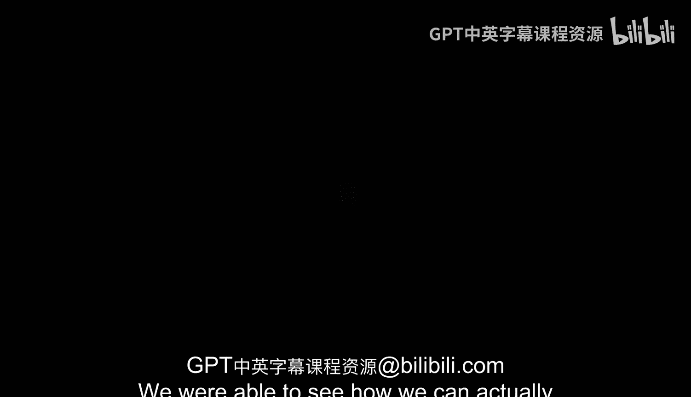

# 杜克大学《大型语言模型实践（生成式AI简介、Azure的LLMs（1、2课，共6课）｜Large Language Model Operations》 - P116：39_02_06_总结_3.zh_en - GPT中英字幕课程资源 - BV1Ef421m7zD

We were able to see how we can actually interact with the Azure OpenaiI service and its APIs。

 specifically the HtTP APIs， we looked at the endpoints and how those look like and we saw a little bit of the examples that we can find on the Azure Open AI service studio that allows us to see exactly how can we actually interact with one of these models once it's deployed and we create a very simple Python example to interact with it and finally the reviewing of usage and good as and clean up resources。

 it is crucial to understand how those work， how we can actually clean those resources so that once you're done。

 you can actually destroy them and avoid getting build by resources that you're no longer using。

