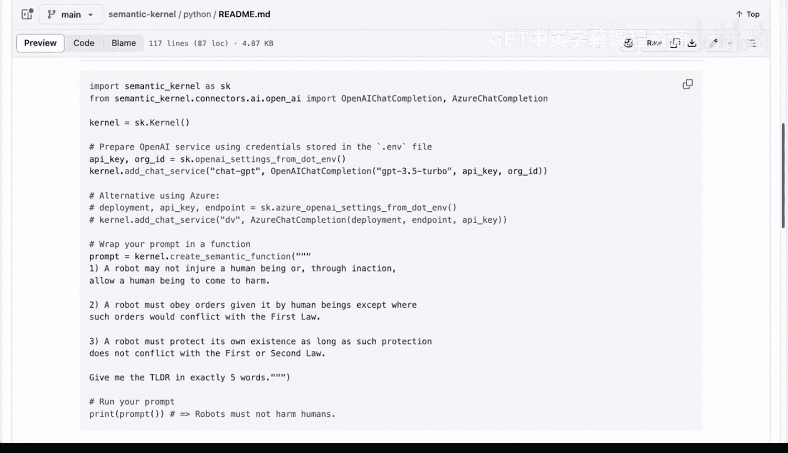

# 杜克大学《大型语言模型实践（生成式AI简介、Azure的LLMs（1、2课，共6课）｜Large Language Model Operations》 - P118：41_03_02_什么是语义内核.zh_en - GPT中英字幕课程资源 - BV1Ef421m7zD

What is the semantic kernel so the semantic kernel is a framework It is a framework provided in several different languages。

 but what is its capabilities right here， so it allows you to generalize on generalize on capabilities of interacting with different models。

 large language models in this case， so you are able to create your own compiles。

 your own extensibility， so you are definitely in control or how to interact and you're not forced to actually use specific large language models。

 so it's an interesting approach and it's also interesting that this comes from Microsoft as well so actually there's other options similar to semantic kernel if the concept is hard to grasp the other one that is open source that is not specifically tied tomic。

soft is L chain but in this case we're going to cover semantic kernel so I wanted to show you this one which allow you to have like a good good overview but let's take a look at the repository I'm going to go here to the repository which is on Github Microsoft s semantic kernel if you want to poke around and this is what we're going to be using for some of the examples as well al right so I'm going to scroll here very quickly and although this kind of makes sense well it's kind of difficult to to grasp so you're going to have this thing called the kernel。

And in the kernel， which is this core within the framework。

 youll have something like the context where you can provide。

 add or interact and put things in there for the large language model to consume you will be able to create functions。

 you will be able to create planning recall memory。

 all of these things that are very interesting and specifically and what we're going to be covering as well is going to be this thing called native function which is a way of calling code and extending large language model functionality using native code。

An interesting thing is that this framework is offered in three different type of languages。

 C sharpharp Python and even on Java， we are going to be concentrating in using these with Python and specifically we're going to be creating our APIs center our examples with Python here I know I'm going to load this so that you can take a quick look at how this how this is laid out so we're going to have to fetch our API keys which we've been doing already with the quick samples and this is kind of like what it looks right now now this might look like a lot might look slightly complicated。

 but it's just a different way of generalizing how to interact with something like large language models that might be coming from Azure from the models that we're deploying from Azure but it also allows you to interact。

Directly with open AI， we're going to be concentrating in using the Azure chat completion and we're going to make sure that everything we do is going to not use the open AI one。

 but rather the alternative， which is going to be Azure and it's going to be slightly different。

 but not so much so that you're going to have trouble。 So that is， in essence。

 what semantic kernel lease is's a framework。 It will allow us to do many different things。

 and we're going try it out and see how we can make it work with Azure。

