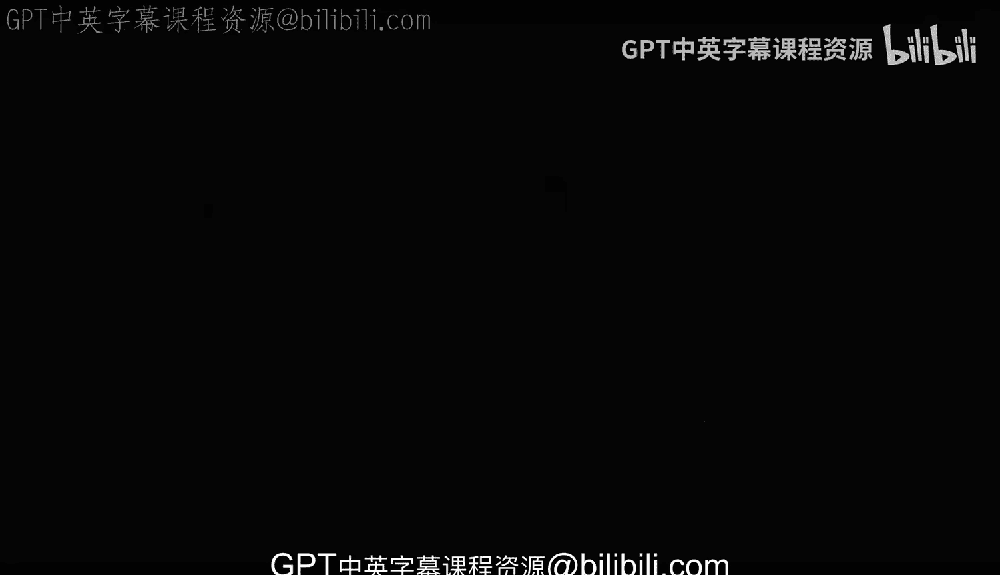
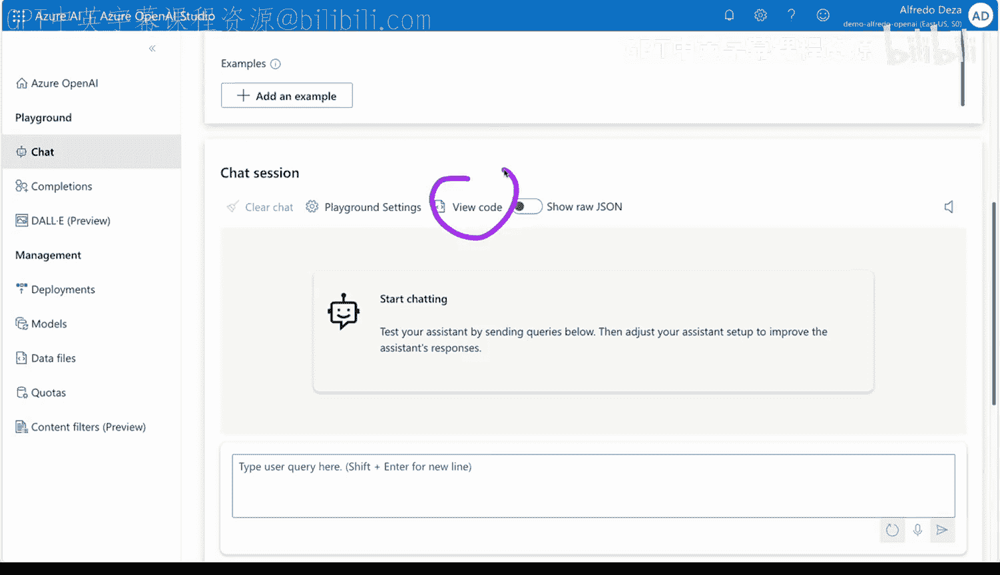
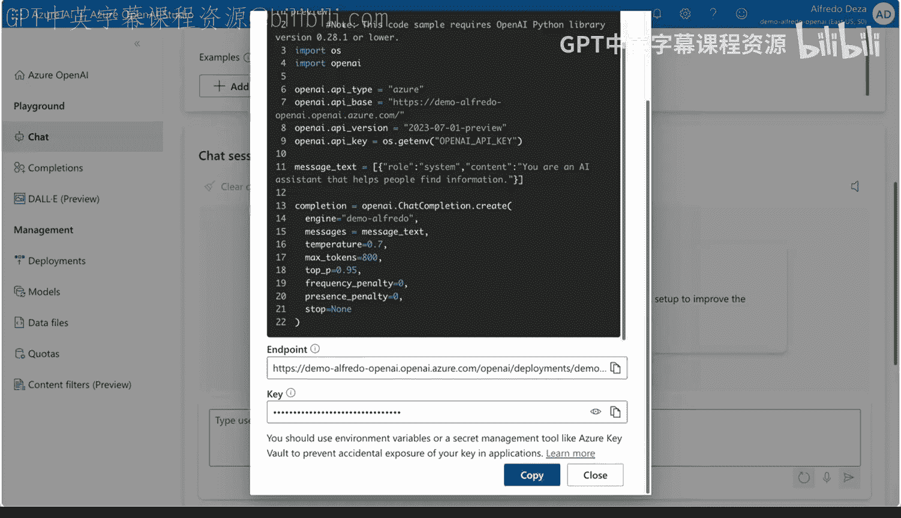
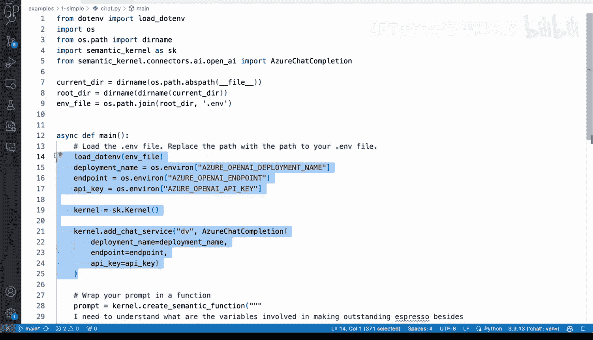
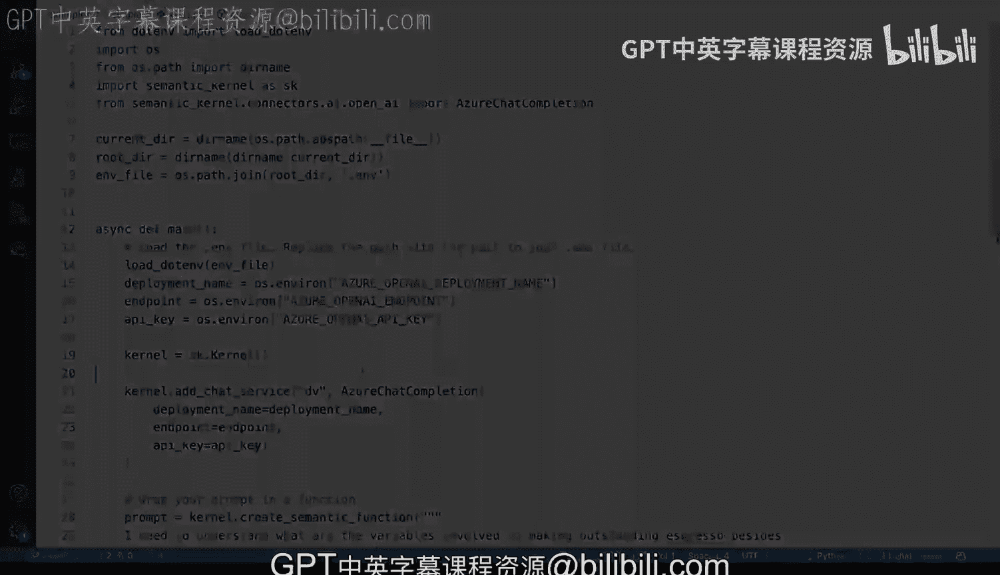

# 杜克大学《大型语言模型实践（生成式AI简介、Azure的LLMs（1、2课，共6课）｜Large Language Model Operations》 - P119：42_03_03_在Azure中使用语义内核.zh_en - GPT中英字幕课程资源 - BV1Ef421m7zD

To start interacting with the semantic kernel and Azure we need to come back to the portal for Azure Open AI servers。

 we're going to take a look at our deployments， we're going to click here。

 I am going to be using this one which is demodallfredo and I'm going to click on this one and this is very important because otherwise you might get into trouble so I'm going open the playground and I am going to scroll all the way here until I can take a look at the code and the reason I want this is because I am going to get interesting things that I'm going to be needing one is the endpoint and because we're going to use semantic kernel we're going to use a framework the endpoint although here you can see that it uses the whole thing this is going to actually be using demo Alfredo dash OpenaiI。

 that openaiI， that Azure。com。

This is a source of confusion and it definitely took me a little bit to get used to it。

 but semantic kernel calls something like the base something different。

 and you will want the actual endpoint， which is this one。 However， when it refers to the endpoint。

 it just refers to this portion right here。 So do you see how that can be confusing。

That's just something to keep in mind and we'll see how everything comes together in a second and the next thing that you're gonna need is the key and you're gonna have to copy it and then you put it in a special spot。

 Alright so I'm going to switch over to my development environment I'm going to use Vi Studio code you can use whatever you want but I'll show you the files and how to interact with them Allright so I have here my example and I'm going to go step by step so that you can actually see what's going on here first I'm going to retrieve everything that I need here and actually I'm not telling you but like semantic kernel releases very often so in this case when I'm providing examples I'll make sure that I give you exactly the right versions and in this case I have not listed here exactly the version but we can quickly toggle the terminal and look for the semantic kernels so I'm going to grab for it semantic kernel and this is going to be。

A useful piece of information for you so you can see here that I'm using this one and actually I think we should be able to put it right there for future reference alright so now we have it and this is crucial because then you know that this will actually work and be consistent direct back to the chat chat application that I have here is a single file I'm going to import Azure chat completion and I'm going to load my secrets I have the key I have the endpoint I have everything that I need but these are going to come from a dot M file。

So for that to work， you'll have to install this library called dom and you're gonna load them from this file all that that means I mean I don't recommend having them hard coded right here。

 This is why they're in an external file I'll show you that file right now is actually this one right here。

 so I'm going to close this one and you can see I have three variables I have my API key my endpoint and the deployment name。

 this is the deployment name that I gave when I deployed this is my endpoint and this is my key back to the chat application andm going very quickly through everything that happens。

 I'm going to going to load I'm going to load that file with my secrets。

 I'm going to retrieve those secrets I'm going to start the kernel。

 This is actually required by semantic kernel It's going to start these where it grabs a context and does everything that is needed I'm going to provide a name I'm going to add a chat service。

 This is going to be based for Mezure and I'm going to pass the deployment name。エンポエディエピアイキー。

Then what I'm going to do is I am going to actually pass in exactly what I want to ask so this is the question for the user input so anything that would come from me for example。

 if I wanted to create a chat application would come from there and finally I'm going to execute that with this little snippet so I am going to toggle the terminal。

And in here I'm going to clear， I'm here I'm going to run Python chatd pi and when I run that iss going to interact with the HtPpi and from the models and there we go my question if you don't remember what I had over here I'm going to scroll is I need to understand what are variables involved in making outstandingspresso besides a good machine。

 for example what is a combination of roast grind temp and water temperature include three practical steps to practice and improve each variable it goes ahead and provides me roasting grinding and temping actually use a calibrated temp in best a very good and solid device so there you go that is a very quick and fast way to get an example with semantic kernel that will interact with the variables just keep in mind that the thing with the M variables and loading them might be a source of pain if you're not doing them correctly especially。

When you're capturing and creating this chat service that is required by the semantic kernel framework。

