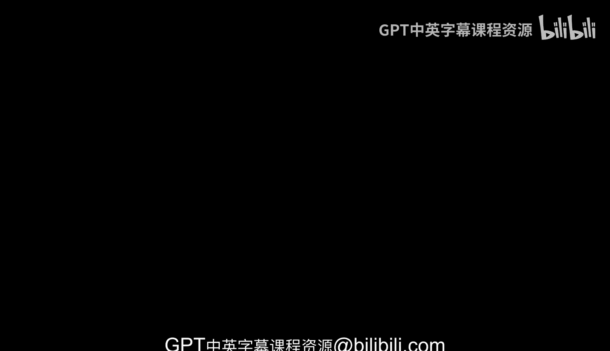
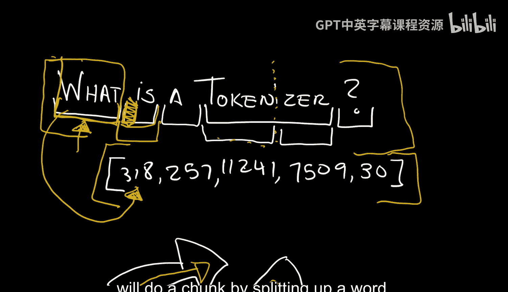
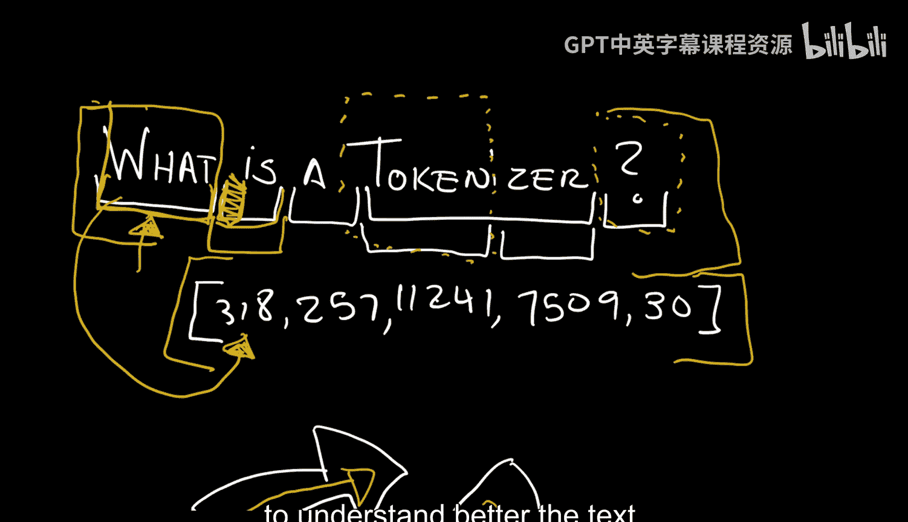
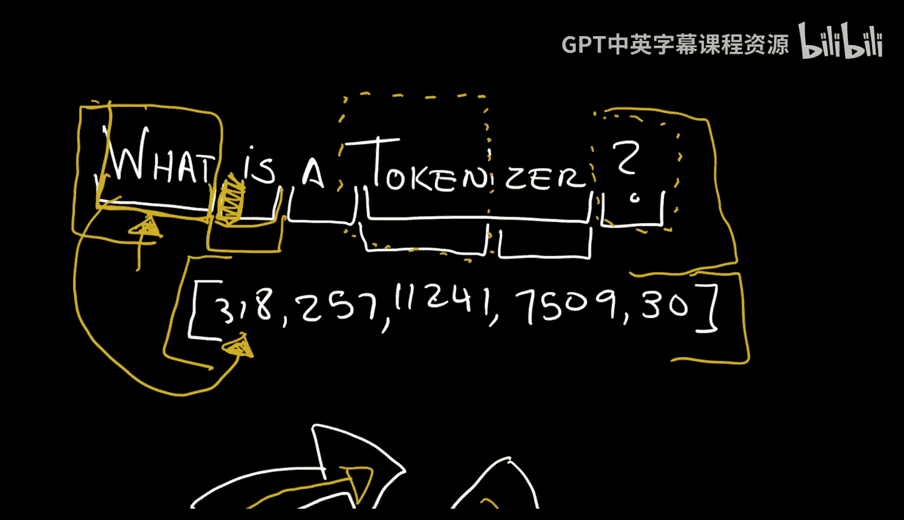
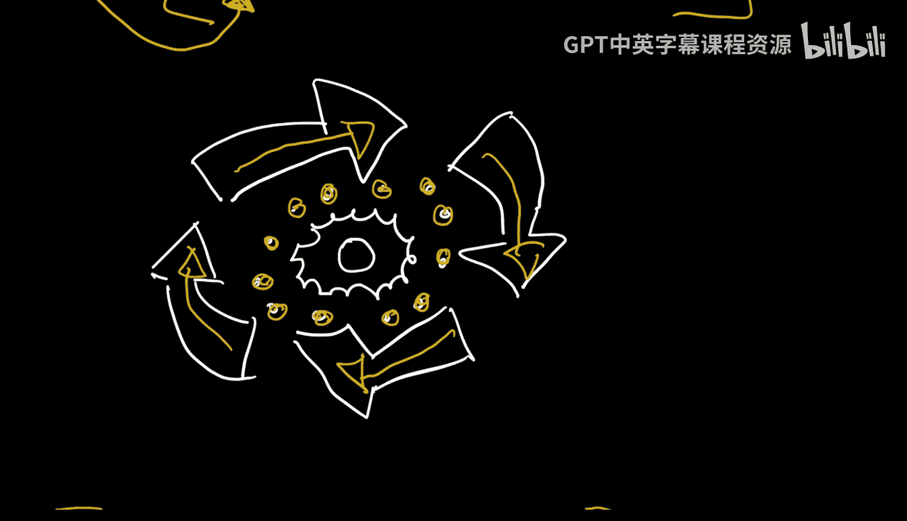
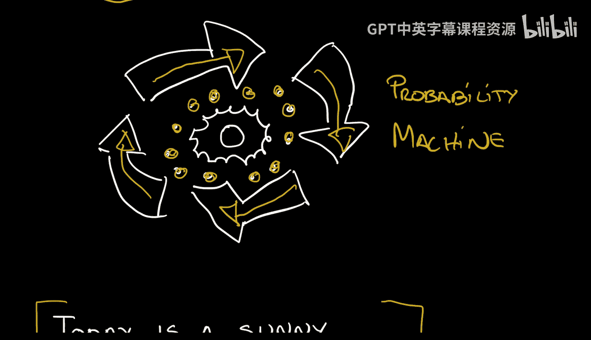
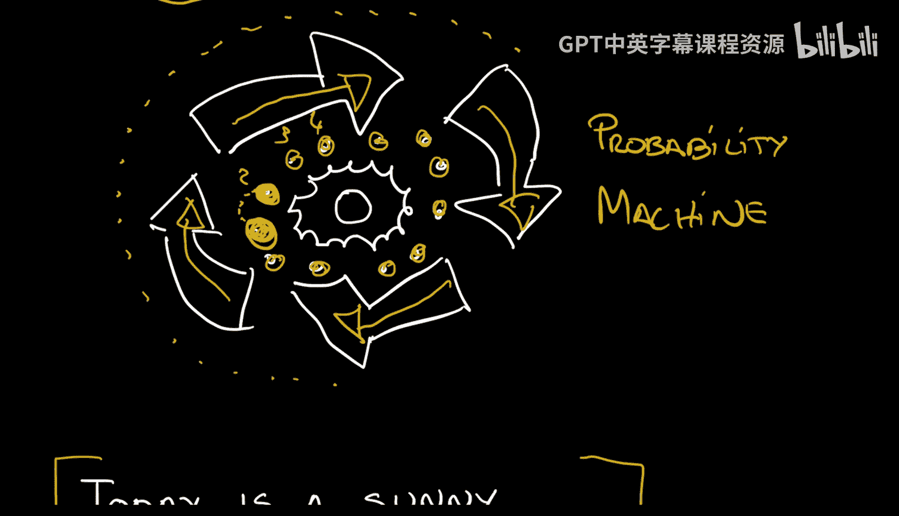
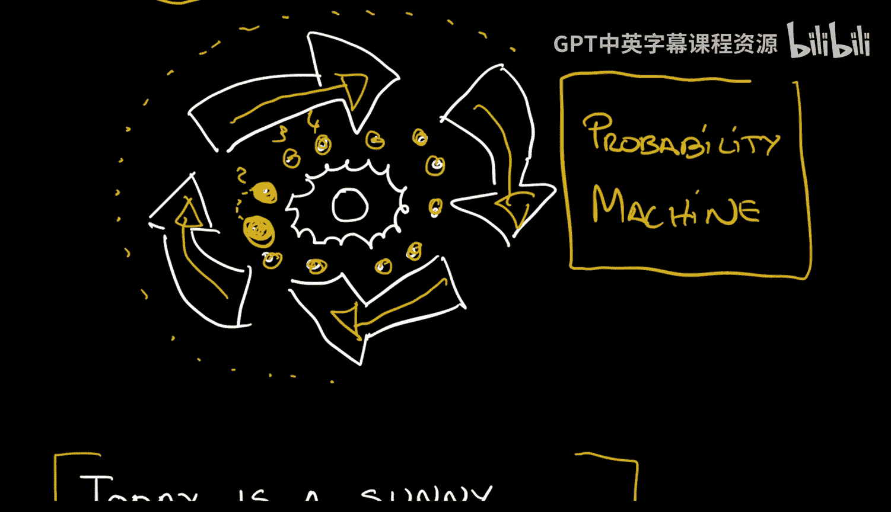
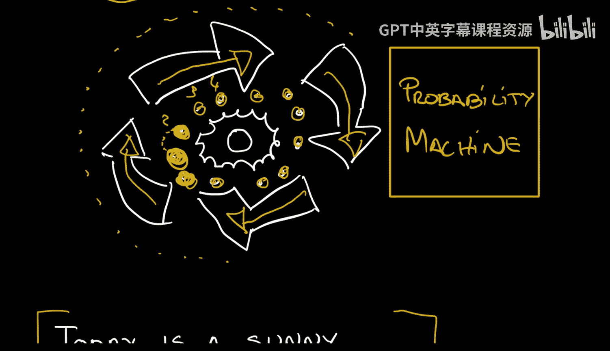

# 杜克大学《大型语言模型实践（生成式AI简介、Azure的LLMs（1、2课，共6课）｜Large Language Model Operations》 - P11：11_01_03_什么是大型语言模型及其工作原理.zh_en - GPT中英字幕课程资源 - BV1Ef421m7zD

To understand LLMs and how do they exactly work， we first need to start with tokens in understanding what tokenizer is in this case we have here a piece of text that poses the question what is a tokenizer and what that exactly means is that a tokenizer is a process where we convert text like this phrase right here into numbers。

 large language models will work with text as input and generate text as output。

 but how exactly does that happen well it happens by processing a phrase like in this case and segmenting that into smaller chunks and in this case for example what would be one of those chunks。

 one of those pieces and that would be converted into a numerical value in that case what would perhaps be？

numerical value， like 318。 All of those pieces would then essentially be converted to numbers and be put into a sort of an array。

 That is the way that a machine can then process those and trying to identify better。

 What are some of these pieces represented by using numerical values。

 we are making sort of like an index。 And this index is an encoding of the original text chunk。

 and we say chunks or pieces because it is not necessarily works in this case。

 we could say here that what is a chunk， but is might have also a bit of white space right here。

 that is also represented here as a whole chunk。 and you can see sometimes even tokens will。

Do a chunk by splitting up a word in this case tokens might be split it in two and even question marks like like this one might also pose a chunk all of these representation will make it easier for the machine learning model to try to understand better the text otherwise it would be well this is the best method we have for machines to understand text now that's the analysis part or the fragmentation。

 the segmentation of these chunks into numerical values so what exactly we're dealing with here and I like to call these a probability machine and why a probability machine this is just trying to understand all of these smaller chunks of text that might go from one text to the other token rather and try to predict what is exactly the probability。

that from this one we'll go to the second one and then we'll go to the third one and to the fourth one and so on so it is at the end of the day in an overly simplified way of explaining things it is just a probability given the massive amounts of texts。

 we will see a machine a learning model， a machine learning model that will try to determine what are all of the probabilities given a piece of text so this is why I want to emphasize that this is exactly a probability machine and it is very easy also to think about these models because sometimes they get so good as a machine that spits out facts。

And even when some of these generation of text looks accurate and correct and representing in reality。

 we should never treat those as fact speeding machines because all that it is is just probabilities given given specific input。

 what is the probability that the next input in the next chunk， the next piece。

 the next token will be based on the amount of text being trained。

 So in the case of having a phrase like today is a sunny and dot dot dot this phrase right here is a perfect way to try to understand what is what is the probability that this dot dot dot section right here will be a specific word and in this case。

 today is a sunny and this would be probably be a day so what does that mean well。

 given the amount of training and the text。

And the decomposing of that text into tokens and generating all of those indexes。

 well the machine understands that probably probably what you want is the word day right here and perhaps even with some white space before so that the text gets properly represented when it gets generated。

So that is， in essence， how machine learning models with large language generation。

 large language models and generation of text will work first by decomposing， creating the indexes。

 and then acting as a probability machine。

