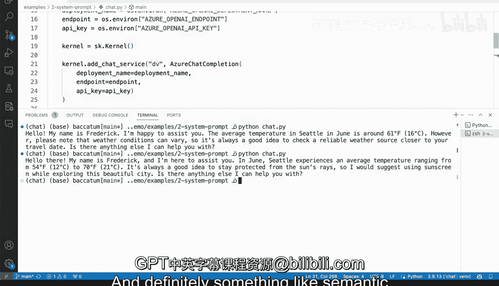

# 杜克大学《大型语言模型实践（生成式AI简介、Azure的LLMs（1、2课，共6课）｜Large Language Model Operations》 - P120：43_03_04_使用系统提示.zh_en - GPT中英字幕课程资源 - BV1Ef421m7zD

Alright， so now that we have a little bit of our of our application going。

 let's just go ahead and modify。 I've actually modified these a little bit。

 Everything else is the same。 I have my same as or chat completion I have my endpoints here with my password。

 my tokens my endpoints no problem。 but here's something that you can do， which is makes it very。

 very interesting。 This chat system prompt where you can configure the prompt for your chat service。

 So what you can do here is you can modify these so that the chat experience is a little bit different。

 So let's let's see what I added here so。😊。

You are a travel weatherer chatbod。 your name is Frederick。

 you're trying to help people find the average temperature in a city in a month。

 always reply like called wrong the wrong way there always reply with your name and a nice greeting So I'm tweaking around how the response is going to be and then I'm going to scroll here I'm going to say hey what's the average temperature in Seattle in June。

So let's see how that that actually works and I'm going to toggle my terminal here okay。

 and now I'm going to and my terminal is up and I'm going to run Python Chand pi I'm going I'm going to call my semantic kernel implementation。

And is going to tell me is going to greet me like the way that I instructed that thing to do hellello。

 my name is Frederick and I'm happy to assist you the average temperature in Seattle in June is around 61 Great so that's fine and it is a very straightforward way that you can take a look at how you can change how this how this chat implementation is going to interact with this is a system prompt so this is abstracted away hidden away from the user so you can say for example。

 always reply with your name and an icescreen and we can add something here and always suggest using sunscreen for example。

 sunscreen in a formal way let's say and when I save that I'm going to toggle the terminal again and run this again and then it's going to say it's always it's always a good idea to stay protected from the sun。

😊，Sugs using sunscreen。 Great。 So you， you know， I'm， I'm just asking the same question。

 and I'm getting a slightly different response because I'm tweaking the system prompt。

 that is tweaking the system prompt and definitely something like semantic kernel allows you to do exactly just that。

😊。

