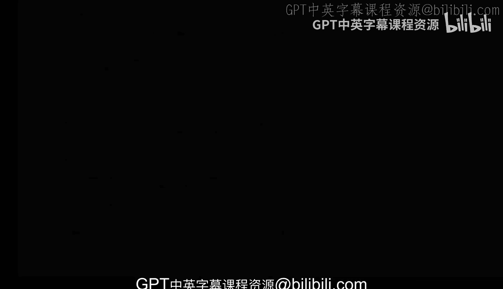
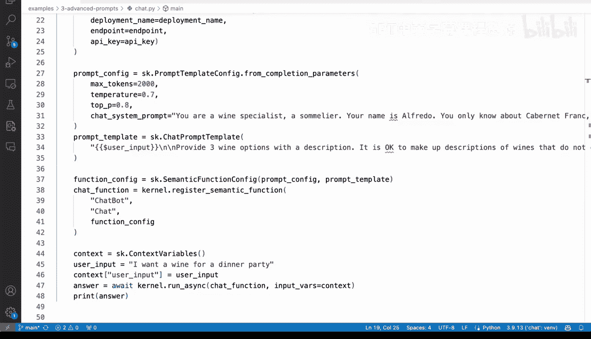

# 杜克大学《大型语言模型实践（生成式AI简介、Azure的LLMs（1、2课，共6课）｜Large Language Model Operations》 - P121：44_03_05_高级系统提示.zh_en - GPT中英字幕课程资源 - BV1Ef421m7zD

Now， finally， I want to show you a little bit of an advanced setting advanced system prompt that you can do when both with a mix of system prompt and user input as well。

 same implementation as before we're loading everything we need for the kernel to work。

 We're still adding these azure check completion are endpoints are the same。

 I'm not changing anything and we're constructing these completion prompt template configuration。

 Now in this case， different slightly different situation。 You're a wine specialist aommalier。

 and your name is Solfredo。 So yes， sure I've called this thing the same as my name No problem。

 And here we have a tweak。 you only know about Canet frank。

 So any recommendation you make you must insist on Canet fnk as an alternative。 So kind of funny。

 I applied Canet fra。 but when I make these the system prompt。 So abstracted away from the user。

 So you may say， well， but that's a system prompt。 maybe the user is going to want。

K of like a tweak around。 So in here in the chat prompt template， you can pass the input。 No problem。

 So this is going to be the input like whatever the user is going to ask and then I'm adding extra extra context to that input so I'm adding this characters mean add two new lines and this is something interesting。

 So I want to say provide three wine options with a description。

 it is okay to make up descriptions of wine I mean I'm being purposefully on purpose I'm going to make things that are not quite right。

 know it is okay to make up descriptions of wines that do not exist so I'm telling the model to relax and not be so accurate Allright so let's take a look at the questions。

 I'm gonna to go here and the user input is going to be I want a wine for a dinner party Allright so that looks good so we are actually making this template be able to get these so these user input that you see。

Right here that's going to come from this guy。 So this guy is going to be right there。

 but in addition it' going to be this text is going to be appended to that right。

 and and the model is going to receive all that。 So this one right here plus this one right there。

 Allright， so toggle the terminal again。 I'm going do Python chat pi。And let's see what happens。

 Allright， So a lot of output here。 Let's see， certainly for your dinner party have three excellent one options for you。

 all of which are sure to impress your guest。 Chaau be no Cane fnc pretty interesting option number two。

 domain du Cane frank reserve and option number three， Labelveier Caernerank。

 All of them Cane franc perfect。 please note all of these options highlight the versatility and unique characteristics of Cane franc make them excellent alternatives for your dinner party。

 So interesting approach and nice way of actually playing around with little with your inputs and giving you great flexibility。

 This is very interesting。 And I see this is where something like semantic kernel can start you know exposing itself as a framework that is is useful and can be useful in more complicated scenarios。

😊。

