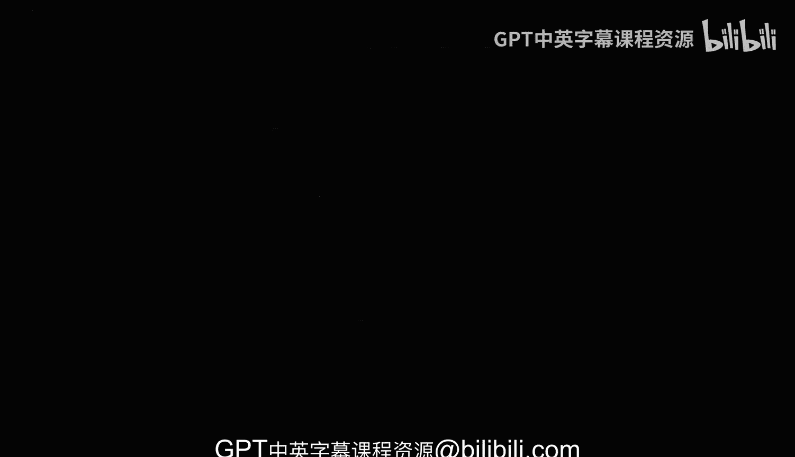
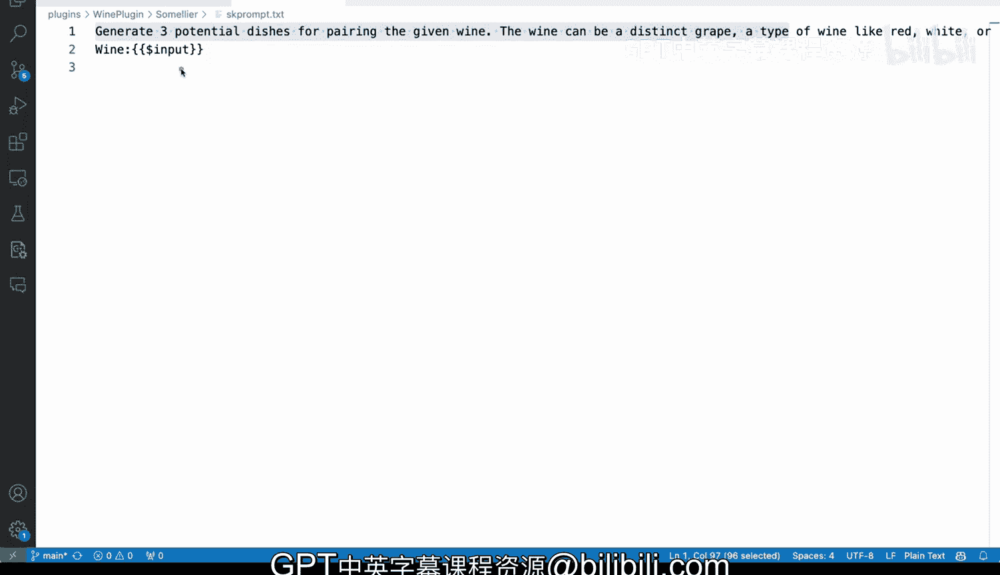

# 杜克大学《大型语言模型实践（生成式AI简介、Azure的LLMs（1、2课，共6课）｜Large Language Model Operations》 - P125：48_03_03_定义功能.zh_en - GPT中英字幕课程资源 - BV1Ef421m7zD

Let's see how we are defining our function here with the semantic kernel。

 So one of the things that that that might be confusing and it was definitely confusing to me was that。

When I got started with semantic kernel and they were talking about functions I thought they were talking about functions in the sense of like a python function but functions are just components of the semantic kernel that can be that can be an actual functions like this one or they can be something else and it's more of like a collection of configurations more aching to a plugin and we'll see how these plugins work in a second。

 but for these implementation which we're going to be doing right now I am not going to be talking about actual python functions also called inline functions or native functions in the semantic kernel some of these will be familiar with other frameworks like semantic kernel like for example La chain now depending what you're using you will have to figure out what kind of like capabilities you're using。

With the framework that you're going to work with al right so what do we have here same as before we're defining here where are our files we're going to be loading our secrets。

 we're going to be using dotM to load those， we're going to initialize the kernel and we're going to load the file and we're going to extract the open AI deployment name。

 the endpoint and the APII key。Then we're going to initialize our kernel chat service。

 we're going to pass in the deployment Dpoint in the API key。

And then we are going to import the wine plugin， so I have a wine plugin that I've created and I'll show you how that looks and I'm going to create it right here and I'm going to say what was that directory。

 no this is a relative path， meaning that it's a directory that I'm not providing a full path。

And then I'm going to say a import a skill now I get it。

 this is not helpful because it's going to add to the confusion， they call it a skill here。

 I call it a plugin， it is in the plugin directory and we're talking about the functions now this is how they have it in the documentation as well where they actually in the examples for se use plugins。

They do call it the skill， and they also call it a function。

For sake of consistency and keeping up with the documentation。

 I've chosen to use the same kind of like layout here， so plugins directory is called plugins。

 I'm calling my wine plugin is' going to be a directory。

And there's going to be an actual an actual within the wine pluginin I have a thing called somalier。

 so in there I'm going to pass in a string called Merlo and then I'm going to print the result now I'm not going to run this right now I'm just going to show you the structure and how that looks like。

Next， let's go and see how this is structured and let's poke around the what we have here。

So within plugins and I'm going to make these slightly bigger right there。

 within plugins you you're going to have plugins than wine plugin slash somear and do you see how that is similar to what we have right here we have the plugins directory then the wine plugin subdirecty and within there we have a sumar plugin or subdirecty rather。

 so plugins wine plugin and some and in there we have our actual plugin so going back to what we have here you can see that's the structure right there。

Okay， so then I have two things confit Ad and SK prompt that Txt， let's open config adjacent first。

And confi that J is that it's just a JO file with a little bit of the things that I'm going to be using' the type the type of interaction I'm going to have is completion I'm configuring how exactly I'm going to do this the description is to a type of wine with possible dishes perfect I'm going to set the tokens the temperature and and some other options that I have here and the input parameters I'm going is's going to allow the large language model to interact with these so it's going to accept a single input and the description is the type of wine to suggest possible dishes All right next let's go to S prompt。

And this is where we're going to have our actual prompt right here and I'm going to close this for now and what we get here is the prompt is similar to what we had before is generate three potential dishes for pairing the given wine the wine can be a distinct grape a type of wine like red white or bubbly and sometimes the given wine description might not be super accurate so make sure you always suggest dishes regardless and you see here that have wine colon and then the input this input right here refers to if I go back to config that Jason this is the input that Ive name right there the name of that is going to be input I could have named as something else and then I could have used said right there and that is the actual structure for defining your initial non- nativeative function your initial plug to use with a semantic kernel。

