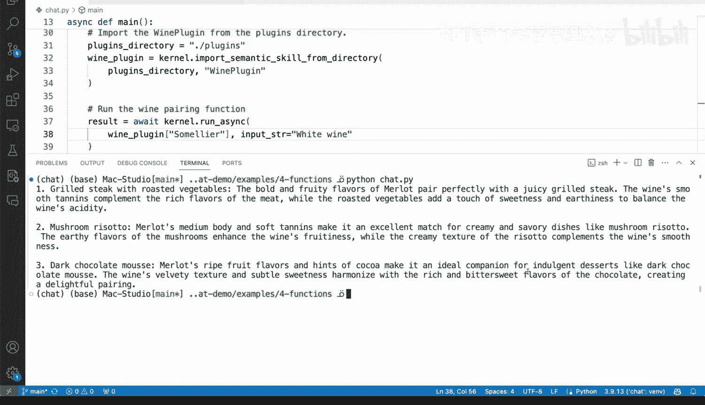

# 杜克大学《大型语言模型实践（生成式AI简介、Azure的LLMs（1、2课，共6课）｜Large Language Model Operations》 - P126：49_03_04_在大语言模型中使用功能.zh_en - GPT中英字幕课程资源 - BV1Ef421m7zD

Now let's see how these will work with the actual large language model that resides in Azure as you know。

 we've already defined our secrets and we will actually take a quick look at how that looks in a second but essentially we've defined three things。

 the Azure Open deployment name， the endpoint and the API key and the reason why I am insistent in mentioning these things again is because it is very easy。

 very， very easy to get these incorrectly done and spend a lot of time with this thing actually not working so before we actually do that do you see how these are named these name keyword arguments if remove if I remove these ones and just made them arguments。

 you can see you will see that it is very， very easy。

To get into trouble and we'm going to save that and I'm going to leave it like that and you can see so at the end of the name let's see at the end of the interaction let's do one more thing let's review let's do a quick recap of what we're going to do we have a plugins directory we have a wine plug inside there we're gonna to have a similar directory with our configuration and we're going to our input string is going to be Merlot if we review the prompt we're going to generate three potential dishes for pairing the given wine that is the instruction for the large language model and theg adjacent is going to say we're going to do completion for pairing a of a type of wine with possible dishes and the input is going to be the type of wine to suggest possible dishes and what is the input that we're going to use we're going to use Merlo。

Great， we're going to toggle and open up the terminal， so I'm going to open up the terminal。

And in the terminal， I'm going to do Python chat pi。 And then this is the name of the file。

 and I'm going to execute it and run it right away。 So I'm going to hit return。

And then I am going to get an error now why am I going to get an error Well。

 this is actually pretty tricky do you see anything here that actually tells you that then some of the arguments that you have are not correct Yes something tells you here that hey the input should be a valid URL where which thing should be a value URL so right here it kind of hints this is actually the my API key which I'll make sure that this is not no longer valid after this video but so it tells you oh URL parsing Well I'm not this is not definitely not a URL and the input type is a string Yes it is a string let's review here what we have we have the deployment name。

 the endpoint and the API key again make sure that you are doing these things correctly and and triple check that you're doing them the correct way otherwise you can get。

Into trouble Allright， once again I'm going to clear these and just by naming I should be now in better shape I'm going to loop Python chatt pie and there we go it actually works it's giving me the three suggestions based on if you remember Merlo Merlos right here getting the three dishes grillreed steak mushroom risotto and dark chocolate mousose perfect if I actually go and change these from Merlot to something else so say for example。

 how about white wine。And I say， save it and then run this again。 Let's just give it a second。

 I am going to get something slightly different grilled lemon herb chicken from scamamppi pasta cappressed salad。

 And you can see that now white wine is being referenced。 So pretty good。

 pretty simple to make changes。 but very， very easy to get into trouble If you're not getting your。

 your kernel completion correctly instantiated and your secrets are using the correct。

 the correct order right there。😊。

