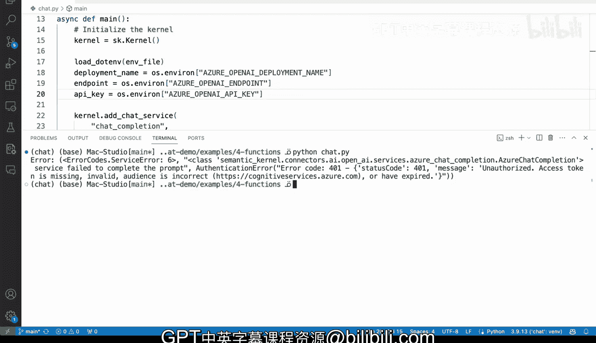

# 杜克大学《大型语言模型实践（生成式AI简介、Azure的LLMs（1、2课，共6课）｜Large Language Model Operations》 - P127：50_03_05_处理错误.zh_en - GPT中英字幕课程资源 - BV1Ef421m7zD

We have already seen a little bit of some of the issues that we may find when we're working with with Aure and the semantic kernel。

 but I wanted to cover a couple of different errors that you may find again this is a source of pain that can catch you off guard and so let's go very quickly through some of the things and I'm going to start with the deployment name I'm going to pick someone that is not the correct one and I think this is going to be the easiest one just make sure that。

That you try it out， things may change on your end as well。

 so it is important to do that so okay so I'm going to run Python Chnda P so I'm going to execute this file with the incorrect deployment name so in here pretty straightforward a 404 means that it's not found but at least this is very good is already telling me deployment not found and the message is the API deployment for this resource does not exist。

Something to keep in mind is that sometimes in Azure。

 if you deploy and it's been less than five minutes， you might get the same error。

It's kind of like a bummer that you may get the same error。

 but just something to keep in mind at least it tells you that that's the case。

 so wait at least five minutes if you've just created that。

 So let's go ahead and make this right again so that's that is going to actually work Now let's change the endpoint and the endpoint you might either get something that tells you hey。

 this is not a URL in this case it is not I'm going get validation error input should be a valid URL input is empty right so and it gives you the the actual value right so let's actually make it an incorrect URL so we'm gonna make Https let's say example do co save that again。

Clear here。 and let's see what error we're going to get。 I'm going to run this again and' to get。

 well， it is a fairly contrived error here within the exception， but we're getting a not found error。

This is a bombmer because if 404 is is not necessarily kind of like explaining what is going on and we're going to hear the connector。

 heres probably this is probably like a class service fail to complete the prompt enough found there and it doesn't tell you well what does that really mean so make sure that the endpoint is actually pointing towards an endpoint that exists in your environment。

So let's actually go ahead and put that in， then let's do the same for the API key in this case。

 let's just put a none。And let's see what happens when the E is a none so we do get please provide either API key at token or a token provider and doesn't tell you exactly in a nice way but you're seeing that we got here and none perfectfect so let's actually change these to something that is a string let's just have it well let's just say empty token just as an example like just like a complete invalid API key when I try that and let's see what we're going to get so we're going to get unauthorized access token is missing invalid or audience is incorrect Great so that is actually a pretty good error authentication error and saying hey you know the access token is either missing or invalid that is actually pretty useful because then I can say well this thing is actually not entirely correct so let me go ahead and fix that。

You know you will have to make sure that as you're making progress that these three pieces of information are actually correct and by going through this trial and error。

 you will be able to understand what is working and what's not working and at least have some sort of idea on how to try to fix that。

