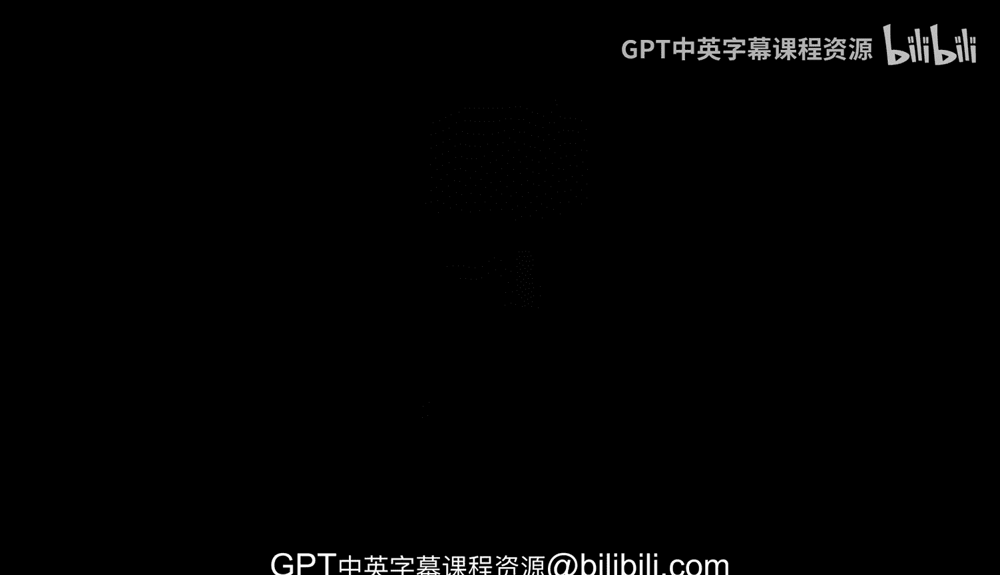

# 杜克大学《大型语言模型实践（生成式AI简介、Azure的LLMs（1、2课，共6课）｜Large Language Model Operations》 - P128：51_03_06_总结_5.zh_en - GPT中英字幕课程资源 - BV1Ef421m7zD

So we saw how we can extend functionality using functions now it is also useful to understand that sometimes functions mean different things for different frameworks but we were able to actually define one and use it with large language model at the very end we also we able to work with the errors and see what are some of the potential things that you should be looking at when things are failing。

 I think that functions in general and the extensibility that you will see with frameworks like the seman kernel and some of the other frameworks that exist like Lacha that we haven't seen yet。

 it is going to be interesting how we can make use of these different components as we try to put applications or think about potential applications that we can deploy with large language models。

