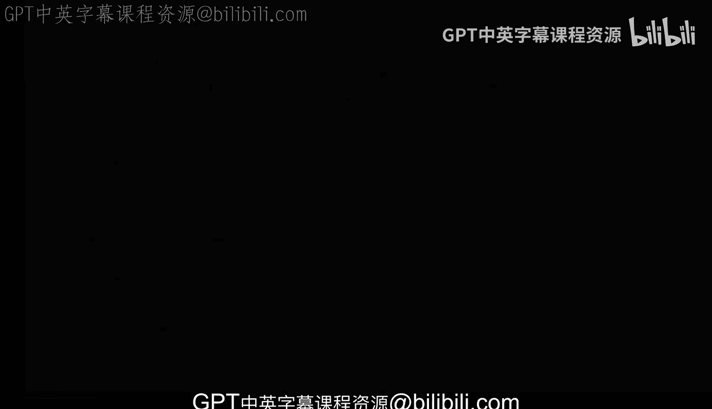
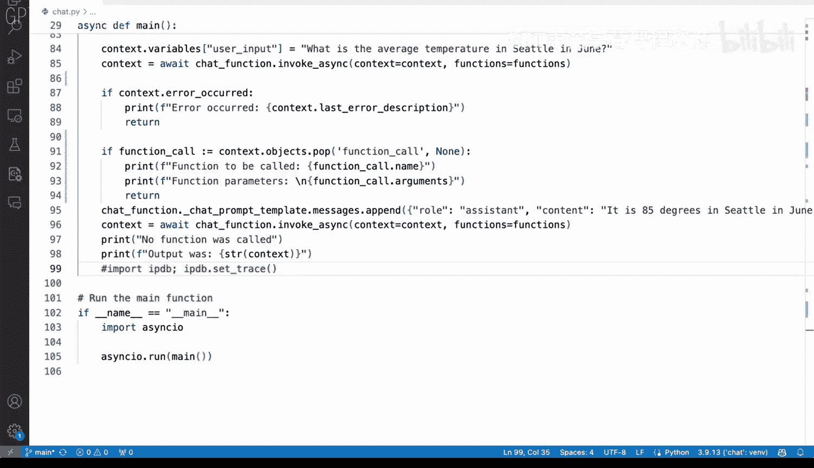

# 杜克大学《大型语言模型实践（生成式AI简介、Azure的LLMs（1、2课，共6课）｜Large Language Model Operations》 - P130：53_03_02_创建胶合函数.zh_en - GPT中英字幕课程资源 - BV1Ef421m7zD

Let's see what it takes to build a native function or a native plugin that is we are going to do without all of the configuration that J and all of the other things that we were doing before and we're going to actually deal with Python so we're going to although this is going to be basically a function we are going to be creating a class and here you can see we have tons of things going on and I'll go through exactly each piece here so we're going to create a class in this case we're going to call it travel weather and travel weather will have these decorators these decorators are import from semantic kernel and you can see skill definition import function SK stands for semantic kernel and we're also going to be using these function context parameter。

And I'll explain how those work as well So let's start first with the SK function for the senseformatic kernel function。

 we give it a description and we give it a name so what we're trying to do here is create a function that will provide us whether for travel purposes so takes a CD in a month and returns the average temperature for that month and usually it's like the historical one but the details don't matter we're going name it travel underscore whether this will be important in a second so it's useful to name it in something that you will be able to use it and that correlates to the name of the class。

Then context parameters。Is a way to tell the LLM through the semantic kernel framework a way that you will understand how to create these things。

 so we're going to accept a C in a month we can accept many cities in many different months and we need to know which one switch so we're going to say the city for which to get the average temperature and the month for which to get the average temperature and then finally we're going to have this function which is not a function because we're inside a class it is actually a method but for sake of consistency we're going to call it a semantic kernel function just as we do right here so this is going to accept a context this object this argument here is going to be a semantic kernel context type which you can see here it comes from there and it is going to return a string。

For now， this is going to return a prebaked response。

RightThe average temperature in city in month is 75 degrees and it going to be is also going to show me what the string variables are which is actually pretty interesting so we're going to be able to poke around that everything else is the same we're gonna to be loading the secrets and that is essentially it we're going to do the Azure chat completion this example requires this specific API version which is a 2023-0701 preview otherwise we wouldn't be able to use the arguments and then we're going to go here remember before we were doing this with a configuration that。

 but now we're doing this right here with the prompt template config are we start by importing the skill name in this case is travel weather we do this with a class notice how we're calling it right here and then we're passing the actual name the skill name。

And then function called this is also pretty crucial， we are going to make it automatic。

 so we're going to be able to tell the large language model throughman kernel that this needs to happen automatically。

And the chat system prompt for what we're trying to do is you are a travel weather chatbot。

 your name is Frederick and you're trying to help people find。

Find the average temperature in a city in a month。 Very good。 and this is going to be the template。

 So we're going to get the user input straight away。 Allright。

 so finally we're going to go here and we're going to define these functions you can have many more functions more than one certainly and in this case we're going to define one So this is the travel weather remember I said that was going to be crucial that is required right here。

 this is the description and we're going to take some parameters。 what are those parameters。 Well。

 we're going to take the city is going to be of type string and we're going to be the city for example。

 Madrid and when I also take the month and it's also going to be a string and this is going to be the month of the year for example。

 June required both of them are required。 both city and month are required。

 So you can see right of the bat you're going have tons of different options if you don't want something that is required。

Then we're going to create a context and then we are going to have this prebaked question which is what's the average temperature in Seattle in June。

 we're going to invoke that asynchronously if there's an error and we'll show you this later that will be returned otherwise we are going to find we're going to poke around all of the objects we're going to find if there's a function call and if there's a function call we're going to print the function to be called and the function parameters that is really neat otherwise we're going to we're going to play around with these content so this is going to allow us to be able to say something's going to get called and we're going to figure out the arguments that is how you create a glue function I know that this is a lot to to take in theres several moving pieces but well go one by one as we make some progress and at the very end one last thing I want to show you。

which does take a lot of back and forth， you can see here that I left a PDV set trace because I was debugging these because it can get tricky。

 there's a lot of moving parts， but in essence this is how we have something that actually works for creating a native glue function in Python with semantic kernel。

