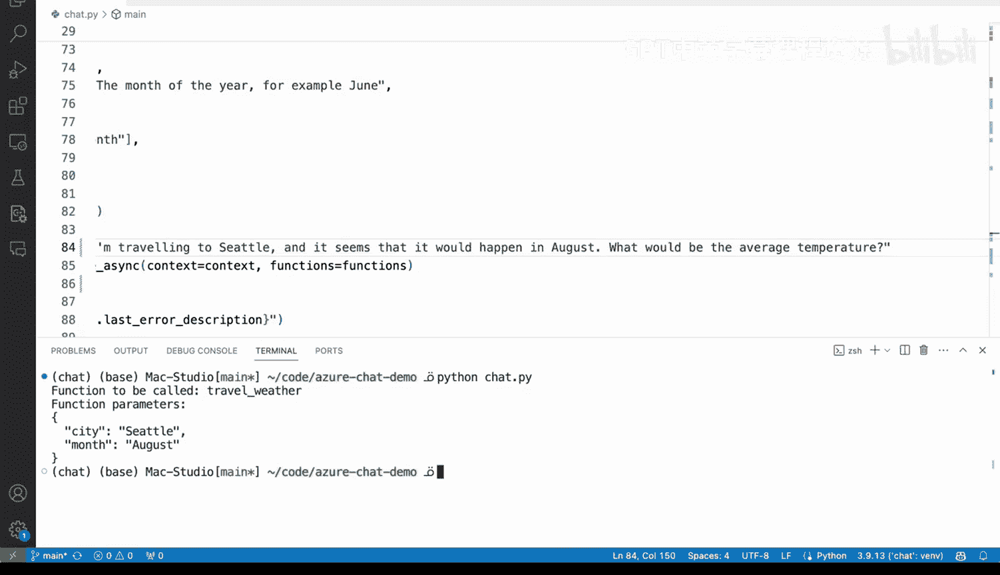

# 杜克大学《大型语言模型实践（生成式AI简介、Azure的LLMs（1、2课，共6课）｜Large Language Model Operations》 - P131：54_03_03_使用函数参数.zh_en - GPT中英字幕课程资源 - BV1Ef421m7zD

Allright， so now we're going to actually be working with the arguments。

 this is where the whole magic happens so let's go back a little bit and figure out a little bit of what we need to have what we need to do here we to have in order to produce to have a working function and scroll all the way to the top two are actual class method that we're going that is actually the function as well。

 so we have this method we have this context and within that context we are required to have the city and the month think about a piece of code that requires to have some information without having to parse this is one of the powerful things that the large language model allows us to do in a phrase like this one for example。

 we want to know exactly what month and exactly what city so that we can actually provide something useful imagine。

Having to parse a sentence to try to identify those the large language model is doing that for us because of all of these descriptions and all that configuration。

 this is possible and so by the time it gets here with the context we are going to be able to understand exactly what those are so that we can actually in both these in a way that makes sense al right so I'm going to scroll all the way to the bottom now and I'm going to go here to the functions and one is going to be the city and the other one is going to be the month but what we're going to do right now is we're going to we're going to poke around the function call the name of that function and the argument so because we said that to automatic we are going to be able to get those already cleaned for us so let me toggle the terminal and in here I'm going to call Python and chat pi and this is。

Going to allow allow me to poke around to see exactly what's going to happen so I'm going to call that and we're already seeing that we're getting the information that we need so we're getting the function to be called it's travel weather which is actually correct and the function parameters in this case the city is Seattle and the month is June This is actually pretty interesting because now we're going to be able to use this for the function the function is going to be able to poke around that so we can actually make this a little bit different so we can say I am traveling to Seattle and what will be the average temperature I'm going to save that'm going to run this again I clear and run this again。

And now I'm getting the same so you can see here that this is very useful， the parsing。

 the parsing is the magic， and now with this I'm able to this function parameters I'm able to decide oh okay so even if the input is changing I'm precisely getting the CT in the month so I can actually pass those on my function which in reality is a method in a class。

😊，So that is how we get access to those and within that method。

 we will have access to those later because those will be part of the actual context。

