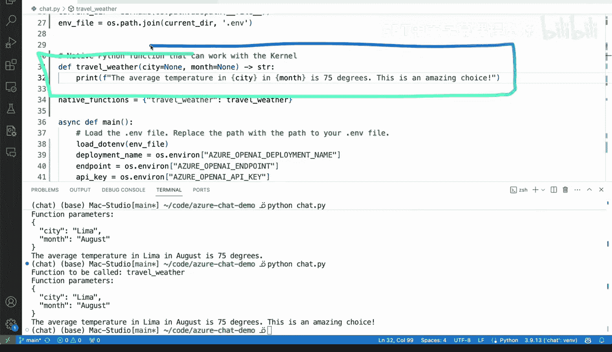

# 杜克大学《大型语言模型实践（生成式AI简介、Azure的LLMs（1、2课，共6课）｜Large Language Model Operations》 - P132：55_03_04_使用原生函数.zh_en - GPT中英字幕课程资源 - BV1Ef421m7zD

Although we've seen something like these from before I want to show you something that I truly think is the best way to try to have more control like if you want to have more control。

 this is going to be very tricky and very verbal I personally would prefer the thing that I'm going to show you next and is's what I'm going to base our examples moving forward and is this one right here。

 it is a native python function that can work with the kernel so we're going to define travel weather we're going to require city we're going to require none。

 well not require because we're assigning none the we're going to define them rather as keyword argumentsm going to default to none。

Right so for now we're going to just return the average temperature in 18 month is 75 degrees。

 so that's it and we're going to have this little helper here called native functions。

 we're going to map。The name of the function in a string to the actual name to the actual function。

 this is right this one right we're no longer going to be using this approach。

 All right so I'm going to go and scroll all the way to the bottom I're going to set everything just as before we're going to the finer functions we're going to see what the properties are and then we are going to say I'm traveling to Seattle and it seems that it would happen in August what would be the average temperature right and what we're going to do is right here。

 we're going to load the JsonN like this is going to be parched。

 the arguments are going to be parched by J before we saw that we already know what the functions is going to be called and what those functions parameters are Now that's great and now we want to call the functions So how we do that Well first we load the arguments we know we have those arguments and this is actually just debugging so you probably want to clean that up but we'll leave them there to。

Bg and see what's exactly going on。 Then the function to call this one right here， it's going to。

That is going to be our little helper here dictionary native functions。

 we're going to find that by the name and we're going to find that actual function and then we're just going to call it and we're going pass star star arguments meaning the arguments are going to be passed as keyword arguments All right so we're going to do that and now we're going to toggle the terminal and run it and see what we right so I'm going to call the Python chat out pi and I'm going to run these and we're going to get remember we're going to get the function to be called which is travel underscore whether and we're going to get the parameters remember this is going to be Jason so we need to load that with Jason load S which is all the way down here where we're going to call these it is right there Jason the load S means I'm going to load these string that is a Jason and these are going to become keyword arguments city is going to map to Seattle and Mon is going to be August so。

This how we're going to get the average temperature in Seattle in August t75 degrees Now if we change the prompt here。

 I'm going to say to we can say how about Lima in Peru。

 I'm going to save that and run this again we will probably get something else All right Lima in August and the average temperature in Lima is going to be 75 degrees what function are we calling I'm going to scroll the way to the top and you're going to see that we're doing here with our little function here we can say this is an amazing choice。

So when I save this you will see that this is actually the one that we are actually calling an amazing choice now shows here at the bottom。

 so why I think this is a better， a better alternative because it gives you full control and more flexibility to do whatever you want with these parameters in a simpler。

 more pythonic way where you can define your functions and do something else we will see next what other things we can do with this approach。

