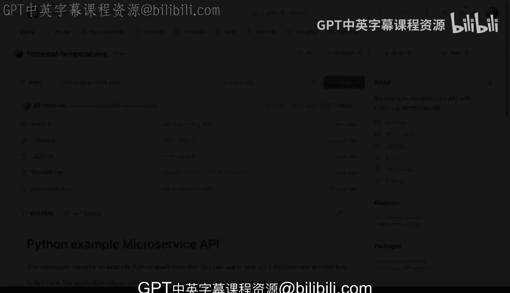
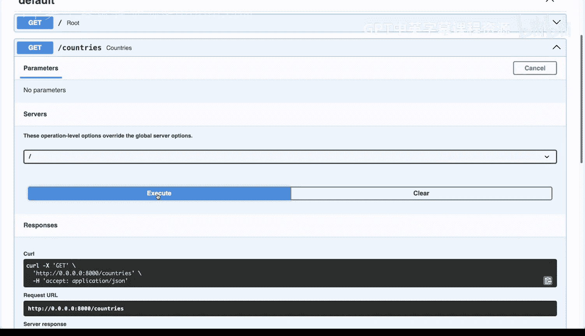
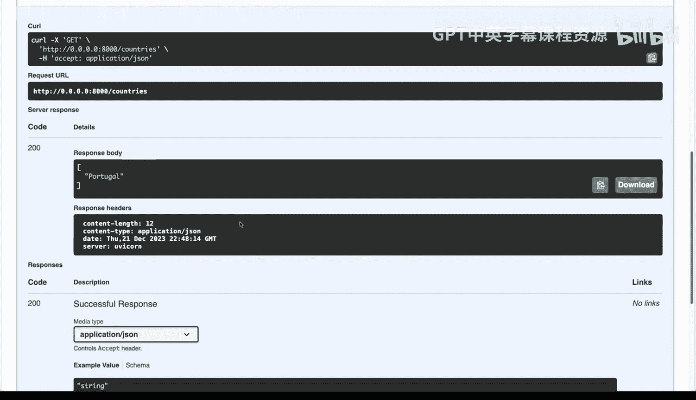
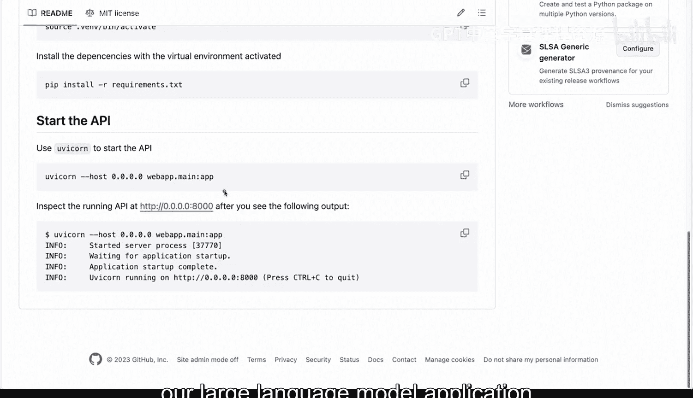

# 杜克大学《大型语言模型实践（生成式AI简介、Azure的LLMs（1、2课，共6课）｜Large Language Model Operations》 - P133：56_03_05_函数微服务概述.zh_en - GPT中英字幕课程资源 - BV1Ef421m7zD

Let's do an overview of a microservice that we can plug in into our whole architecture。

 We're gonna to use this example API， which is going to be historical temperatures for what we're trying to do before we've been only returning a string So now we're going to try to connect to an external microservice So this is using Python it could be actually anything else。

 it doesn't matter because this is going to do is going to track with an HttP。

 this is going to be an HttP API。 All right so we have here kind of like how we run it how we started I'm going run run with this the details for this is not important The important thing is that this is going to run at port  a000 on my local host So let me quickly go here because I've already actually start and let me show you what that looks like so I'm going have this API running I have a couple things here and I have only I'm only supporting get requests so I have。

HereWe can actually try it out this is Swwagger， which is a way of interacting with a live API。

And I'm going to try it out and I'm going to execute this to see what what do I get。

 So you can see here that is a request URL and I am going to get only Portugal。

 So that's interesting。 I'm going to get only Portugal C。

 I'm going to cancel that out and see if I can actually get the average for a month so I'm going to try it out and I'm going to say Portugal。

And then C， how about we can do Porto？And let's do generate。And let's let's try that。

 let's execute these and see what we're gonna get perfectf we're going get a response at 200 and this is actually what we will be getting so high and a low which is actually pretty nice if we take a look back at the repository and the web application we will see that it is actually pretty straightforward by having just a few routes so nothing too complicated and you can see that it will only return Portugal for now so pretty straightforward and this is the idea here is that by having an external API and why this is relevant to LLMs is that you can actually enhance the responses from your prompts and provide data that you might not have or the large language model might not have in this case it's just historical temperatures as we've seen only for Portugal and。

We'll be running on local hosts， but you could actually deploy this to a production environment and enhance your application in that way。

So we will see next how we can actually plug that in so that we can start making requests in our large language model application and then try to enhance it。

