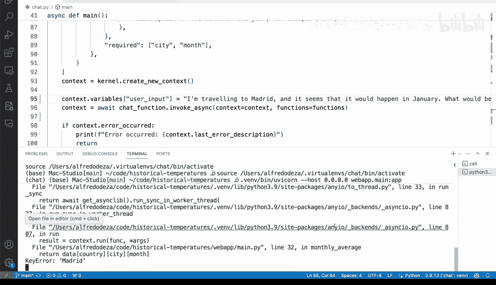
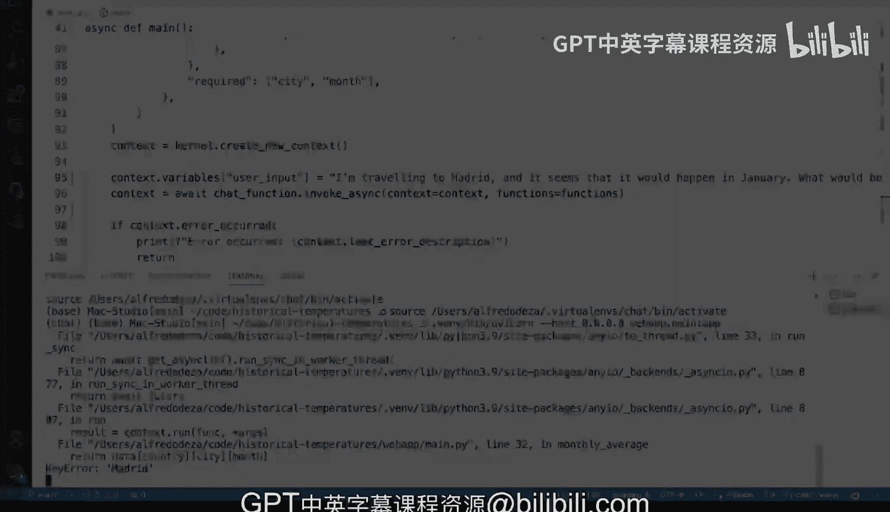

# 杜克大学《大型语言模型实践（生成式AI简介、Azure的LLMs（1、2课，共6课）｜Large Language Model Operations》 - P134：57_03_06_使用外部微服务API.zh_en - GPT中英字幕课程资源 - BV1Ef421m7zD

I am back here with my text data and I've decided to start the application。

 It is running right here from Vicious Studio code in the terminal at port 8000 running locally and I'm doing this so that you can actually see that interacting Now I'm going to go all the way up here so that you can see how I'm actually I've actually enhance our travel weatherer function here so that you can do that microservice request so I have the microservice URL and in here what I'm doing is I'm defining the address in this case local hostst if you were doing something in production。

 you would probably not use something like these you would use something slightly more robust but for demonstration purposes this is going to be pretty good Now we're going to poke around the result the requests library is going to do a get request if you remember we're only accepting get request。

GDP requests and that's going to be only for Portug right so we have countries Portugal is the only countries supported and we are going to pass in city and month and then when when to say send that to load that response as Jason finally we're going to use that response to say the average temperature the average high temperature in city in month is result high remember this is going to be Jason so high is part of the JN response and we're going to keep those variables that were seeing in the terminal as well when we make the request All right so this is the application the microservice。

 the external microservice we're going to go back to the previous terminal and when I say Python chat pie oh the last thing that I wanted to show you before I do that is I'm going to scroll here so that you can see what is going to be the actual。

The actual request， so I'm traveling to Porto， which is a city in in Portugal。

 and it seems that it would happen in August what would be the temperature the average temperature there。

 so I'm going to do Python chat I'm going to run that and we're going to see that travel weather is going to be called。

 we're going to get the function parameters Porto in Augustm going to get the average high temperature in Porto is going to be 77 degrees。

 noticeice that I'm not hard codinging that anymore。

 if I go all the way up again and scroll very quickly you're going see that that is coming from the result if I want to make sure that my external microservice is getting called I'm going to go here change tab and you can see that I got an okay so Portugal Porto and August was correct I can change this to another city which I think we can do Lisbon and we can try that to do something different so we can say Lisbon。

And we can say not August， but I want to go there in January。And then save that runner prompt again。

 Python chat pi and Lisbon in January is going to be 57 degrees if I change terminals。

 you will see that I'll get an N 2000 from Lisbon。Now this is now production grade is meant to be an example and there's all kinds of different things that you need to guard against if I say for example I'm going to read。

Marid would implode because I wouldn't get the external API is only accepting it's only accepting cities in Portugal and Madri is in Spain so you can see here I'm going to get adjacent decoder if I go to the art terminal you will see that I'm going to get a care errors all over the place that is one of the caveats of running microservices but in essence it gives you a good solid idea how you can put together how you can enhance and make a large language model by using microservices。

